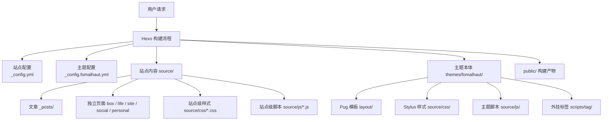
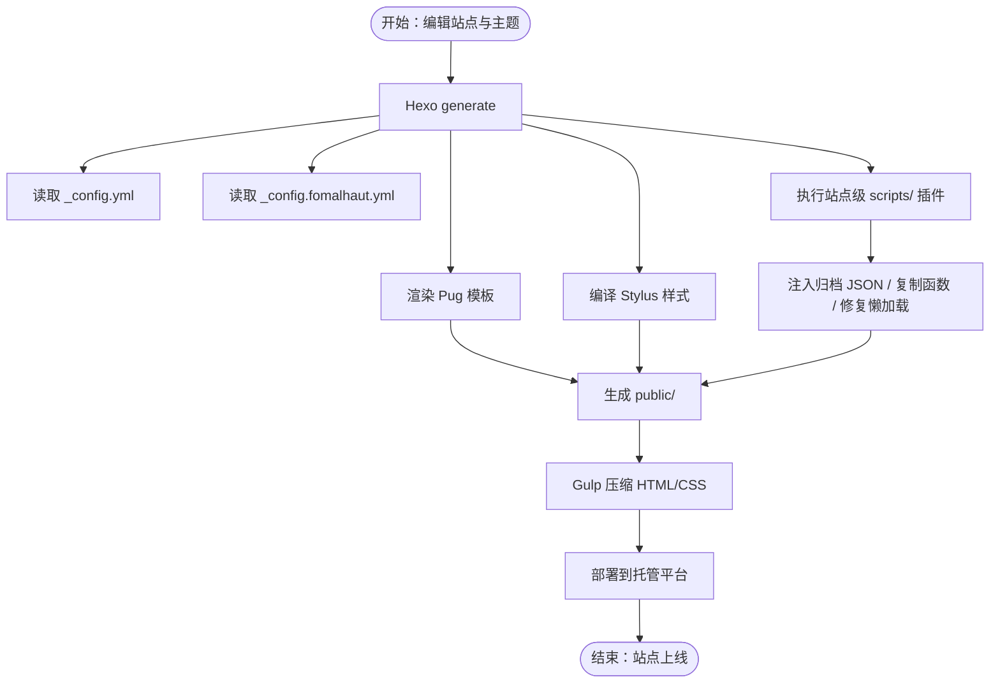
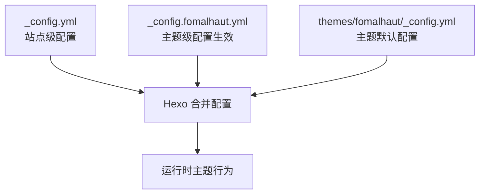
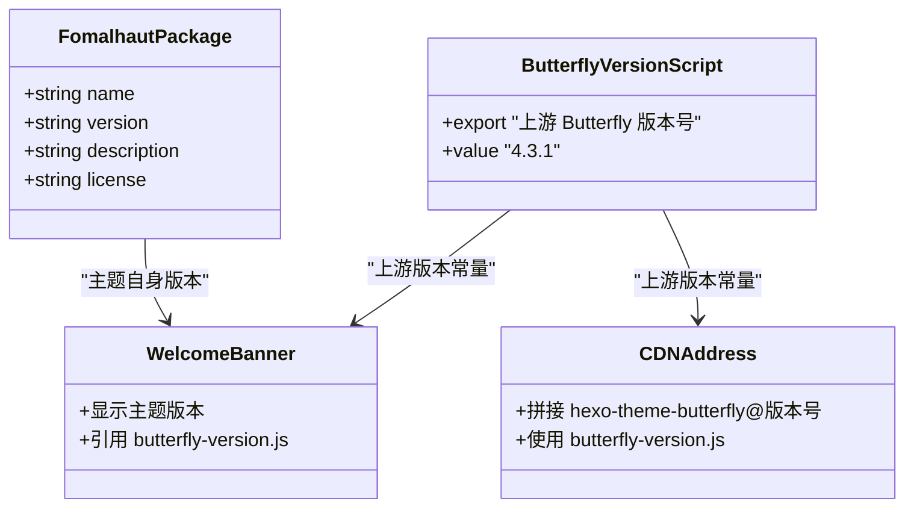
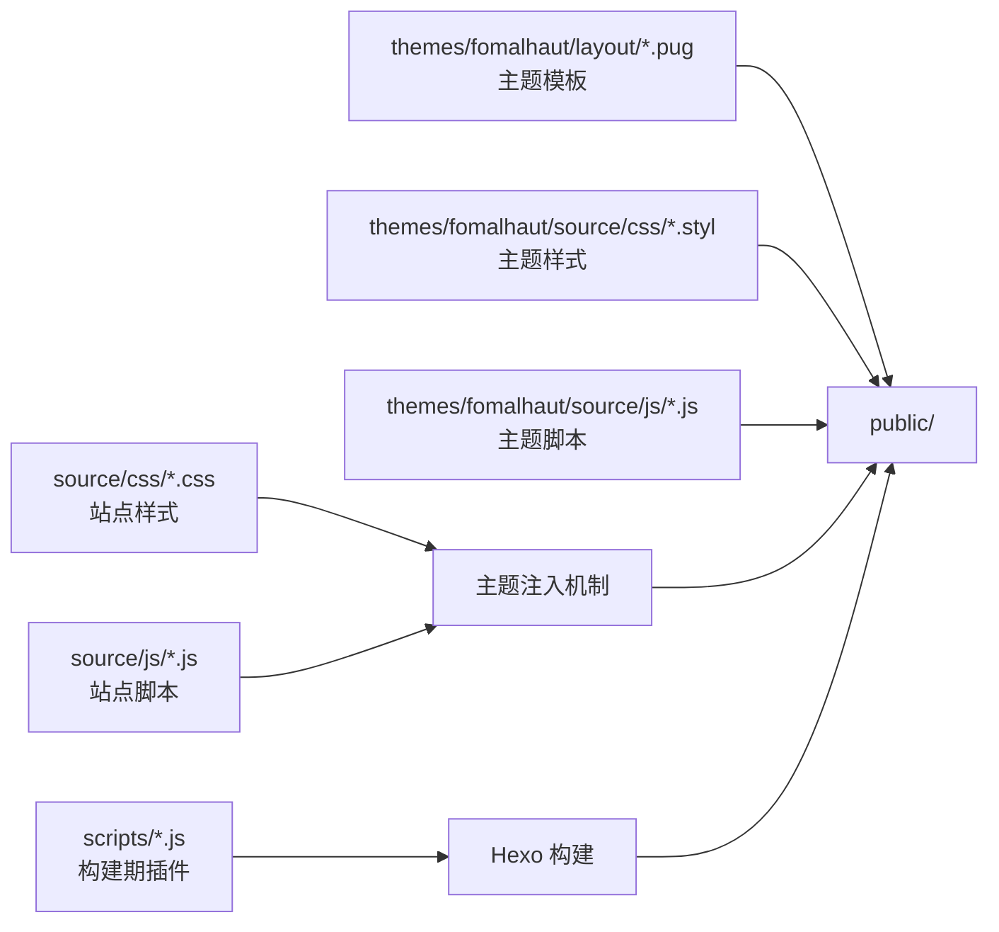
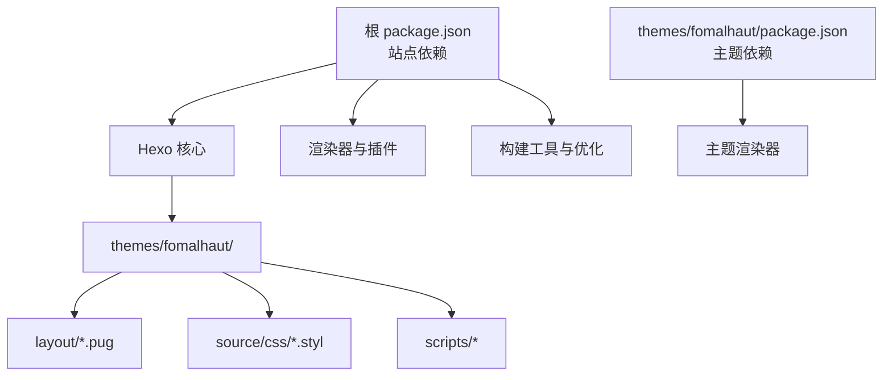

# 项目介绍与特色

<cite>
**本文引用的文件**   
- [README.md](file://README.md)
- [themes/fomalhaut/README.md](file://themes/fomalhaut/README.md)
- [package.json](file://package.json)
- [themes/fomalhaut/package.json](file://themes/fomalhaut/package.json)
- [_config.yml](file://_config.yml)
- [_config.fomalhaut.yml](file://_config.fomalhaut.yml)
- [themes/fomalhaut/scripts/butterfly-version.js](file://themes/fomalhaut/scripts/butterfly-version.js)
</cite>

## 目录
1. [引言](#引言)
2. [项目结构](#项目结构)
3. [核心组件](#核心组件)
4. [架构总览](#架构总览)
5. [详细组件分析](#详细组件分析)
6. [依赖关系分析](#依赖关系分析)
7. [性能与工程化特性](#性能与工程化特性)
8. [版本历史、许可证与社区支持](#版本历史许可证与社区支持)
9. [使用场景与价值主张](#使用场景与价值主张)
10. [常见问题与排错建议](#常见问题与排错建议)
11. [结论](#结论)

## 引言
hexo-theme-fomalhaut 是一个基于 Butterfly 4.3.1 深度二次开发的 Hexo 卡片式博客主题，同时也是一个“克隆即用”的完整站点模板。它的核心设计理念是：**站点配置与主题代码彻底分离**。用户通过根目录的站点配置和主题配置文件进行外观、功能与内容组织，而主题本体位于 `themes/fomalhaut/`；升级主题时只需替换主题目录，不会冲掉站点侧的自定义样式、脚本与页面。

从背景来看，作者自 2022 年起持续对 Butterfly 进行个性化改造，把散落在配置、单文件和主题源码中的改动逐步抽离为独立模块与文件；到 2026-10 完成一次结构化重构，将原先近三千行的主引导脚本拆成模块化结构，并把大量内联样式与脚本迁移到站点级资源中，最终整理为 v1.0.0 并持续迭代至当前版本。

与其他 Hexo 主题相比，fomalhaut 的优势主要体现在：
- 不是单纯的主题目录，而是包含站点配置、示例页面、构建脚本与部署配置的完整仓库。
- 强调“改配置就能搭站”，避免直接修改主题源码带来的升级冲突。
- 提供美化设置面板、PWA、多线路分流、归档页卡片改版、时间线归档、AI 助手等丰富扩展能力。
- 在 README 与文档中明确区分“主题自身版本”和“上游 Butterfly 版本”，降低 CDN 地址与版本号混淆的风险。

**章节来源**
- [README.md:1-13](file://README.md#L1-L13)
- [README.md:240-256](file://README.md#L240-L256)
- [themes/fomalhaut/README.md:1-6](file://themes/fomalhaut/README.md#L1-L6)

## 项目结构
仓库采用“站点 + 主题”的双层结构：
- 根目录负责站点级配置、Hexo 插件、构建脚本、示例内容与部署配置。
- `themes/fomalhaut/` 负责主题模板、Stylus 样式、主题脚本、外挂标签、事件与语言包。

**图表来源**
- [README.md:259-284](file://README.md#L259-L284)
- [README.md:472-504](file://README.md#L472-L504)
- [README.md:628-643](file://README.md#L628-L643)

**章节来源**
- [README.md:259-284](file://README.md#L259-L284)
- [README.md:472-504](file://README.md#L472-L504)
- [README.md:628-643](file://README.md#L628-L643)

## 核心组件
本项目可理解为三层协作：
1. **站点配置层**：由 `_config.yml` 与 `_config.fomalhaut.yml` 共同组成，前者是 Hexo 站点基础信息，后者是 fomalhaut 主题的实际生效配置。
2. **主题本体层**：`themes/fomalhaut/` 下的 Pug 模板、Stylus 样式、主题脚本、外挂标签、事件钩子与多语言文案。
3. **站点增强层**：根目录 `scripts/` 下的构建期插件、`source/js/` 与 `source/css/` 下的站点级脚本与样式，以及示例页面与数据文件。

关键职责划分如下：
- `_config.yml`：站点标题、作者、URL、部署、搜索、统计、分类磁贴、Markdown 渲染等。
- `_config.fomalhaut.yml`：导航菜单、社交图标、封面图、主题色、暗色模式、评论系统、侧栏卡片、CDN、美化开关等。
- `themes/fomalhaut/_config.yml`：主题默认配置模板，通常不需要直接修改。
- `themes/fomalhaut/scripts/butterfly-version.js`：记录上游 Butterfly 的版本号，用于启动横幅与 CDN 地址拼接，与主题自身版本解耦。

**章节来源**
- [README.md:286-293](file://README.md#L286-L293)
- [README.md:477-504](file://README.md#L477-L504)
- [themes/fomalhaut/README.md:9-20](file://themes/fomalhaut/README.md#L9-L20)
- [themes/fomalhaut/scripts/butterfly-version.js:1-16](file://themes/fomalhaut/scripts/butterfly-version.js#L1-L16)

## 架构总览
从运行视角看，fomalhaut 的工作流可以概括为：
- 开发者编辑站点内容、站点样式、站点脚本与主题配置。
- Hexo 读取站点配置与主题配置，渲染 Pug 模板，编译 Stylus。
- 构建期执行站点级脚本，注入 JSON、复制函数文件、修复懒加载、生成归档索引等。
- Gulp 压缩 HTML/CSS，输出 `public/` 后推送到托管平台。

**图表来源**
- [README.md:259-284](file://README.md#L259-L284)
- [README.md:331-340](file://README.md#L331-L340)
- [README.md:432-438](file://README.md#L432-L438)

**章节来源**
- [README.md:259-284](file://README.md#L259-L284)
- [README.md:331-340](file://README.md#L331-L340)
- [README.md:432-438](file://README.md#L432-L438)

## 详细组件分析

### 站点配置与主题配置分离机制
fomalhaut 的核心差异在于把“站点信息”和“主题行为”拆开：
- 站点信息放在 `_config.yml`，例如站点名、作者、域名、部署目标、Algolia、百度统计、分类磁贴等。
- 主题行为放在 `_config.fomalhaut.yml`，例如导航、社交、封面、主题色、评论、侧栏、CDN、美化开关等。
- 主题自带的默认值放在 `themes/fomalhaut/_config.yml`，但实际生效的是根目录的 `_config.fomalhaut.yml`。

这种设计让升级主题时只需要覆盖 `themes/fomalhaut/`，而不必担心站点配置被覆盖。

**图表来源**
- [README.md:286-293](file://README.md#L286-L293)
- [themes/fomalhaut/README.md:33-36](file://themes/fomalhaut/README.md#L33-L36)

**章节来源**
- [README.md:286-293](file://README.md#L286-L293)
- [themes/fomalhaut/README.md:33-36](file://themes/fomalhaut/README.md#L33-L36)

### 上游 Butterfly 版本与主题版本解耦
主题自身版本与上游 Butterfly 版本分开管理，避免主题升版导致 CDN 地址错误：
- 主题自身版本定义在根 `package.json` 与 `themes/fomalhaut/package.json` 的 `version`。
- 上游 Butterfly 版本定义在 `themes/fomalhaut/scripts/butterfly-version.js`，值为 `4.3.1`。
- 启动横幅与 CDN 地址使用该常量，而不是主题自身的 package.json 版本。

**图表来源**
- [package.json:1-10](file://package.json#L1-L10)
- [themes/fomalhaut/package.json:1-10](file://themes/fomalhaut/package.json#L1-L10)
- [themes/fomalhaut/scripts/butterfly-version.js:1-16](file://themes/fomalhaut/scripts/butterfly-version.js#L1-L16)

**章节来源**
- [package.json:1-10](file://package.json#L1-L10)
- [themes/fomalhaut/package.json:1-10](file://themes/fomalhaut/package.json#L1-L10)
- [themes/fomalhaut/scripts/butterfly-version.js:1-16](file://themes/fomalhaut/scripts/butterfly-version.js#L1-L16)

### 站点增强与主题本体的边界
fomalhaut 鼓励把站点级改动放在 `source/` 与根 `scripts/`，而不是直接改主题源码：
- 站点级样式集中在 `source/css/*.css`，并通过主题配置的注入机制引入。
- 站点级脚本集中在 `source/js/`，包括模块、注入脚本与独立功能脚本。
- 构建期逻辑集中在根 `scripts/`，例如归档索引、懒加载修复、函数文件复制、pjax 重连等。
- 主题本体 `themes/fomalhaut/` 主要提供模板、样式框架、外挂标签与通用行为。

**图表来源**
- [README.md:472-504](file://README.md#L472-L504)
- [README.md:506-604](file://README.md#L506-L604)
- [README.md:628-643](file://README.md#L628-L643)

**章节来源**
- [README.md:472-504](file://README.md#L472-L504)
- [README.md:506-604](file://README.md#L506-L604)
- [README.md:628-643](file://README.md#L628-L643)

## 依赖关系分析
项目的依赖可以分为三类：
1. **运行时依赖**：Hexo、Pug 渲染器、Stylus 渲染器、Markdown 渲染器、搜索、统计、音乐、地图、懒加载等。
2. **构建期依赖**：Gulp 及其压缩插件、Babel、Terser、Workbox 等。
3. **主题依赖**：主题本体只声明了必要的渲染器依赖，其余功能通过站点 `package.json` 管理。

**图表来源**
- [package.json:1-75](file://package.json#L1-L75)
- [themes/fomalhaut/package.json:1-32](file://themes/fomalhaut/package.json#L1-L32)

**章节来源**
- [package.json:1-75](file://package.json#L1-L75)
- [themes/fomalhaut/package.json:1-32](file://themes/fomalhaut/package.json#L1-L32)

## 性能与工程化特性
fomalhaut 在工程化和性能方面做了多项改进，核心思路是“减少首屏阻塞、避免重复初始化、提升交互流畅度”：
- 构建链：`hexo generate` → `gulp` 压缩 HTML/CSS，一条命令出产物。
- 图片懒加载修复：处理轮播与 pjax 场景下 lazyload 失效。
- 搜索懒加载：只在用户点开搜索时才拉取相关库。
- pjax 守卫：修复换页后状态残留、选择器不匹配导致的整页刷新或遮罩卡住。
- CDN 预连接：对首屏外部域名做预连接与 DNS 预取。
- 字体与图片外链：改为公共占位图服务与开源字体，降低私人服务依赖。
- 配置瘦身：主引导脚本从近三千行拆成模块化结构，内联样式与脚本迁移到独立文件。

这些特性使 fomalhaut 更适合长期维护的个人博客：既能快速搭建，又能稳定升级。

**章节来源**
- [README.md:331-340](file://README.md#L331-L340)
- [README.md:200-233](file://README.md#L200-L233)
- [README.md:160-198](file://README.md#L160-L198)

## 版本历史、许可证与社区支持

### 版本历史
当前仓库展示的主要版本演进如下：
- v1.0.0：首个正式版，主题从 `themes/butterfly` 独立为 `themes/fomalhaut`，站点配置与主题代码彻底分离。
- v1.0.1：打磨首屏关键链、动画生命周期、滚动与指针体验，新增回归测试。
- v1.0.2：AI 助手流式渲染、Service Worker 缓存策略优化、主题色联动与窄屏溢出修复。
- v1.0.3：归档页卡片改版、时间线档案页统计拆分、日历热力图 pjax 修复。
- v1.0.4：美化面板预览化、导航改版、主题色自定义、萤火虫与雪花重写、点击涟漪。
- v1.0.5：日夜自动模式、访客按真实日出日落切换深浅色、首页卡片入场动画优化、pjax 重连修复。

**章节来源**
- [README.md:37-74](file://README.md#L37-L74)
- [README.md:75-129](file://README.md#L75-L129)
- [README.md:130-159](file://README.md#L130-L159)
- [README.md:160-198](file://README.md#L160-L198)
- [README.md:200-236](file://README.md#L200-L236)

### 许可证信息
- 项目整体沿用 Apache License 2.0。
- 主题派生自 hexo-theme-butterfly，保留上游许可证与署名。
- 主题本体 README 明确指出 LICENSE 位置与授权方式。

**章节来源**
- [README.md:9](file://README.md#L9)
- [README.md:1294](file://README.md#L1294)
- [themes/fomalhaut/README.md:4](file://themes/fomalhaut/README.md#L4)
- [themes/fomalhaut/README.md:38-40](file://themes/fomalhaut/README.md#L38-L40)

### 社区支持情况
从仓库可见信息判断：
- 项目使用 GitHub 作为代码托管平台。
- 配置了 Dependabot，用于依赖自动更新。
- 主题 README 提供了 issues 链接，说明存在问题反馈渠道。
- 文档以中文为主，面向中文 Hexo 用户群体。

**章节来源**
- [package.json:17-23](file://package.json#L17-L23)
- [.github/dependabot.yml](file://.github/dependabot.yml)
- [themes/fomalhaut/package.json:17-23](file://themes/fomalhaut/package.json#L17-L23)

## 使用场景与价值主张

### 适合谁用
- 希望快速拥有一个“看起来已经很好”的 Hexo 博客的人。
- 不想每次升级主题都重新抄一遍自定义样式和脚本的人。
- 喜欢卡片式布局、侧栏信息卡、美化面板、暗色模式、PWA 等现代博客体验的人。
- 需要归档页卡片墙、时间线归档、网站统计、AI 助手、多线路分流等进阶功能的人。

### 典型使用场景
1. **个人知识博客**：用 `_config.fomalhaut.yml` 配置头像、社交、导航、封面、主题色，写 Markdown 文章即可上线。
2. **技术笔记站点**：启用代码高亮、目录、相关文章、评论系统，配合 Algolia 或本地搜索。
3. **作品集与站点集合**：利用 `box/`、`social/`、`site/` 等独立页面展示画廊、友链、统计、时间线。
4. **长期维护站点**：通过站点级 CSS/JS 与构建期脚本扩展功能，升级主题时只覆盖 `themes/fomalhaut/`。

### 价值主张
- “克隆即用”：仓库自带示例内容、截图、部署配置，无需从零搭建。
- “改配置就能搭站”：大部分外观和功能通过 `_config.fomalhaut.yml` 控制。
- “升级不丢改动”：站点级资源与主题本体分离，降低维护成本。
- “可进可退”：新手可以直接用默认效果，高级用户可以深入定制样式、脚本与构建流程。

**章节来源**
- [README.md:1-13](file://README.md#L1-L13)
- [README.md:240-256](file://README.md#L240-L256)
- [README.md:357-438](file://README.md#L357-L438)
- [README.md:646-800](file://README.md#L646-L800)

## 常见问题与排错建议

### 为什么改了主题模板没有热重载？
Hexo 在启动时读取 `.pug` 模板，因此修改 `themes/` 下的模板通常需要重启 server；而 `source/` 下的内容与 CSS 会自动重新渲染。

**章节来源**
- [README.md:372-378](file://README.md#L372-L378)

### 为什么升级主题会丢失自定义样式？
如果直接把自定义样式写进主题源码，升级主题覆盖 `themes/fomalhaut/` 时会丢失。正确做法是把自定义样式放到 `source/css/*.css`，并通过主题配置的注入机制引入。

**章节来源**
- [README.md:249-251](file://README.md#L249-L251)
- [README.md:642-643](file://README.md#L642-L643)

### 为什么 CDN 地址可能 404？
如果主题自身版本和上游 Butterfly 版本混用，可能导致 CDN 地址拼错。fomalhaut 通过 `butterfly-version.js` 单独管理上游版本，避免这个问题。

**章节来源**
- [themes/fomalhaut/scripts/butterfly-version.js:1-16](file://themes/fomalhaut/scripts/butterfly-version.js#L1-L16)
- [README.md:156-158](file://README.md#L156-L158)

### 如何确认当前使用的是哪个主题配置？
实际生效的是根目录的 `_config.fomalhaut.yml`；`themes/fomalhaut/_config.yml` 只是默认值模板，修改它不会生效。

**章节来源**
- [themes/fomalhaut/README.md:33-36](file://themes/fomalhaut/README.md#L33-L36)
- [README.md:286-293](file://README.md#L286-L293)

## 结论
hexo-theme-fomalhaut 不是一个普通的 Hexo 主题，而是一个围绕“站点配置与主题代码彻底分离”理念构建的完整博客解决方案。它以 Butterfly 4.3.1 为基础，通过模块化、站点级增强、构建期插件与 PWA 等工程化手段，解决了传统主题升级容易丢失自定义改动的痛点。对于希望长期维护个人博客、重视可读性与可升级性的作者来说，fomalhaut 提供了一个既美观又稳定的起点。