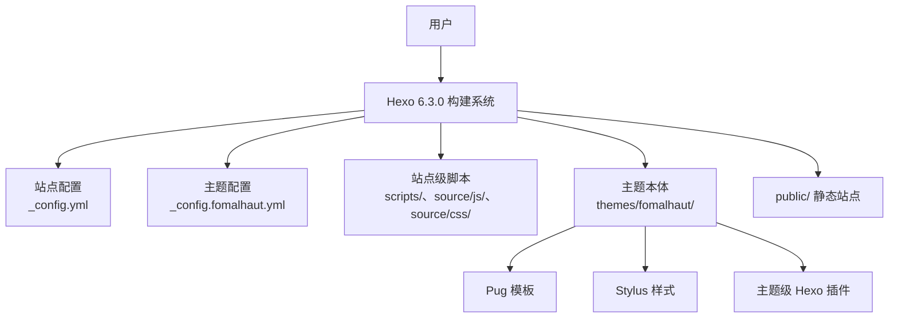
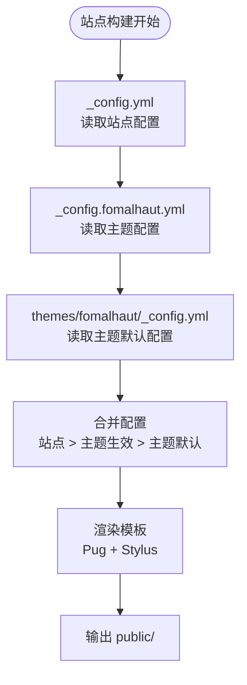

# 项目概述

<cite>
**本文引用的文件**   
- [README.md](file://README.md)
- [_config.yml](file://_config.yml)
- [_config.fomalhaut.yml](file://_config.fomalhaut.yml)
- [package.json](file://package.json)
- [themes/fomalhaut/package.json](file://themes/fomalhaut/package.json)
- [themes/fomalhaut/_config.yml](file://themes/fomalhaut/_config.yml)
- [tools/qoder-static-links.js](file://tools/qoder-static-links.js)
</cite>

## 更新摘要
**已进行的变更**   
- 更新了站点配置个性化信息，包含作者信息和描述
- 添加了 Qoder Sites 部署 URL 和平台支持说明
- 新增了 Qoder Sites 专用部署工具和链接处理逻辑
- 更新了部署示例以包含 Qoder Sites 平台

## 目录
1. [简介](#简介)
2. [技术栈与环境要求](#技术栈与环境要求)
3. [核心设计理念：站点配置与主题代码彻底分离](#核心设计理念站点配置与主题代码彻底分离)
4. [主要功能特性](#主要功能特性)
5. [与其他 Hexo 主题的区别与优势](#与其他-hexo-主题的区别与优势)
6. [快速开始指南](#快速开始指南)
7. [项目架构概览](#项目架构概览)
8. [关键配置说明](#关键配置说明)
9. [使用场景与部署示例](#使用场景与部署示例)
10. [常见问题速查](#常见问题速查)
11. [总结](#总结)

## 简介
hexo-theme-fomalhaut 是一个基于 Butterfly 4.3.1 深度二次开发的 Hexo 卡片式博客主题，同时提供一整套可运行的站点模板。它不只是 `themes/` 下的一个主题目录，而是把「主题代码」和「站点配置 / 站点级增强」拆成不同目录，让使用者通过改配置、加独立 CSS 与 JS 来定制站点，升级主题时直接替换主题目录即可，不会冲掉自己的改动。

项目的核心目标是：
- 用卡片式 UI 呈现文章、侧栏、归档、友链等页面；
- 把站点配置集中在根目录的 `_config.fomalhaut.yml`，主题默认值放在 `themes/fomalhaut/_config.yml`；
- 通过 Pug 模板 + Stylus 样式构建出静态站点；
- 在体验上加入 AI 聊天集成、美化面板、多线路分流、PWA 支持、夜间自动切换、归档页卡片改版等功能；
- 支持多种部署平台，包括 GitHub Pages、Vercel、Cloudflare Pages 以及最新的 Qoder Sites。

**章节来源**
- [README.md:1-13](file://README.md#L1-L13)
- [README.md:240-255](file://README.md#L240-L255)

## 技术栈与环境要求
### 技术栈
| 层级 | 技术 | 说明 |
| --- | --- | --- |
| 框架 | Hexo 6.3.0 | 仓库明确声明 Hexo 版本，并通过 `npx hexo` 运行 |
| 主题基座 | Butterfly 4.3.1 | 主题 README 与更新日志中多次提到上游 Butterfly 版本 |
| 模板引擎 | Pug | 主题依赖 `hexo-renderer-pug`，模板位于 `themes/fomalhaut/layout/*.pug` |
| 样式处理器 | Stylus | 主题依赖 `hexo-renderer-stylus`，样式位于 `themes/fomalhaut/source/css/*.styl` |
| 构建产物 | Gulp | 根目录 `gulpfile.js` 负责 HTML / CSS 压缩等后处理 |
| PWA | Service Worker | 主题自带 `themes/fomalhaut/source/sw.js`，站点配置段为 `pwa` |
| 搜索 | Algolia / 本地搜索 | 根 `_config.yml` 与主题配置都包含搜索相关字段 |
| 评论 | Twikoo 为主 | 主题配置默认启用 Twikoo，并带站点级评论美化样式 |
| 部署平台 | 多平台支持 | 支持 GitHub Pages、Vercel、Cloudflare Pages、Qoder Sites 等 |

### 环境要求
| 依赖 | 版本 | 说明 |
| --- | --- | --- |
| Node.js | 18 / 20 / 22 LTS（推荐 22） | README 明确列出支持的 Node 版本 |
| npm | 9+ | 随 Node 安装，用于 `npm install` 或 `npm ci` |
| Hexo | 6.3.0 | 根 `package.json` 的 `hexo.version` 指定了版本 |
| Git | 任意较新版本 | 克隆仓库与部署时使用 |

**章节来源**
- [README.md:344-353](file://README.md#L344-L353)
- [package.json:1-19](file://package.json#L1-L19)
- [themes/fomalhaut/package.json:24-27](file://themes/fomalhaut/package.json#L24-L27)

## 核心设计理念：站点配置与主题代码彻底分离
这个主题最关键的架构决策是：**站点配置与主题代码分开**。

传统 Hexo 主题使用中，很多用户会直接修改 `themes/butterfly/` 下的源码来实现美化；一旦上游主题升级，这些改动就会被覆盖。hexo-theme-fomalhaut 的做法是：

1. **主题本体**放在 `themes/fomalhaut/`，包含：
   - Pug 模板；
   - Stylus 样式；
   - 主题级 Hexo 插件（标签、过滤器、助手函数、启动事件）；
   - 主题默认配置 `themes/fomalhaut/_config.yml`。

2. **站点配置**放在根目录：
   - `_config.yml`：Hexo 站点级配置，如标题、作者、域名、部署、插件；
   - `_config.fomalhaut.yml`：主题级配置，也是本站实际生效的主题开关所在。

3. **站点级增强**放在根目录：
   - `scripts/`：构建期 Hexo 插件，例如归档页索引注入、Vercel API 复制、AI 助手注入；
   - `source/css/`：站点级自定义样式；
   - `source/js/`：站点级自定义脚本；
   - `source/box/`、`source/life/`、`source/site/`、`source/social/`、`source/personal/`：各种独立页面。

这种设计带来的好处是：
- 升级主题时只需替换 `themes/fomalhaut/`；
- 站点内容、样式、脚本、配置都留在根目录；
- 想关闭某个功能，通常只需要改配置或删一行 `inject.head` / `inject.bottom`，不需要动主题源码。



**图表来源**
- [README.md:259-284](file://README.md#L259-L284)
- [README.md:472-504](file://README.md#L472-L504)

**章节来源**
- [README.md:240-255](file://README.md#L240-L255)
- [README.md:259-293](file://README.md#L259-L293)
- [README.md:472-504](file://README.md#L472-L504)

## 主要功能特性
### 1. AI 聊天集成
右侧悬浮对话面板，可以总结当前页面、解释名词、继续追问。前端逻辑在站点级脚本中，后端可通过同源代理隐藏 Key。

关键点：
- 前端：`source/js/ai-chat.js`；
- 注入器：`scripts/ai-chat-inject.js`；
- Vercel 代理：`api/chat/completions.js`；
- Cloudflare Pages 代理：`functions/api/chat/completions.js`；
- 配置段：`ai_chat`，位于 `_config.fomalhaut.yml`。

两种用法：
- 直连服务商：适合本地或内网测试，Key 会下发到浏览器；
- 同源代理：公网推荐，Key 放在环境变量里，由服务端转发请求。

**章节来源**
- [README.md:933-991](file://README.md#L933-L991)
- [_config.fomalhaut.yml:1559-1587](file://_config.fomalhaut.yml#L1559-L1587)

### 2. 美化设置面板
右下角齿轮打开的设置面板，允许访客自定义字体、主题色、背景、特效开关、布局部件等，所有设置保存在浏览器 `localStorage`。

关键点：
- 面板主逻辑：`source/js/modules/settings.js`；
- 字体预览：`source/js/modules/appearance-fonts.js`；
- 背景预览：`source/js/modules/appearance-backgrounds.js`；
- 首屏预置：`source/js/inject/beauty-boot.js`；
- 预设主题色、旧键迁移、前景色计算等逻辑都在美化模块中。

**章节来源**
- [README.md:878-915](file://README.md#L878-L915)
- [_config.fomalhaut.yml:877-883](file://_config.fomalhaut.yml#L877-L883)

### 3. 多线路分流与延迟探测
站点提供了多种部署方案，并在关于页、公告栏等处展示各线路的实时延迟。

关键点：
- GitHub Pages + Actions；
- Vercel；
- Cloudflare Pages；
- Qoder Sites；
- 本地生成 + 手动推送；
- 公告栏线路延时徽标脚本：`source/js/inject/ping-route.js` 与 `source/js/inject/ping-route-boot.js`；
- 关于页线路卡延迟探针：`source/js/inject/about-route-probe.js`。

**章节来源**
- [README.md:1229-1262](file://README.md#L1229-L1262)
- [_config.fomalhaut.yml:1259-1265](file://_config.fomalhaut.yml#L1259-L1265)

### 4. PWA 支持
主题内置 Service Worker，站点配置中包含 PWA 段，可用于离线缓存、图标、Manifest 等。

关键点：
- Service Worker：`themes/fomalhaut/source/sw.js`；
- 站点 PWA 配置段：`pwa`，位于 `_config.fomalhaut.yml`；
- Manifest：`source/manifest.json`；
- 主题 PWA 模板片段：`themes/fomalhaut/layout/includes/head/pwa.pug`。

**章节来源**
- [README.md:328-329](file://README.md#L328-L329)
- [_config.fomalhaut.yml:1155-1166](file://_config.fomalhaut.yml#L1155-L1166)

### 5. 其他重要特性
| 特性 | 说明 |
| --- | --- |
| 全站日夜自动模式 | 按真实日出日落决定深浅色，支持手动选择优先与总开关 |
| 归档页卡片改版 | 年度分布统计、年份胶囊、年份章节、文章卡片网格 |
| 时间线归档 | 用时间线标签写站史 / 里程碑 |
| 网站统计页 | 图表看板，配色由主题色派生 |
| 手机端抽屉菜单 | 独立样式表，适配窄屏导航 |
| 友情链接 / 朋友圈 / 画廊 / 八音盒 | 多种站点级页面 |
| 评论系统 | 默认 Twikoo，支持多种评论后端 |
| 搜索 | Algolia 与本地搜索可选 |
| 代码高亮 | 支持 highlight.js / Prismjs 相关配置 |
| 数学公式 | MathJax / KaTeX 可选 |

**章节来源**
- [README.md:316-340](file://README.md#L316-L340)
- [README.md:820-877](file://README.md#L820-L877)
- [README.md:993-1006](file://README.md#L993-L1006)

## 与其他 Hexo 主题的区别与优势
### 区别
| 对比维度 | 普通 Hexo 主题 | hexo-theme-fomalhaut |
| --- | --- | --- |
| 主题目录 | 通常是 `themes/butterfly/` 或其他主题名 | 独立为 `themes/fomalhaut/` |
| 主题配置 | 可能混在 `_config.butterfly.yml` 或直接改主题源码 | 根目录 `_config.fomalhaut.yml` 作为真正生效的主题配置 |
| 自定义方式 | 常直接改主题源码 | 优先通过配置、`source/css/`、`source/js/`、`inject` 注入 |
| 升级成本 | 改主题源码后升级容易丢失改动 | 升级主题目录不影响站点配置与站点级增强 |
| 功能组织 | 功能可能散落在主题源码中 | 大量功能以站点级脚本 / 样式 / 构建插件形式存在 |

### 优势
1. **升级安全**：主题升级只替换 `themes/fomalhaut/`，站点配置和增强不动。
2. **配置集中**：大部分开关集中在 `_config.fomalhaut.yml`，便于查找和回滚。
3. **模块化强**：站点 JS 从近 3000 行单文件拆成多个模块，职责清晰。
4. **性能优化细致**：包括懒加载、Pjax 守卫、Service Worker TTL 分流、字体预连接、搜索按需加载等。
5. **开箱即用**：仓库自带示例页面、示例文章、截图占位图，克隆后可直接预览。
6. **多平台支持**：原生支持 GitHub Pages、Vercel、Cloudflare Pages、Qoder Sites 等多种部署平台。

**章节来源**
- [README.md:296-340](file://README.md#L296-L340)
- [README.md:472-504](file://README.md#L472-L504)

## 快速开始指南
### 环境准备
确保已安装：
- Node.js 18 / 20 / 22 LTS；
- npm；
- Git。

### 克隆与安装
```bash
git clone https://github.com/N1280851853/my_blog.git my-blog
cd my-blog
npm install
```

### 本地预览
```bash
npx hexo server
```
访问 `http://localhost:4000`。

### 改成你自己的站点
至少需要修改：
1. 根 `_config.yml`：站点名、作者、域名、部署仓库；
2. 根 `_config.fomalhaut.yml`：头像、社交链接、首页大图、菜单、评论、统计等；
3. 写文章：`npx hexo new post "文章标题"`。

### 构建与部署
```bash
npx hexo clean && npx hexo generate && npx gulp
```
产物在 `public/`，可按 README 中的部署方案推送到 GitHub Pages、Vercel、Cloudflare Pages 或 Qoder Sites。

**章节来源**
- [README.md:344-439](file://README.md#L344-L439)
- [README.md:1229-1262](file://README.md#L1229-L1262)

## 项目架构概览
### 整体结构
```
用户请求
   │
   ▼
Hexo 6.3.0
   ├─ 根 _config.yml          站点级配置
   ├─ 根 _config.fomalhaut.yml 主题配置（实际生效）
   ├─ 根 scripts/*.js         站点级构建期插件
   ├─ source/                 站点内容
   │   ├─ _posts/             文章
   │   ├─ css/*.css           站点级样式
   │   ├─ js/*.js             站点级脚本
   │   └─ box|life|site|social|personal/ 独立页面
   └─ themes/fomalhaut/       主题本体
        ├─ layout/*.pug       Pug 模板
        ├─ source/css/*.styl  Stylus 样式
        ├─ source/js/*.js     主题脚本
        └─ scripts/           主题级 Hexo 插件
```

### 三层配置优先级
| 层级 | 文件 | 作用 |
| --- | --- | --- |
| 站点 | 根 `_config.yml` | 站点名、作者、URL、部署、算法插件等 |
| 主题（生效） | 根 `_config.fomalhaut.yml` | 本站真正使用的主题配置，所有开关都在这里 |
| 主题（默认） | `themes/fomalhaut/_config.yml` | 主题自带的默认值模板，留作参考 / 兜底 |



**图表来源**
- [README.md:259-293](file://README.md#L259-L293)

**章节来源**
- [README.md:259-293](file://README.md#L259-L293)

## 关键配置说明
### 站点配置：`_config.yml`
这是 Hexo 的标准站点配置文件，控制：
- 站点元信息：标题、副标题、描述、关键词、作者、语言、时区；
- URL 与永久链接：`url`、`permalink`；
- 目录结构：`source_dir`、`public_dir`、`tag_dir`、`archive_dir`、`category_dir`；
- 文章生成：`new_post_name`、`default_layout`；
- 代码高亮：highlight / prismjs；
- 数学公式：mathjax；
- 首页分页：`index_generator.per_page`；
- 归档分页：`archive_generator`；
- 部署：`deploy`；
- 搜索：Algolia；
- 轮播、磁贴、分类磁贴等扩展插件。

**当前站点配置特点**：
- 作者：王慧超
- 描述：记录成长的一些笔记
- 域名：https://fomalhaut-blog-ose6tlu97zb.qoder.zone/
- 已针对 Qoder Sites 平台进行优化

**章节来源**
- [_config.yml:1-319](file://_config.yml#L1-L319)

### 主题配置：`_config.fomalhaut.yml`
这是本站实际生效的主题配置，控制：
- 导航菜单 `menu`；
- 代码块高亮主题、复制、语言显示；
- 社交图标 `social`；
- 搜索：Algolia 与本地搜索；
- 数学公式：MathJax；
- 头像、顶部图、封面池；
- 404 页；
- 文章元信息、字数统计、目录；
- 评论系统：Twikoo 等；
- 页脚；
- 分析工具；
- 广告；
- 站长验证；
- 美化与效果；
- 主题色；
- 背景；
- 侧栏卡片；
- 深色模式；
- Pjax、懒加载、PWA；
- `inject.head` / `inject.bottom` 注入体系；
- CDN；
- wowjs 动画；
- AI 助手 `ai_chat`。

**章节来源**
- [_config.fomalhaut.yml:1-1587](file://_config.fomalhaut.yml#L1-L1587)

### 主题默认配置：`themes/fomalhaut/_config.yml`
这是 Butterfly 风格主题的默认配置模板，包含：
- 导航菜单示例；
- 代码块默认行为；
- 社交图标示例；
- 搜索默认值；
- 数学公式默认值；
- 头像、封面、404 默认值；
- 侧栏卡片默认值；
- 评论系统默认值；
- 页脚默认值；
- 分析工具默认值；
- 美化效果默认值；
- PWA 默认值；
- CDN 默认值；
- inject 默认值。

注意：根目录的 `_config.fomalhaut.yml` 会覆盖这份默认配置。

**章节来源**
- [themes/fomalhaut/_config.yml:1-918](file://themes/fomalhaut/_config.yml#L1-L918)

## 使用场景与部署示例
### 场景一：个人知识博客
适合写学习笔记、技术总结、嵌入式知识点、算法笔记等。  
典型操作：
- 在 `_config.fomalhaut.yml` 中设置头像、社交链接、菜单；
- 在 `_config.yml` 中设置站点名、域名、部署仓库；
- 使用 `npx hexo new post` 写文章；
- 开启 Twikoo 评论；
- 根据需要开启 Algolia 搜索。

### 场景二：带 AI 助手的演示站点
适合希望给读者提供"页面助手"的场景。  
典型操作：
- 在 `_config.fomalhaut.yml` 的 `ai_chat` 段开启 AI 助手；
- 公网部署时设置环境变量 `DEEPSEEK_API_KEY`；
- 使用 Vercel 或 Cloudflare Pages 的函数作为代理；
- 前端通过 `/api` 同源请求，避免 Key 泄露。

### 场景三：多线路部署与延迟探测
适合有多个托管平台或镜像站点的场景。  
典型操作：
- 同时配置 GitHub Pages、Vercel、Cloudflare Pages、Qoder Sites；
- 在关于页或公告栏展示各线路延迟；
- 根据延迟选择最优访问路径。

### 部署示例
#### GitHub Pages + GitHub Actions
- 把仓库推到自己的 GitHub 账号；
- 添加 CI 工作流；
- 在 Secrets 中添加所需密钥；
- 推送 main 分支触发构建。

#### Vercel
- 执行 `npx vercel`；
- 如需 AI 助手，添加环境变量 `DEEPSEEK_API_KEY`。

#### Cloudflare Pages
- 构建命令：`hexo clean && hexo generate && gulp`；
- 输出目录：`public`；
- 函数目录：`functions/`。

#### Qoder Sites
- 构建命令：`hexo clean && hexo generate && gulp`；
- 输出目录：`public`；
- 特殊处理：使用 `tools/qoder-static-links.js` 处理静态链接；
- 平台特性：不支持目录索引，会自动将目录链接改写为 `index.html`。

#### 本地生成 + 手动推送
- 执行 `npx hexo clean && npx hexo generate && npx gulp`；
- 把 `public/` 推到任意静态托管平台。

**章节来源**
- [README.md:1229-1262](file://README.md#L1229-L1262)

## 常见问题速查
| 问题 | 说明 |
| --- | --- |
| 执行 `hexo server` 报找不到主题 | 检查 `_config.yml` 的 `theme:` 是否为 `fomalhaut` |
| 改了 `.pug` 没生效 | 重启 `hexo server`，Hexo 只在启动时读模板 |
| 该改哪个配置文件 | 改根目录 `_config.fomalhaut.yml`，主题目录那份只是默认值 |
| 首页文章没有封面 | 在文章 Front-matter 写 `cover`，或在 `_config.fomalhaut.yml` 的 `cover.default_cover` 配置 |
| 字体 / 图片挂了 | 默认走公共 CDN，可换成自己的字体与图床 |
| 想彻底不用某个页面 | 删掉 `source/` 下对应目录，并去掉菜单项 |
| 构建很慢 | 首次安装依赖最慢，之后增量构建较快 |
| 美化面板设置下次重置 | 设置存在浏览器 `localStorage`，换域名或清数据会重置 |
| Qoder Sites 部署后链接失效 | 使用 `tools/qoder-static-links.js` 处理静态链接 |

**章节来源**
- [README.md:1264-1289](file://README.md#L1264-L1289)

## 总结
hexo-theme-fomalhaut 不是一个简单的主题包，而是一个围绕 Hexo 6.3.0、Butterfly 4.3.1、Pug、Stylus 构建的完整博客站点模板。它的最大价值在于：

1. **把站点配置与主题代码彻底分离**，让升级主题不再等于重写站点；
2. **提供丰富的前端体验**，包括 AI 聊天、美化面板、多线路分流、PWA、归档卡片、时间线归档、夜间自动切换等；
3. **保持工程化与可维护性**，站点级脚本模块化、构建链清晰、回归测试齐全；
4. **降低上手门槛**，提供完整的快速开始、配置说明、部署方案和常见问题解答；
5. **支持多平台部署**，包括最新的 Qoder Sites 平台，提供专门的工具来处理平台特定的问题。

如果你正在寻找一个既能快速搭建个人博客，又能在不破坏主题升级的前提下持续定制样式的 Hexo 主题，hexo-theme-fomalhaut 是一个值得优先考虑的选择。

**新增特性**：
- 针对 Qoder Sites 平台的专门优化，包括静态链接处理和部署工具
- 个性化的站点配置，包含作者信息和描述
- 完善的部署支持，覆盖主流静态托管平台