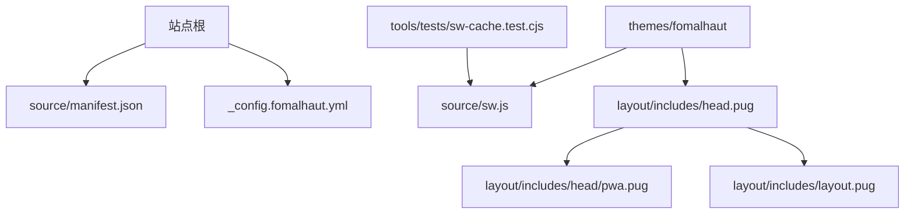
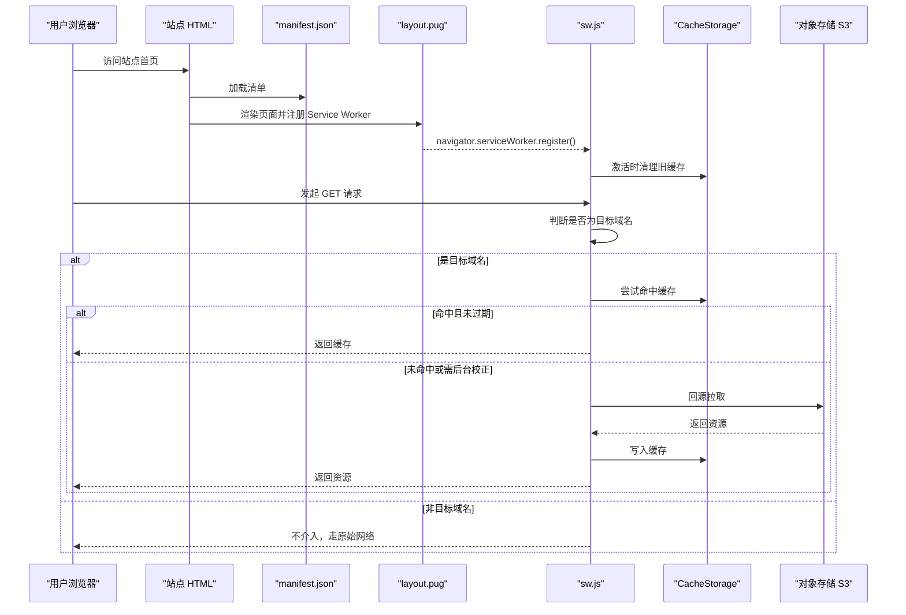
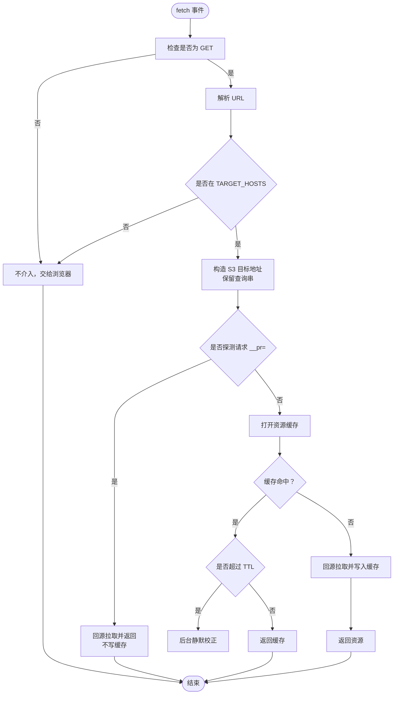
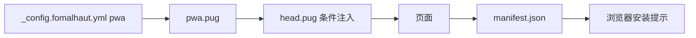
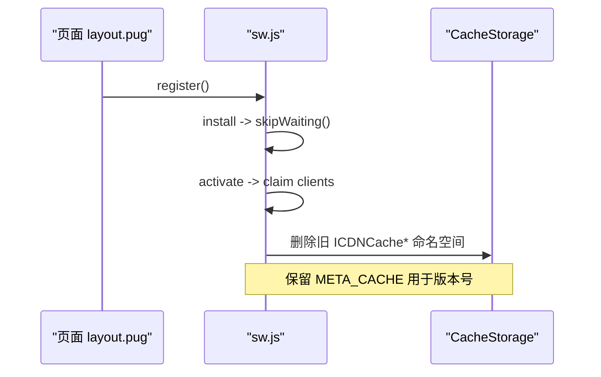
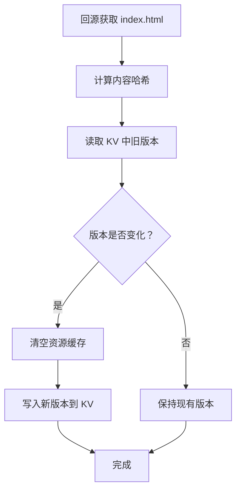
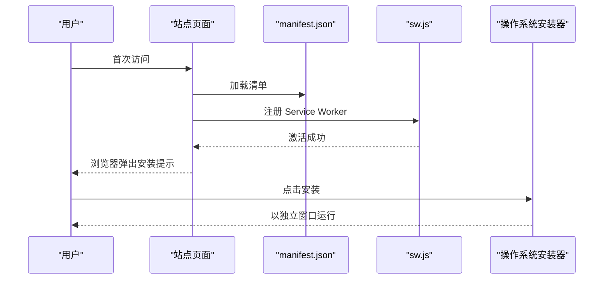
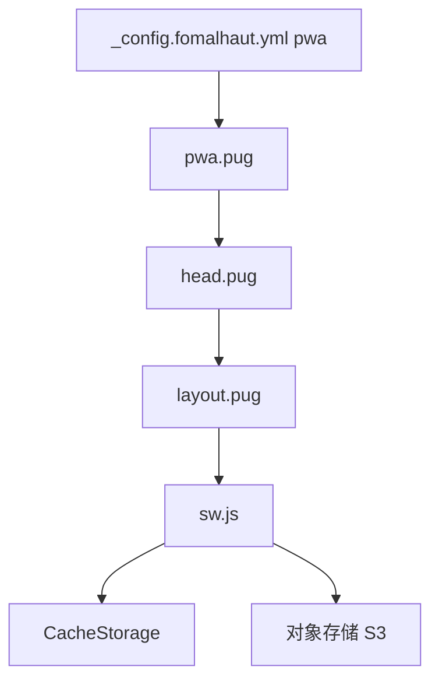
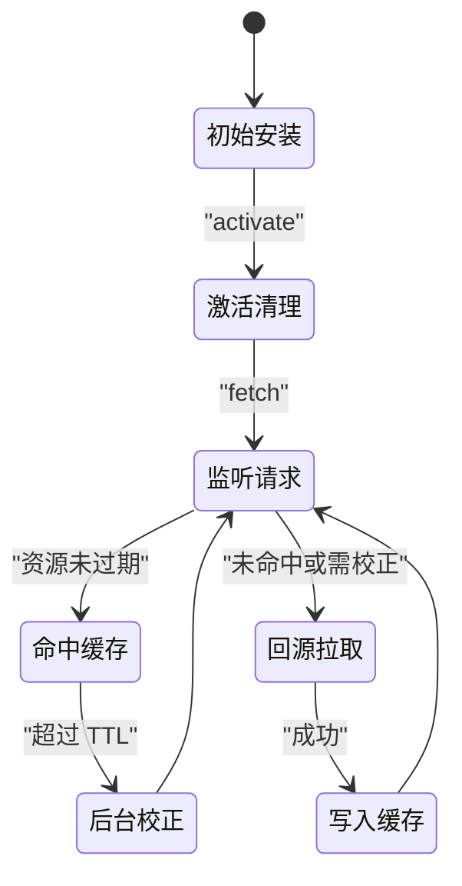

# PWA 功能支持

<cite>
**本文引用的文件**   
- [sw.js](file://themes/fomalhaut/source/sw.js)
- [manifest.json](file://source/manifest.json)
- [_config.fomalhaut.yml](file://_config.fomalhaut.yml)
- [pwa.pug](file://themes/fomalhaut/layout/includes/head/pwa.pug)
- [head.pug](file://themes/fomalhaut/layout/includes/head.pug)
- [layout.pug](file://themes/fomalhaut/layout/includes/layout.pug)
- [sw-cache.test.cjs](file://tools/tests/sw-cache.test.cjs)
</cite>

## 目录
1. [简介](#简介)
2. [项目结构](#项目结构)
3. [核心组件](#核心组件)
4. [架构总览](#架构总览)
5. [详细组件分析](#详细组件分析)
6. [依赖关系分析](#依赖关系分析)
7. [性能与缓存优化](#性能与缓存优化)
8. [离线缓存与版本管理](#离线缓存与版本管理)
9. [推送通知与安装配置](#推送通知与安装配置)
10. [故障排除与调试](#故障排除与调试)
11. [结论](#结论)

## 简介
本仓库为基于 Hexo 的 Fomalhaut 主题站点，PWA 能力由两部分组成：
- 主题内置的 Service Worker：实现 CDN 分流、资源缓存、TTL 管理与站点版本控制。
- 主题 PWA 模板与站点 manifest：负责安装入口、图标、应用元数据与浏览器安装提示。

Service Worker 的核心目标是：在目标域名上把请求分流到对象存储（S3），对静态资源做缓存加速，对 HTML 保持回源优先，并通过站点版本哈希自动清理旧缓存，避免长期吃旧代码。

## 项目结构
与 PWA 直接相关的文件分布如下：

**图表来源**
- [sw.js:1-221](file://themes/fomalhaut/source/sw.js#L1-L221)
- [manifest.json:1-47](file://source/manifest.json#L1-L47)
- [_config.fomalhaut.yml:1155-1166](file://_config.fomalhaut.yml#L1155-L1166)
- [pwa.pug:1-12](file://themes/fomalhaut/layout/includes/head/pwa.pug#L1-L12)
- [head.pug:46-47](file://themes/fomalhaut/layout/includes/head.pug#L46-L47)
- [layout.pug:14-14](file://themes/fomalhaut/layout/includes/layout.pug#L14-L14)
- [sw-cache.test.cjs:20-21](file://tools/tests/sw-cache.test.cjs#L20-L21)

**章节来源**
- [sw.js:1-221](file://themes/fomalhaut/source/sw.js#L1-L221)
- [manifest.json:1-47](file://source/manifest.json#L1-L47)
- [_config.fomalhaut.yml:1155-1166](file://_config.fomalhaut.yml#L1155-L1166)
- [pwa.pug:1-12](file://themes/fomalhaut/layout/includes/head/pwa.pug#L1-L12)
- [head.pug:46-47](file://themes/fomalhaut/layout/includes/head.pug#L46-L47)
- [layout.pug:14-14](file://themes/fomalhaut/layout/includes/layout.pug#L14-L14)
- [sw-cache.test.cjs:1-33](file://tools/tests/sw-cache.test.cjs#L1-L33)

## 核心组件
- Service Worker：`themes/fomalhaut/source/sw.js`
- 站点清单：`source/manifest.json`
- 主题 PWA 配置：`_config.fomalhaut.yml`
- PWA 模板注入：`themes/fomalhaut/layout/includes/head/pwa.pug`
- 页面头模板开关：`themes/fomalhaut/layout/includes/head.pug`
- SW 注册与清理逻辑：`themes/fomalhaut/layout/includes/layout.pug`
- SW 单元测试：`tools/tests/sw-cache.test.cjs`

**章节来源**
- [sw.js:1-221](file://themes/fomalhaut/source/sw.js#L1-L221)
- [manifest.json:1-47](file://source/manifest.json#L1-L47)
- [_config.fomalhaut.yml:1155-1166](file://_config.fomalhaut.yml#L1155-L1166)
- [pwa.pug:1-12](file://themes/fomalhaut/layout/includes/head/pwa.pug#L1-L12)
- [head.pug:46-47](file://themes/fomalhaut/layout/includes/head.pug#L46-L47)
- [layout.pug:14-14](file://themes/fomalhaut/layout/includes/layout.pug#L14-L14)
- [sw-cache.test.cjs:1-33](file://tools/tests/sw-cache.test.cjs#L1-L33)

## 架构总览
PWA 在站点中的整体交互如下：

**图表来源**
- [layout.pug:14-14](file://themes/fomalhaut/layout/includes/layout.pug#L14-L14)
- [sw.js:48-55](file://themes/fomalhaut/source/sw.js#L48-L55)
- [sw.js:153-220](file://themes/fomalhaut/source/sw.js#L153-L220)

## 详细组件分析

### Service Worker：CDN 分流器与缓存策略
Service Worker 承担以下职责：
- 仅对白名单内的目标域名介入请求，其他域名完全放行。
- 将站内请求重写并重定向到对象存储地址，保留查询参数。
- HTML 始终回源，保证内容最新；其余资源缓存优先，并按类型设置不同 TTL。
- 使用 index.html 内容哈希作为站点版本，版本变化时清空资源缓存。
- 探测类请求只改写并回源，不落盘缓存，防止缓存膨胀。
- 任何异常都回退到浏览器原始请求，避免请求悬空。

关键行为要点：
- 目标域名白名单：只有 `TARGET_HOSTS` 内的域名才会被分流。
- 路径处理：目录补 `index.html`，无扩展名且无查询串时补 `.html`。
- MIME 类型推断：根据扩展名映射 Content-Type，补齐常见媒体、字体、音视频等类型。
- 文本资源短 TTL：HTML/JS/CSS/JSON/XML 等文本资源默认 10 分钟，图片/字体/音视频 24 小时。
- 后台静默校正：命中缓存后若超过 TTL，后台重新拉取更新缓存，不影响本次返回。
- 版本控制：每次 HTML 回源后计算哈希并与 KV 中旧版本比较，不一致则清空资源缓存并写入新版本。
- 探测请求：带 `__pr=` 的请求只做改写和回源，不写 CacheStorage。

**图表来源**
- [sw.js:153-220](file://themes/fomalhaut/source/sw.js#L153-L220)

**章节来源**
- [sw.js:35-46](file://themes/fomalhaut/source/sw.js#L35-L46)
- [sw.js:69-96](file://themes/fomalhaut/source/sw.js#L69-L96)
- [sw.js:98-151](file://themes/fomalhaut/source/sw.js#L98-L151)
- [sw.js:153-220](file://themes/fomalhaut/source/sw.js#L153-L220)

### 站点清单与图标配置
`manifest.json` 定义 PWA 的基本信息：
- 名称与短名称
- 主题色与背景色
- 显示模式为独立应用
- 作用域与启动页
- 多尺寸图标列表

主题侧通过 `_config.fomalhaut.yml` 的 `pwa` 配置项控制模板注入，包括 manifest 路径、主题色、Apple 触摸图标、favicon 与 Safari 固定标签图标。

**图表来源**
- [_config.fomalhaut.yml:1155-1166](file://_config.fomalhaut.yml#L1155-L1166)
- [pwa.pug:1-12](file://themes/fomalhaut/layout/includes/head/pwa.pug#L1-L12)
- [head.pug:46-47](file://themes/fomalhaut/layout/includes/head.pug#L46-L47)
- [manifest.json:1-47](file://source/manifest.json#L1-L47)

**章节来源**
- [manifest.json:1-47](file://source/manifest.json#L1-L47)
- [_config.fomalhaut.yml:1155-1166](file://_config.fomalhaut.yml#L1155-L1166)
- [pwa.pug:1-12](file://themes/fomalhaut/layout/includes/head/pwa.pug#L1-L12)
- [head.pug:46-47](file://themes/fomalhaut/layout/includes/head.pug#L46-L47)

### Service Worker 注册与生命周期
页面模板在 `<head>` 中引入 PWA 相关资源，并在布局层执行 Service Worker 注册与清理逻辑。SW 在 `install` 阶段跳过等待，在 `activate` 阶段接管客户端并清理旧缓存命名空间。

**图表来源**
- [layout.pug:14-14](file://themes/fomalhaut/layout/includes/layout.pug#L14-L14)
- [sw.js:48-55](file://themes/fomalhaut/source/sw.js#L48-L55)

**章节来源**
- [layout.pug:14-14](file://themes/fomalhaut/layout/includes/layout.pug#L14-L14)
- [sw.js:48-55](file://themes/fomalhaut/source/sw.js#L48-L55)

### 版本管理机制
版本机制以 index.html 的内容哈希为核心：
- 每次 HTML 回源后计算哈希。
- 与 KV 中保存的旧版本比较。
- 若版本变化，则清空资源缓存，再写入新版本。
- 这样可避免因 JS/CSS 变更但 index.html 字节不变导致的长期旧代码问题。

**图表来源**
- [sw.js:98-103](file://themes/fomalhaut/source/sw.js#L98-L103)
- [sw.js:186-199](file://themes/fomalhaut/source/sw.js#L186-L199)

**章节来源**
- [sw.js:98-103](file://themes/fomalhaut/source/sw.js#L98-L103)
- [sw.js:186-199](file://themes/fomalhaut/source/sw.js#L186-L199)

### 离线缓存与预加载
当前 Service Worker 并非传统意义上的“离线包”方案，而是“分流 + 缓存”：
- HTML 始终回源，确保内容最新。
- 其他资源命中缓存即返回，未命中则回源并缓存。
- 文本资源短 TTL，媒体资源长 TTL。
- 后台静默校正，提升命中率同时降低带宽。

预加载方面，站点通过 head 注入与 preload 配置优化首屏体验，例如字体预加载与外部域名预连接。这些不属于 SW 自身逻辑，但与 PWA 首屏性能密切相关。

**章节来源**
- [sw.js:132-151](file://themes/fomalhaut/source/sw.js#L132-L151)
- [sw.js:186-209](file://themes/fomalhaut/source/sw.js#L186-L209)
- [_config.fomalhaut.yml:1181-1194](file://_config.fomalhaut.yml#L1181-L1194)

### 推送通知配置与使用方法
仓库中未发现针对 Web Push API 的 Service Worker 订阅与消息处理实现。主题配置中存在 Snackbar/Toast 通知样式，但这属于 UI 通知，不是系统级推送通知。

因此，当前项目的“推送通知”应理解为：
- 前端 UI 通知：通过主题脚本与样式展示临时提示。
- 系统级 Web Push：未在仓库中提供完整实现，需要额外开发 Service Worker 的 push 与 notificationclick 事件处理，以及后端订阅管理。

**章节来源**
- [_config.fomalhaut.yml:1127-1135](file://_config.fomalhaut.yml#L1127-L1135)
- [sw.js:1-221](file://themes/fomalhaut/source/sw.js#L1-L221)

### PWA 安装流程与 manifest 配置
安装流程依赖：
- 有效的 `manifest.json`
- 已注册的 Service Worker
- 浏览器支持的 PWA 环境

主题通过 `pwa.pug` 注入 manifest 链接与图标资源，`head.pug` 根据主题配置决定是否启用 PWA 模板。`layout.pug` 负责注册 Service Worker。

**图表来源**
- [pwa.pug:1-12](file://themes/fomalhaut/layout/includes/head/pwa.pug#L1-L12)
- [head.pug:46-47](file://themes/fomalhaut/layout/includes/head.pug#L46-L47)
- [layout.pug:14-14](file://themes/fomalhaut/layout/includes/layout.pug#L14-L14)
- [manifest.json:1-47](file://source/manifest.json#L1-L47)

**章节来源**
- [pwa.pug:1-12](file://themes/fomalhaut/layout/includes/head/pwa.pug#L1-L12)
- [head.pug:46-47](file://themes/fomalhaut/layout/includes/head.pug#L46-L47)
- [layout.pug:14-14](file://themes/fomalhaut/layout/includes/layout.pug#L14-L14)
- [manifest.json:1-47](file://source/manifest.json#L1-L47)

## 依赖关系分析
Service Worker 与站点构建配置、模板注入之间存在明确依赖：

**图表来源**
- [_config.fomalhaut.yml:1155-1166](file://_config.fomalhaut.yml#L1155-L1166)
- [pwa.pug:1-12](file://themes/fomalhaut/layout/includes/head/pwa.pug#L1-L12)
- [head.pug:46-47](file://themes/fomalhaut/layout/includes/head.pug#L46-L47)
- [layout.pug:14-14](file://themes/fomalhaut/layout/includes/layout.pug#L14-L14)
- [sw.js:153-220](file://themes/fomalhaut/source/sw.js#L153-L220)

**章节来源**
- [_config.fomalhaut.yml:1155-1166](file://_config.fomalhaut.yml#L1155-L1166)
- [pwa.pug:1-12](file://themes/fomalhaut/layout/includes/head/pwa.pug#L1-L12)
- [head.pug:46-47](file://themes/fomalhaut/layout/includes/head.pug#L46-L47)
- [layout.pug:14-14](file://themes/fomalhaut/layout/includes/layout.pug#L14-L14)
- [sw.js:153-220](file://themes/fomalhaut/source/sw.js#L153-L220)

## 性能与缓存优化
- 缓存命中率优化
  - 文本资源短 TTL，避免旧代码长期驻留。
  - 媒体资源长 TTL，减少重复下载。
  - 后台静默校正，在不影响用户体验的前提下提升后续命中率。
- 网络请求优化
  - 仅对目标域名介入，避免无关请求被拦截。
  - HTML 回源优先，保证内容实时性。
  - 探测请求不落盘，防止缓存无限膨胀。
- 内存与存储管理
  - 激活时清理旧命名空间缓存，避免残留占用。
  - 版本变化时整片资源缓存清空，避免碎片化。
  - 使用独立元数据缓存存放版本号，清资源缓存时不受牵连。

**章节来源**
- [sw.js:48-55](file://themes/fomalhaut/source/sw.js#L48-L55)
- [sw.js:132-151](file://themes/fomalhaut/source/sw.js#L132-L151)
- [sw.js:166-181](file://themes/fomalhaut/source/sw.js#L166-L181)
- [sw.js:186-209](file://themes/fomalhaut/source/sw.js#L186-L209)

## 离线缓存与版本管理
- 离线能力现状
  - 当前 SW 主要做分流与缓存，并非完整离线包方案。
  - HTML 始终回源，因此严格意义上不具备完全离线浏览能力。
  - 已缓存的资源可在网络不可用时继续访问。
- 版本管理策略
  - 以 index.html 内容哈希作为站点版本。
  - 版本变化时清空资源缓存，确保新 CSS/JS 生效。
  - 文本资源短 TTL 作为兜底，即使忘记改缓存戳也能在较短时间内自我纠正。

**图表来源**
- [sw.js:48-55](file://themes/fomalhaut/source/sw.js#L48-L55)
- [sw.js:145-151](file://themes/fomalhaut/source/sw.js#L145-L151)
- [sw.js:186-209](file://themes/fomalhaut/source/sw.js#L186-L209)

**章节来源**
- [sw.js:48-55](file://themes/fomalhaut/source/sw.js#L48-L55)
- [sw.js:145-151](file://themes/fomalhaut/source/sw.js#L145-L151)
- [sw.js:186-209](file://themes/fomalhaut/source/sw.js#L186-L209)

## 推送通知与安装配置
- 推送通知
  - 仓库未提供 Web Push 订阅与消息处理实现。
  - 主题 Snackbar/Toast 属于 UI 通知，不是系统推送。
- 安装配置
  - 启用主题 PWA 配置后，模板会注入 manifest 与图标。
  - 页面注册 Service Worker，浏览器根据 manifest 与 SW 状态决定是否显示安装提示。
  - 图标建议提供多尺寸，覆盖桌面、任务栏、Safari 固定标签等场景。

**章节来源**
- [_config.fomalhaut.yml:1127-1135](file://_config.fomalhaut.yml#L1127-L1135)
- [_config.fomalhaut.yml:1155-1166](file://_config.fomalhaut.yml#L1155-L1166)
- [pwa.pug:1-12](file://themes/fomalhaut/layout/includes/head/pwa.pug#L1-L12)
- [manifest.json:1-47](file://source/manifest.json#L1-L47)

## 故障排除与调试
常见问题与定位方法：
- Service Worker 未生效
  - 检查页面是否注册了 SW。
  - 检查主题是否启用了 PWA 模板。
  - 检查 manifest 路径是否正确。
- 缓存未更新
  - 确认 index.html 内容是否变化，从而触发版本清理。
  - 检查文本资源 TTL 是否过短或过长。
  - 查看是否误用固定 URL 导致缓存键不变。
- 缓存膨胀
  - 确认探测请求是否带有随机参数并被落盘。
  - 检查是否有多份旧命名空间未清理。
- 资源类型错误
  - 检查扩展名映射是否包含实际使用的媒体类型。
  - 确认 Content-Type 是否正确设置。

调试建议：
- 使用浏览器开发者工具的 Application 面板查看 CacheStorage 与 Service Worker 状态。
- 使用 Network 面板观察请求是否被 SW 拦截。
- 使用控制台日志查看 SW 的回退与错误信息。
- 使用仓库提供的单元测试验证 SW 行为，无需真实浏览器或网络。

**章节来源**
- [layout.pug:14-14](file://themes/fomalhaut/layout/includes/layout.pug#L14-L14)
- [head.pug:46-47](file://themes/fomalhaut/layout/includes/head.pug#L46-L47)
- [sw.js:153-220](file://themes/fomalhaut/source/sw.js#L153-L220)
- [sw-cache.test.cjs:1-33](file://tools/tests/sw-cache.test.cjs#L1-L33)

## 结论
该项目的 PWA 能力以 Service Worker 为核心，重点在于 CDN 分流与资源缓存，而非完整离线包方案。其优势在于：
- 对目标域名进行精准分流，避免干扰其他域名。
- HTML 回源优先，保证内容实时性。
- 文本资源短 TTL，媒体资源长 TTL，兼顾时效性与省流。
- 基于 index.html 哈希的版本管理，自动清理旧缓存。
- 探测请求不落盘，防止缓存无限膨胀。

若需要更强的离线能力或系统级推送通知，应在当前 SW 基础上扩展离线资源预缓存与 Web Push 订阅处理逻辑，并结合后端服务完成订阅管理与消息下发。