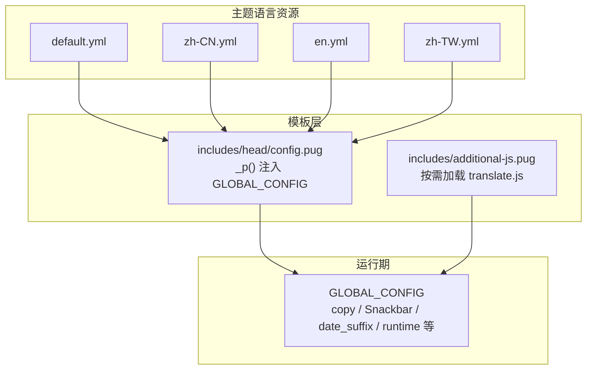
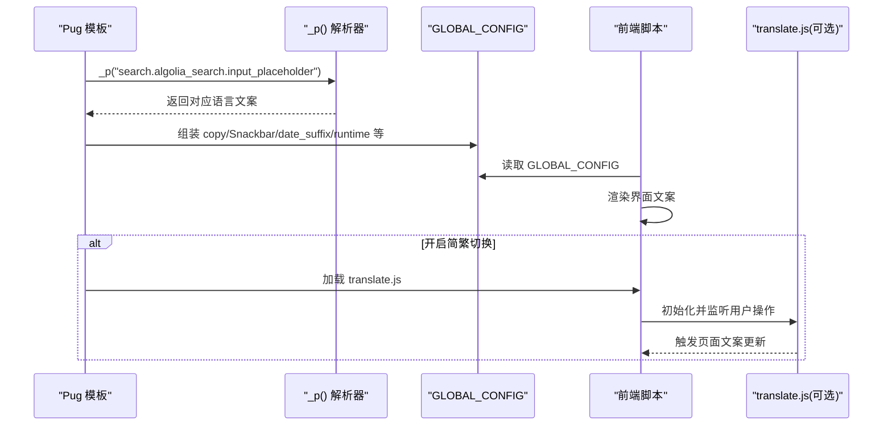
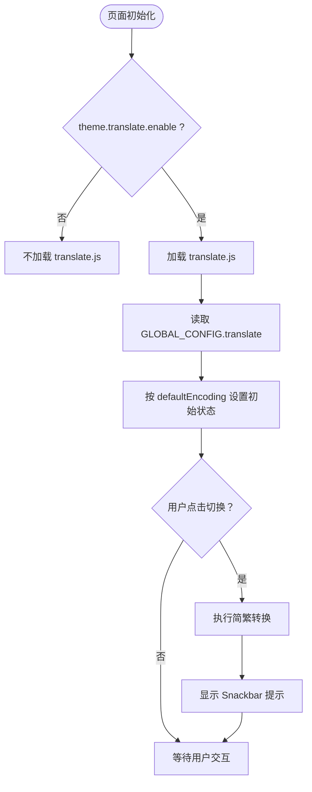
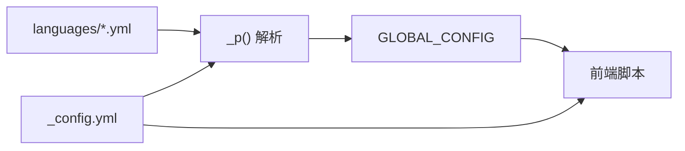

# 国际化支持

<cite>
**本文引用的文件**   
- [themes/fomalhaut/languages/default.yml](file://themes/fomalhaut/languages/default.yml)
- [themes/fomalhaut/languages/zh-CN.yml](file://themes/fomalhaut/languages/zh-CN.yml)
- [themes/fomalhaut/languages/en.yml](file://themes/fomalhaut/languages/en.yml)
- [themes/fomalhaut/languages/zh-TW.yml](file://themes/fomalhaut/languages/zh-TW.yml)
- [themes/fomalhaut/layout/includes/head/config.pug](file://themes/fomalhaut/layout/includes/head/config.pug)
- [themes/fomalhaut/layout/includes/additional-js.pug](file://themes/fomalhaut/layout/includes/additional-js.pug)
- [themes/fomalhaut/_config.yml](file://themes/fomalhaut/_config.yml)
</cite>

## 目录
1. [简介](#简介)
2. [项目结构](#项目结构)
3. [核心组件](#核心组件)
4. [架构总览](#架构总览)
5. [详细组件分析](#详细组件分析)
6. [依赖关系分析](#依赖关系分析)
7. [性能与体验](#性能与体验)
8. [新增语言完整流程](#新增语言完整流程)
9. [文本本地化方法](#文本本地化方法)
10. [最佳实践](#最佳实践)
11. [常见问题排查](#常见问题排查)
12. [结论](#结论)

## 简介
本主题通过 YAML 翻译键值文件、Pug 模板中的 _p() 函数以及前端全局配置对象，实现多语言界面展示。当前内置简体中文、繁体中文和英文三种语言，并提供简繁切换功能（基于主题配置）。文档将系统说明：
- 多语言文件结构与命名规范
- 默认语言回退机制
- 语言检测与动态切换
- 新增语言的步骤
- 模板中如何使用标签进行本地化
- 日期时间格式化与相对时间显示
- 常见问题的定位与解决

## 项目结构
主题的多语言资源集中在 themes/fomalhaut/languages 目录下，每个语言一个 YAML 文件；模板在 Pug 中使用 _p("key") 获取对应文案；运行时通过 GLOBAL_CONFIG 把部分文案注入到前端脚本。

图表来源
- [themes/fomalhaut/languages/default.yml:1-122](file://themes/fomalhaut/languages/default.yml#L1-L122)
- [themes/fomalhaut/languages/zh-CN.yml:1-124](file://themes/fomalhaut/languages/zh-CN.yml#L1-L124)
- [themes/fomalhaut/languages/en.yml:1-122](file://themes/fomalhaut/languages/en.yml#L1-L122)
- [themes/fomalhaut/languages/zh-TW.yml:1-123](file://themes/fomalhaut/languages/zh-TW.yml#L1-L123)
- [themes/fomalhaut/layout/includes/head/config.pug:1-125](file://themes/fomalhaut/layout/includes/head/config.pug#L1-L125)
- [themes/fomalhaut/layout/includes/additional-js.pug:1-20](file://themes/fomalhaut/layout/includes/additional-js.pug#L1-L20)

章节来源
- [themes/fomalhaut/languages/default.yml:1-122](file://themes/fomalhaut/languages/default.yml#L1-L122)
- [themes/fomalhaut/languages/zh-CN.yml:1-124](file://themes/fomalhaut/languages/zh-CN.yml#L1-L124)
- [themes/fomalhaut/languages/en.yml:1-122](file://themes/fomalhaut/languages/en.yml#L1-L122)
- [themes/fomalhaut/languages/zh-TW.yml:1-123](file://themes/fomalhaut/languages/zh-TW.yml#L1-L123)
- [themes/fomalhaut/layout/includes/head/config.pug:1-125](file://themes/fomalhaut/layout/includes/head/config.pug#L1-L125)
- [themes/fomalhaut/layout/includes/additional-js.pug:1-20](file://themes/fomalhaut/layout/includes/additional-js.pug#L1-L20)

## 核心组件
- 语言文件（YAML）
  - default.yml：默认语言（英文），作为缺失键的回退源
  - zh-CN.yml：简体中文
  - zh-TW.yml：繁体中文
  - en.yml：英文（与 default.yml 内容一致，便于显式选择）
- 模板渲染（Pug）
  - includes/head/config.pug：使用 _p("key") 将文案注入 GLOBAL_CONFIG
  - includes/additional-js.pug：根据 theme.translate.enable 决定是否加载 translate.js
- 主题配置（_config.yml）
  - translate.*：控制简繁开关、按钮文案、默认编码、延迟等

章节来源
- [themes/fomalhaut/languages/default.yml:1-122](file://themes/fomalhaut/languages/default.yml#L1-L122)
- [themes/fomalhaut/languages/zh-CN.yml:1-124](file://themes/fomalhaut/languages/zh-CN.yml#L1-L124)
- [themes/fomalhaut/languages/en.yml:1-122](file://themes/fomalhaut/languages/en.yml#L1-L122)
- [themes/fomalhaut/languages/zh-TW.yml:1-123](file://themes/fomalhaut/languages/zh-TW.yml#L1-L123)
- [themes/fomalhaut/layout/includes/head/config.pug:1-125](file://themes/fomalhaut/layout/includes/head/config.pug#L1-L125)
- [themes/fomalhaut/layout/includes/additional-js.pug:1-20](file://themes/fomalhaut/layout/includes/additional-js.pug#L1-L20)
- [themes/fomalhaut/_config.yml:698-710](file://themes/fomalhaut/_config.yml#L698-L710)

## 架构总览
下图展示了从模板到运行期的数据流：模板调用 _p() 读取 YAML 文案，生成 GLOBAL_CONFIG；前端脚本读取该配置并渲染 UI；当开启简繁切换时，additional-js.pug 会加载 translate.js，依据 translate 配置执行转换。

图表来源
- [themes/fomalhaut/layout/includes/head/config.pug:1-125](file://themes/fomalhaut/layout/includes/head/config.pug#L1-L125)
- [themes/fomalhaut/layout/includes/additional-js.pug:1-20](file://themes/fomalhaut/layout/includes/additional-js.pug#L1-L20)

## 详细组件分析

### 语言文件结构与命名规范
- 文件组织
  - 每个语言一个 YAML 文件，文件名即语言标识（如 zh-CN、zh-TW、en）
  - default.yml 作为默认语言与缺失键回退
- 键名规范
  - 使用点号分隔的层级结构，语义清晰，例如 search.algolia_search.input_placeholder、aside.card_webinfo.runtime.unit
  - 同一语义在不同语言文件中保持一致的键路径
- 嵌套结构
  - 分组明确：footer、copy、page、post、search、pagination、comment、aside、date_suffix、rightside、copy_copyright、Snackbar、loading、error404 等
  - 针对搜索、侧边栏卡片、版权信息等模块分别维护子键

章节来源
- [themes/fomalhaut/languages/default.yml:1-122](file://themes/fomalhaut/languages/default.yml#L1-L122)
- [themes/fomalhaut/languages/zh-CN.yml:1-124](file://themes/fomalhaut/languages/zh-CN.yml#L1-L124)
- [themes/fomalhaut/languages/en.yml:1-122](file://themes/fomalhaut/languages/en.yml#L1-L122)
- [themes/fomalhaut/languages/zh-TW.yml:1-123](file://themes/fomalhaut/languages/zh-TW.yml#L1-L123)

### 翻译键值管理系统与默认回退
- 默认语言
  - default.yml 提供英文文案，作为缺失键的回退源
- 键查找顺序
  - 优先使用当前语言文件中的键值
  - 若缺失则回退到 default.yml
- 模板注入
  - includes/head/config.pug 通过 _p("key") 将需要的文案写入 GLOBAL_CONFIG，供前端脚本使用
  - 涉及范围包括：复制提示、Snackbar 消息、相对时间后缀、运行时单位、搜索占位符等

章节来源
- [themes/fomalhaut/languages/default.yml:1-122](file://themes/fomalhaut/languages/default.yml#L1-L122)
- [themes/fomalhaut/layout/includes/head/config.pug:1-125](file://themes/fomalhaut/layout/includes/head/config.pug#L1-L125)

### 语言检测逻辑与动态切换
- 语言检测
  - 主题未提供浏览器语言自动检测逻辑；当前以主题配置的 translate.defaultEncoding 决定初始简繁状态
- 动态切换
  - additional-js.pug 根据 theme.translate.enable 决定是否加载 translate.js
  - config.pug 将 translate 相关配置（默认编码、延迟、按钮文案）注入 GLOBAL_CONFIG.translate
  - translate.js 负责根据配置执行简繁转换，并通过 Snackbar 反馈状态

图表来源
- [themes/fomalhaut/layout/includes/additional-js.pug:1-20](file://themes/fomalhaut/layout/includes/additional-js.pug#L1-L20)
- [themes/fomalhaut/layout/includes/head/config.pug:31-39](file://themes/fomalhaut/layout/includes/head/config.pug#L31-L39)
- [themes/fomalhaut/_config.yml:698-710](file://themes/fomalhaut/_config.yml#L698-L710)

章节来源
- [themes/fomalhaut/layout/includes/additional-js.pug:1-20](file://themes/fomalhaut/layout/includes/additional-js.pug#L1-L20)
- [themes/fomalhaut/layout/includes/head/config.pug:31-39](file://themes/fomalhaut/layout/includes/head/config.pug#L31-L39)
- [themes/fomalhaut/_config.yml:698-710](file://themes/fomalhaut/_config.yml#L698-L710)

### 文本内容的本地化方法
- 模板中的语言标签
  - 使用 _p("key") 获取对应文案，例如搜索占位符、Snackbar 消息、相对时间后缀等
- 动态内容翻译
  - 通过 GLOBAL_CONFIG 将后端生成的文案注入前端，避免硬编码
- 日期时间格式化
  - post_meta.date_format 可设置为 relative，启用相对时间显示
  - date_suffix 提供“刚刚/分钟前/小时前/天前/个月前”等后缀文案
  - runtime 单位文案来自 aside.card_webinfo.runtime.unit

章节来源
- [themes/fomalhaut/layout/includes/head/config.pug:87-125](file://themes/fomalhaut/layout/includes/head/config.pug#L87-L125)
- [themes/fomalhaut/_config.yml:139-151](file://themes/fomalhaut/_config.yml#L139-L151)
- [themes/fomalhaut/languages/zh-CN.yml:86-93](file://themes/fomalhaut/languages/zh-CN.yml#L86-L93)

## 依赖关系分析
- 模板对语言文件的依赖
  - includes/head/config.pug 通过 _p() 依赖 languages/*.yml
- 前端脚本对配置的依赖
  - additional-js.pug 根据 theme.translate.enable 条件加载 translate.js
  - GLOBAL_CONFIG 为前端脚本提供统一的数据入口
- 主题配置对行为的影响
  - translate.* 控制是否启用简繁切换及按钮文案
  - post_meta.date_format 控制相对时间显示
  - snackbar.* 控制提示样式与位置

图表来源
- [themes/fomalhaut/layout/includes/head/config.pug:1-125](file://themes/fomalhaut/layout/includes/head/config.pug#L1-L125)
- [themes/fomalhaut/layout/includes/additional-js.pug:1-20](file://themes/fomalhaut/layout/includes/additional-js.pug#L1-L20)
- [themes/fomalhaut/_config.yml:698-710](file://themes/fomalhaut/_config.yml#L698-L710)

章节来源
- [themes/fomalhaut/layout/includes/head/config.pug:1-125](file://themes/fomalhaut/layout/includes/head/config.pug#L1-L125)
- [themes/fomalhaut/layout/includes/additional-js.pug:1-20](file://themes/fomalhaut/layout/includes/additional-js.pug#L1-L20)
- [themes/fomalhaut/_config.yml:698-710](file://themes/fomalhaut/_config.yml#L698-L710)

## 性能与体验
- 按需加载
  - 仅在 theme.translate.enable 为真时加载 translate.js，减少首屏体积
- 文案预取
  - 通过 GLOBAL_CONFIG 一次性注入所需文案，避免多次请求
- 相对时间
  - 使用 date_suffix 文案与相对时间模式，提升可读性
- 用户体验
  - Snackbar 提供切换反馈，增强操作感知

[本节为通用指导，不涉及具体文件分析]

## 新增语言完整流程
- 创建语言文件
  - 在 themes/fomalhaut/languages 下新建 xx.yml，保持与 default.yml 一致的键路径
- 修改模板注入
  - 在 includes/head/config.pug 中根据需要添加 _p("new.key") 注入 GLOBAL_CONFIG
- 更新主题配置（如需）
  - 在 _config.yml 的 translate 或 snackbar 等区域补充新语言所需的按钮文案或提示
- 验证
  - 构建后检查页面文案是否正确显示
  - 若启用简繁切换，确保 translate.js 能正确识别并处理新语言

章节来源
- [themes/fomalhaut/languages/default.yml:1-122](file://themes/fomalhaut/languages/default.yml#L1-L122)
- [themes/fomalhaut/layout/includes/head/config.pug:1-125](file://themes/fomalhaut/layout/includes/head/config.pug#L1-L125)
- [themes/fomalhaut/_config.yml:698-710](file://themes/fomalhaut/_config.yml#L698-L710)

## 文本本地化方法
- 模板中使用 _p("key")
  - 适用于所有需要本地化的静态文案
- 动态内容翻译
  - 通过 GLOBAL_CONFIG 将后端生成的文案注入前端，避免硬编码
- 日期时间格式化
  - 使用 post_meta.date_format=relative 启用相对时间
  - 使用 date_suffix 文案定义“刚刚/分钟前/小时前/天前/个月前”
  - runtime 单位文案来自 aside.card_webinfo.runtime.unit

章节来源
- [themes/fomalhaut/layout/includes/head/config.pug:87-125](file://themes/fomalhaut/layout/includes/head/config.pug#L87-L125)
- [themes/fomalhaut/_config.yml:139-151](file://themes/fomalhaut/_config.yml#L139-L151)
- [themes/fomalhaut/languages/zh-CN.yml:86-93](file://themes/fomalhaut/languages/zh-CN.yml#L86-L93)

## 最佳实践
- 键名一致性
  - 所有语言文件保持相同的键路径，避免遗漏导致回退
- 分层组织
  - 按模块划分键组（如 search、aside、post、copy_copyright、Snackbar）
- 最小化变更
  - 新增语言时仅新增 xx.yml，不改动其他语言文件
- 渐进式注入
  - 只在 GLOBAL_CONFIG 中注入前端实际使用的键，减少冗余
- 可访问性与提示
  - 使用 Snackbar 提供切换反馈，提升用户体验

[本节为通用指导，不涉及具体文件分析]

## 常见问题排查
- 文案未显示或显示英文
  - 检查对应语言文件是否存在该键
  - 确认 includes/head/config.pug 中是否已注入该键
- 简繁切换无效
  - 检查 theme.translate.enable 是否为真
  - 检查 includes/additional-js.pug 是否加载了 translate.js
  - 检查 GLOBAL_CONFIG.translate 是否包含必要字段
- 相对时间不生效
  - 检查 post_meta.date_format 是否设置为 relative
  - 检查 date_suffix 文案是否齐全
- Snackbar 提示异常
  - 检查 snackbar.* 配置是否正确
  - 检查 GLOBAL_CONFIG.Snackbar 是否包含必要字段

章节来源
- [themes/fomalhaut/layout/includes/head/config.pug:1-125](file://themes/fomalhaut/layout/includes/head/config.pug#L1-L125)
- [themes/fomalhaut/layout/includes/additional-js.pug:1-20](file://themes/fomalhaut/layout/includes/additional-js.pug#L1-L20)
- [themes/fomalhaut/_config.yml:698-710](file://themes/fomalhaut/_config.yml#L698-L710)

## 结论
本主题通过 YAML 翻译文件与 Pug 模板的 _p() 函数，结合 GLOBAL_CONFIG 的前端注入，实现了稳定可控的多语言支持。当前内置简体中文、繁体中文与英文，并提供简繁切换能力。遵循本文的结构规范与最佳实践，可高效扩展更多语言并保持界面一致性与可维护性。