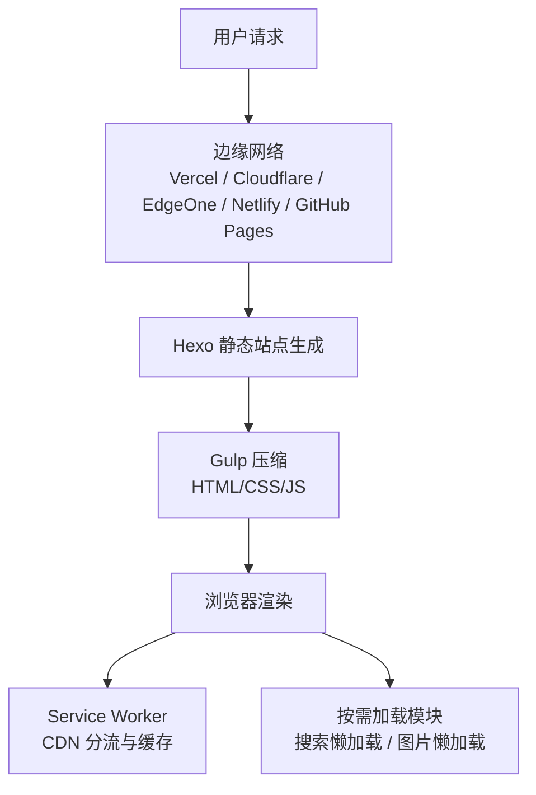
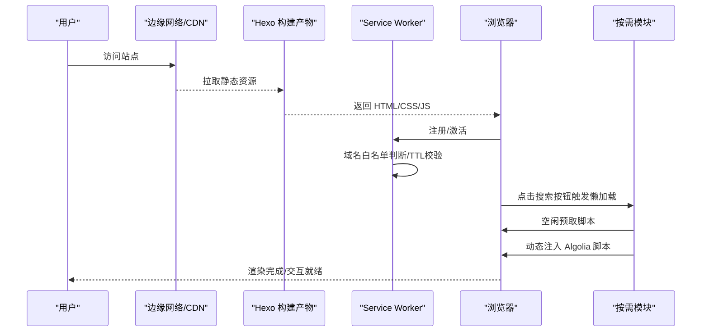
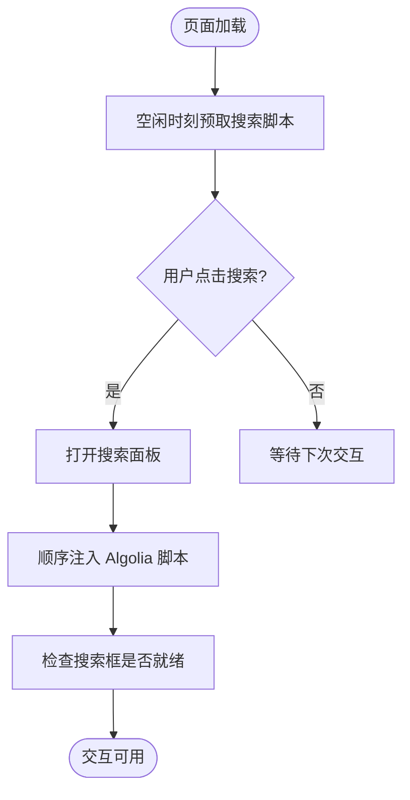
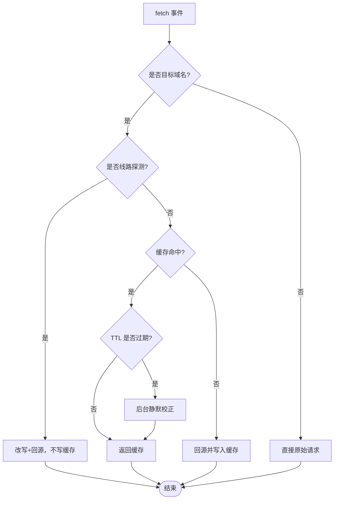
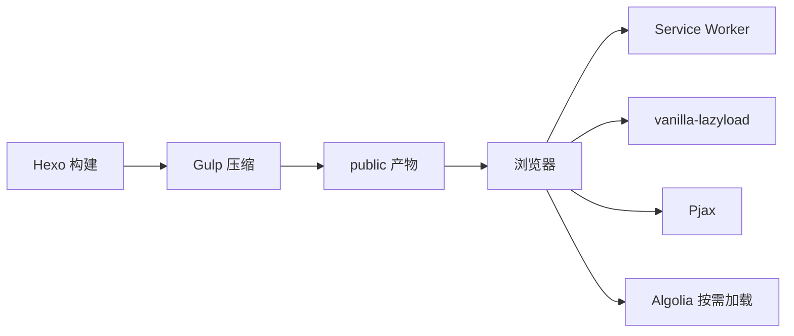

# 性能优化策略

<cite>
**本文引用的文件**   
- [README.md](file://README.md)
- [_config.yml](file://_config.yml)
- [_config.fomalhaut.yml](file://_config.fomalhaut.yml)
- [package.json](file://package.json)
- [gulpfile.js](file://gulpfile.js)
- [themes/fomalhaut/source/sw.js](file://themes/fomalhaut/source/sw.js)
- [source/js/inject/search-lazy.js](file://source/js/inject/search-lazy.js)
- [themes/fomalhaut/layout/includes/head.pug](file://themes/fomalhaut/layout/includes/head.pug)
- [themes/fomalhaut/layout/includes/head/preconnect.pug](file://themes/fomalhaut/layout/includes/head/preconnect.pug)
- [themes/fomalhaut/scripts/filters/post_lazyload.js](file://themes/fomalhaut/scripts/filters/post_lazyload.js)
- [scripts/swiper-lazyload-fix.js](file://scripts/swiper-lazyload-fix.js)
- [source/js/inject/webinfo-card.js](file://source/js/inject/webinfo-card.js)
- [source/personal/about/index.md](file://source/personal/about/index.md)
</cite>

## 目录
1. [引言](#引言)
2. [项目结构](#项目结构)
3. [核心组件](#核心组件)
4. [架构总览](#架构总览)
5. [详细组件分析](#详细组件分析)
6. [依赖关系分析](#依赖关系分析)
7. [性能考量](#性能考量)
8. [故障排查指南](#故障排查指南)
9. [结论](#结论)
10. [附录](#附录)

## 引言
本文件面向“性能优化策略”，围绕代码分割与按需加载、资源预加载、缓存策略、构建优化、性能监控与测试方法，结合仓库中实际实现进行系统化说明。目标是帮助读者在不深入源码的情况下理解站点如何减少首屏阻塞、降低带宽、提升交互流畅度，并给出可落地的改进建议。

## 项目结构
本项目基于 Hexo + Butterfly 主题二次开发，采用“站点配置与主题代码分离”的结构：站点级脚本与样式放在 `source/`，主题本体在 `themes/fomalhaut/`，构建产物经 Gulp 压缩后部署到多平台。关键路径包括：
- 站点配置：根 `_config.yml`、主题生效配置 `_config.fomalhaut.yml`
- 构建链：Hexo 生成 → Gulp 压缩 HTML/CSS/JS
- 前端运行时：Pjax、vanilla-lazyload、Algolia 搜索懒加载、Service Worker 分流与缓存
- 模板注入：head 预连接、PWA、第三方脚本注入点

图示来源
- [README.md:259-284](file://README.md#L259-L284)
- [package.json:10-16](file://package.json#L10-L16)
- [gulpfile.js:12-64](file://gulpfile.js#L12-L64)
- [themes/fomalhaut/source/sw.js:1-34](file://themes/fomalhaut/source/sw.js#L1-L34)

章节来源
- [README.md:259-284](file://README.md#L259-L284)
- [package.json:10-16](file://package.json#L10-L16)

## 核心组件
- 构建与压缩：Gulp 任务负责 JS 压缩、CSS 压缩（排除含容器查询的文件）、HTML 清理与压缩。
- 资源懒加载：主题过滤器将图片 src 替换为 data-lazy-src；站点脚本修复轮播与 pjax 场景下的懒加载失效。
- 搜索按需加载：Algolia 相关脚本通过空闲预取 + 点击兜底动态注入，避免首屏阻塞。
- Service Worker 分流与缓存：按域名白名单介入，文本资源短 TTL、媒体长 TTL，探测请求不写缓存。
- 预连接与字体加载：head 模板注入 preconnect，字体样式延迟加载。
- 页面内联数据与状态：归档页 JSON 数据、部署时间缓存等，减少重复请求。

章节来源
- [gulpfile.js:12-64](file://gulpfile.js#L12-L64)
- [themes/fomalhaut/scripts/filters/post_lazyload.js:1-30](file://themes/fomalhaut/scripts/filters/post_lazyload.js#L1-L30)
- [scripts/swiper-lazyload-fix.js:1-33](file://scripts/swiper-lazyload-fix.js#L1-L33)
- [source/js/inject/search-lazy.js:1-77](file://source/js/inject/search-lazy.js#L1-L77)
- [themes/fomalhaut/source/sw.js:1-34](file://themes/fomalhaut/source/sw.js#L1-L34)
- [themes/fomalhaut/layout/includes/head.pug:39-70](file://themes/fomalhaut/layout/includes/head.pug#L39-L70)

## 架构总览
下图展示从请求进入边缘网络到浏览器执行的关键流程，以及各性能优化点在链路中的位置。

图示来源
- [themes/fomalhaut/source/sw.js:153-220](file://themes/fomalhaut/source/sw.js#L153-L220)
- [source/js/inject/search-lazy.js:179-199](file://source/js/inject/search-lazy.js#L179-L199)
- [source/js/inject/search-lazy.js:470-506](file://source/js/inject/search-lazy.js#L470-L506)

## 详细组件分析

### 代码分割与按需加载
- 搜索模块按需加载
  - 默认主题会在每页阻塞加载 Algolia 相关脚本，影响首屏。站点通过 `search-lazy.js` 改为：
    - 空闲预取：页面 load 后用 `<link rel=prefetch>` 预取脚本，仅下载不执行。
    - 点击兜底：若用户提前点击，先打开面板再顺序注入脚本，保证体验一致。
    - 初始化兼容：接管已完成的 window.addEventListener('load')，确保脚本能正确初始化。
  - 效果：显著减少非首屏功能的解析与执行开销，避免阻塞主线程。

- 图片懒加载
  - 主题过滤器将 img 的 src 替换为 data-lazy-src，并由 vanilla-lazyload 在滚动进入视口时加载真图。
  - 站点脚本修复轮播与 pjax 场景下懒加载失效问题，确保换页或动态内容更新后仍正常加载。

- 模块依赖管理
  - 通过主题 inject.head/inject.bottom 与站点脚本组合，控制脚本加载时机与顺序。
  - 对第三方库（如 Algolia）提供本地兜底与失败回退，增强鲁棒性。

图示来源
- [source/js/inject/search-lazy.js:179-199](file://source/js/inject/search-lazy.js#L179-L199)
- [source/js/inject/search-lazy.js:470-506](file://source/js/inject/search-lazy.js#L470-L506)

章节来源
- [source/js/inject/search-lazy.js:1-77](file://source/js/inject/search-lazy.js#L1-L77)
- [source/js/inject/search-lazy.js:179-199](file://source/js/inject/search-lazy.js#L179-L199)
- [source/js/inject/search-lazy.js:470-506](file://source/js/inject/search-lazy.js#L470-L506)
- [themes/fomalhaut/scripts/filters/post_lazyload.js:1-30](file://themes/fomalhaut/scripts/filters/post_lazyload.js#L1-L30)
- [scripts/swiper-lazyload-fix.js:1-33](file://scripts/swiper-lazyload-fix.js#L1-L33)

### 资源预加载机制
- 关键资源预取
  - head 模板注入 preconnect，提前建立与常用 CDN/分析服务的 DNS 解析与 TCP 握手，缩短首次请求延迟。
  - 字体样式使用 media="print" + onload 延迟加载，避免阻塞首屏渲染。

- 字体预加载
  - 主题 README 提到正文字体补上游 preload，配合 CORS 模式获取，减少字体闪烁与阻塞。

- 图片预加载
  - 背景切换走 Image 对象预加载 + 超时取消，避免切换时出现空白。
  - 封面与壁纸列表在分类打开时才赋 src，减少无关请求。

章节来源
- [themes/fomalhaut/layout/includes/head.pug:39-70](file://themes/fomalhaut/layout/includes/head.pug#L39-L70)
- [themes/fomalhaut/layout/includes/head/preconnect.pug:1-22](file://themes/fomalhaut/layout/includes/head/preconnect.pug#L1-L22)
- [README.md:204-207](file://README.md#L204-L207)
- [README.md:90-94](file://README.md#L90-L94)

### 缓存策略优化
- 浏览器缓存
  - 构建产物通过 Gulp 压缩，文件名带版本戳（?v=），利于长期缓存。
  - webinfo-card 对部署时间接口强制 no-store，避免旧值污染。

- CDN 缓存
  - Service Worker 对目标域名白名单内的请求进行分流与缓存：
    - HTML 优先回源，保证内容最新；其余资源缓存优先，TTL 到期后台静默校正。
    - 文本资源 TTL 较短（10 分钟），媒体资源较长（24 小时）。
    - 探测请求（__pr=）不写入缓存，防止 CacheStorage 无限膨胀。

- Service Worker 缓存
  - 激活时清理旧版本残留缓存键，避免脏数据。
  - 通过 index.html 哈希检测站点版本变化，必要时清空资源缓存，避免长期吃旧代码。

图示来源
- [themes/fomalhaut/source/sw.js:153-220](file://themes/fomalhaut/source/sw.js#L153-L220)

章节来源
- [themes/fomalhaut/source/sw.js:1-34](file://themes/fomalhaut/source/sw.js#L1-L34)
- [themes/fomalhaut/source/sw.js:153-220](file://themes/fomalhaut/source/sw.js#L153-L220)
- [source/js/inject/webinfo-card.js:65-100](file://source/js/inject/webinfo-card.js#L65-L100)

### 构建优化技巧
- CSS 压缩
  - Gulp 使用 clean-css 压缩 CSS，但排除含 @container 的文件，避免兼容性导致规则丢失。
  - 这些文件交由 CDN Brotli 压缩，体积差异不大但更安全。

- JS 压缩
  - Gulp 使用 terser 压缩 public 目录下未 min 的 JS，确保生产环境体积最小化。

- HTML 压缩
  - 使用 htmlclean 清理标签，再用 htmlmin 移除注释、空白、布尔属性值等，同时压缩内联 JS/CSS/URL。

- 图片优化
  - 文档提及 Imagine 有损压缩 + imagesTool 转 WebP，字体子集化 + WOFF2 转换，减少传输体积。

章节来源
- [gulpfile.js:12-64](file://gulpfile.js#L12-L64)
- [README.md:233-238](file://README.md#L233-L238)

### 性能监控方法
- 加载时间分析
  - 使用灵雀监控与百度统计，站点脚本全部 defer，不进首屏关键路径。
  - 通过 Service Worker 的 X-SW-TIME 头记录入库时间，辅助定位缓存命中与刷新。

- 内存使用监控
  - 帧率监测仅在面板开启时启动，后台自动挂起，避免常驻循环占用内存。
  - 特效（雪花/萤火虫）在不可见时退出 rAF，恢复时再重建，降低后台消耗。

- 网络请求优化
  - 搜索模块按需加载，避免每页阻塞加载大体积脚本。
  - 图片懒加载与轮播修复，减少无效请求与重绘。

章节来源
- [source/personal/about/index.md:194-263](file://source/personal/about/index.md#L194-L263)
- [themes/fomalhaut/source/sw.js:105-112](file://themes/fomalhaut/source/sw.js#L105-L112)
- [README.md:209-219](file://README.md#L209-L219)

### 性能测试工具与基准测试方法
- 回归脚本
  - 使用 Node 自带的 node:test 编写回归脚本，覆盖光标效果、FPS 生命周期、滚动监听、Service Worker 缓存行为等。
  - 支持用环境变量指向基线做前后对比，便于评估改动影响。

- 基准测试建议
  - Lighthouse / PageSpeed Insights：评估首屏时间、可交互时间、累积布局偏移等指标。
  - Chrome DevTools Performance：录制关键路径，观察主线程阻塞、强制布局与重绘。
  - Network Panel：分析资源大小、缓存命中率、TTFB 与并发限制。
  - 自定义基准：针对搜索懒加载、图片懒加载、Service Worker 分流分别设计用例，比较优化前后的关键指标。

章节来源
- [README.md:605-626](file://README.md#L605-L626)

## 依赖关系分析
- 构建依赖
  - gulp、gulp-html-minifier-terser、gulp-clean-css、gulp-terser 等用于压缩与清理。
  - workbox-build 用于生成 Service Worker（仓库引用该依赖）。

- 运行时依赖
  - vanilla-lazyload 用于图片懒加载。
  - Pjax 用于无刷新路由与局部更新。
  - Algolia 搜索库按需加载，避免首屏阻塞。

图示来源
- [package.json:20-63](file://package.json#L20-L63)
- [gulpfile.js:12-64](file://gulpfile.js#L12-L64)
- [themes/fomalhaut/source/sw.js:153-220](file://themes/fomalhaut/source/sw.js#L153-L220)

章节来源
- [package.json:20-63](file://package.json#L20-L63)
- [gulpfile.js:12-64](file://gulpfile.js#L12-L64)

## 性能考量
- 首屏关键链优化
  - 预连接外部域名，减少 DNS/TCP 握手耗时。
  - 字体样式延迟加载，避免阻塞首屏。
  - 搜索等大体积脚本按需加载，减少解析与执行开销。

- 交互流畅度
  - 流式渲染合并 DOM 提交，减少强制布局。
  - 滚动事件 passive 处理，避免阻塞主线程。
  - 特效在不可见时退出动画循环，降低 CPU/GPU 压力。

- 缓存与一致性
  - 文本资源短 TTL，避免发版后长时间吃旧代码。
  - 探测请求不写缓存，防止 CacheStorage 膨胀。
  - 站点版本哈希驱动缓存失效，保证一致性。

[本节为通用指导，无需列出具体文件来源]

## 故障排查指南
- 搜索面板一直显示“正在加载”
  - 原因：老版本把提示节点插入 #algolia-hits，且依赖 data-search-lazy 属性判断，但 instantsearch 在无 query 时不渲染，导致清理分支无法进入。
  - 解决：提示由独立节点持有，库就绪时移除；失败时明确提示并可重试。

- 搜索结果链接跳到正式站
  - 原因：索引中的 url 是构建时写死的正式域，本地预览或镜像域名下会跳出本站。
  - 解决：MutationObserver 重写不同源链接为站内相对路径。

- Service Worker 缓存异常
  - 现象：探测请求无限写入缓存，导致缓存膨胀。
  - 解决：带 __pr= 的请求只做改写+回源，不落地缓存。

- CSS 容器查询被误删
  - 现象：clean-css 不认识 @container，导致规则丢失。
  - 解决：排除相关文件，交由 CDN Brotli 压缩。

章节来源
- [source/js/inject/search-lazy.js:35-55](file://source/js/inject/search-lazy.js#L35-L55)
- [source/js/inject/search-lazy.js:227-262](file://source/js/inject/search-lazy.js#L227-L262)
- [themes/fomalhaut/source/sw.js:166-181](file://themes/fomalhaut/source/sw.js#L166-L181)
- [gulpfile.js:20-38](file://gulpfile.js#L20-L38)

## 结论
本项目在代码分割、资源预加载、缓存策略与构建优化方面已有较完善的实践：搜索按需加载、图片懒加载、Service Worker 分流与 TTL 分层、Gulp 压缩与 HTML/CSS/JS 优化。建议在后续迭代中持续引入 Lighthouse 与性能基准测试，量化优化收益，并结合业务特性调整预加载与缓存策略，以平衡用户体验与资源成本。

[本节为总结性内容，无需列出具体文件来源]

## 附录
- 快速开始与构建命令参考 README 与 package.json scripts。
- 主题配置项位于 _config.fomalhaut.yml，站点配置位于 _config.yml。
- 如需扩展性能监控，可在 head 模板注入分析脚本，并确保 defer 加载。

章节来源
- [README.md:357-438](file://README.md#L357-L438)
- [package.json:10-16](file://package.json#L10-L16)
- [themes/fomalhaut/layout/includes/head.pug:39-70](file://themes/fomalhaut/layout/includes/head.pug#L39-L70)