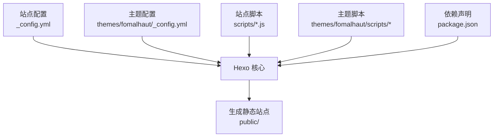
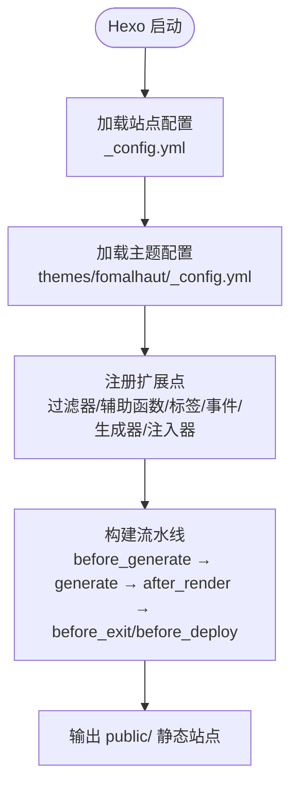
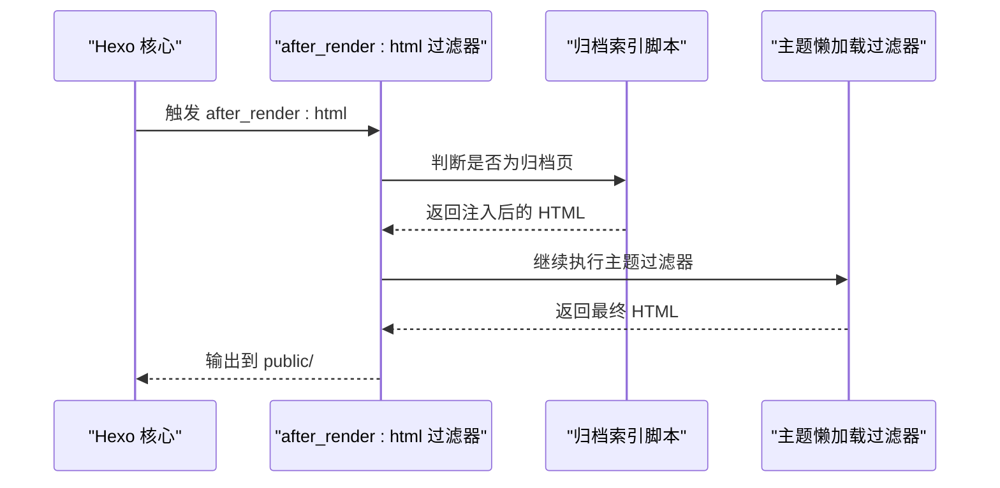
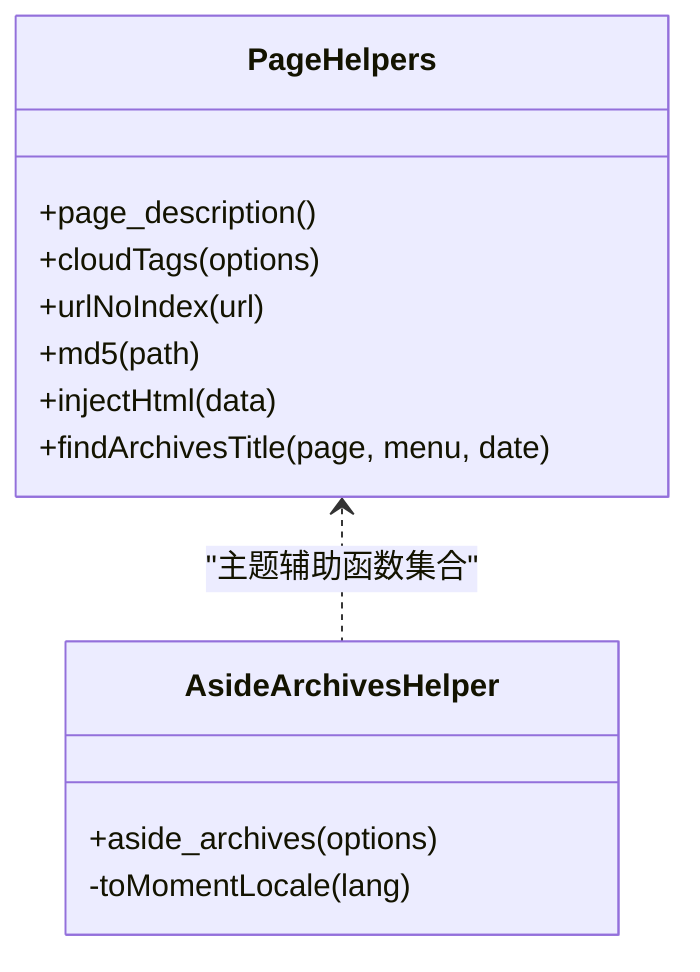
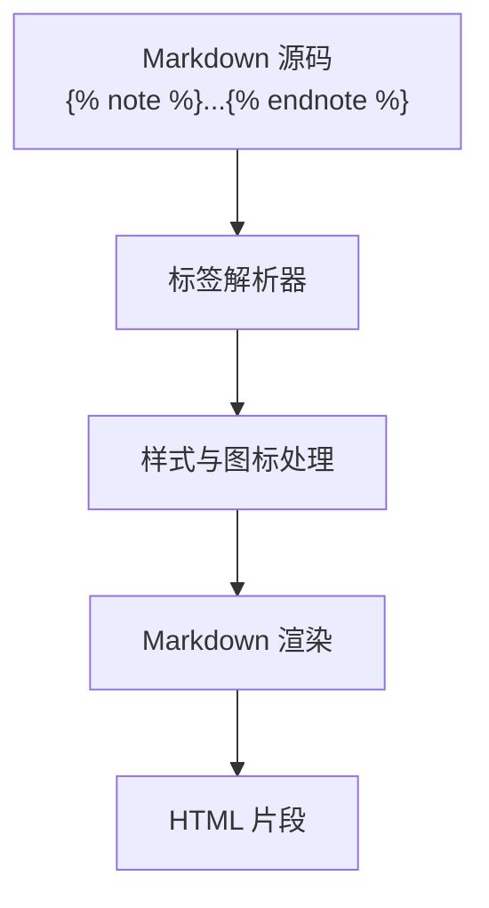
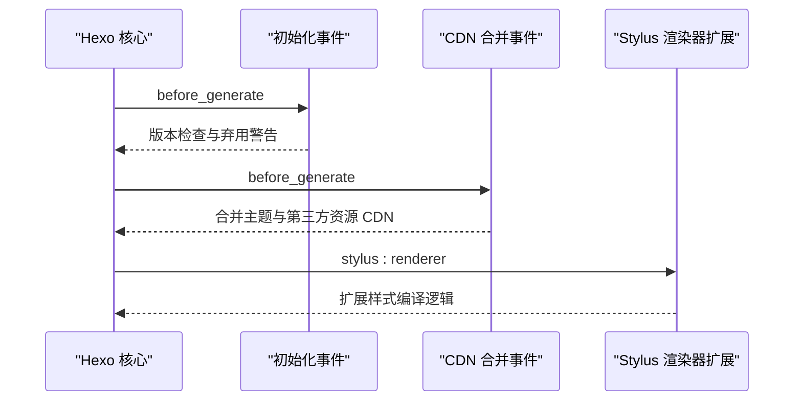
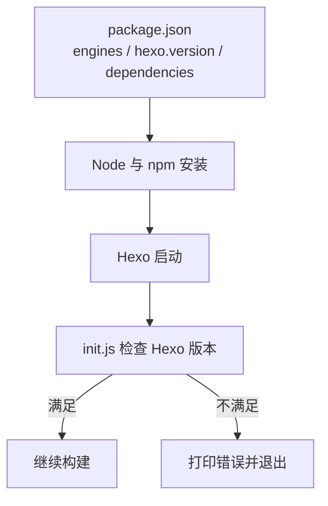
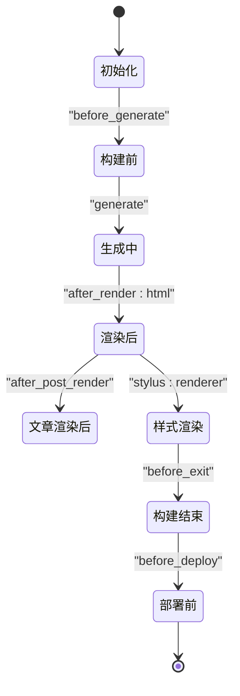
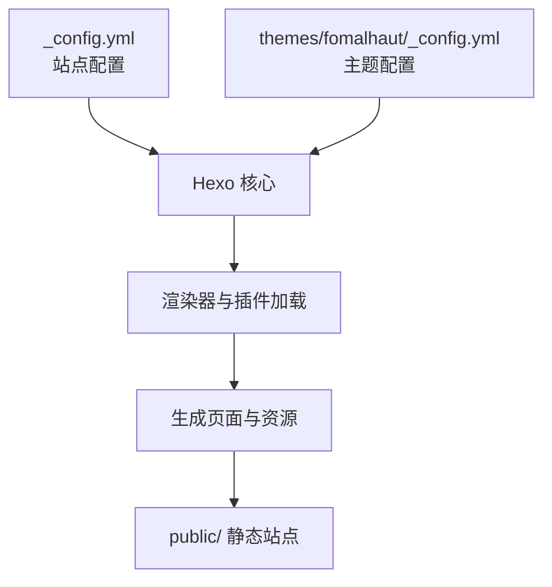

# Hexo 插件接口规范

<cite>
**本文引用的文件**   
- [站点配置 _config.yml](file://_config.yml)
- [主题配置 themes/fomalhaut/_config.yml](file://themes/fomalhaut/_config.yml)
- [项目依赖 package.json](file://package.json)
- [归档索引脚本 scripts/archive-index.js](file://scripts/archive-index.js)
- [主题初始化事件 themes/fomalhaut/scripts/events/init.js](file://themes/fomalhaut/scripts/events/init.js)
- [CDN 合并事件 themes/fomalhaut/scripts/events/cdn.js](file://themes/fomalhaut/scripts/events/cdn.js)
- [文章懒加载过滤器 themes/fomalhaut/scripts/filters/post_lazyload.js](file://themes/fomalhaut/scripts/filters/post_lazyload.js)
- [侧边栏归档辅助函数 themes/fomalhaut/scripts/helpers/aside_archives.js](file://themes/fomalhaut/scripts/helpers/aside_archives.js)
- [页面辅助函数 themes/fomalhaut/scripts/helpers/page.js](file://themes/fomalhaut/scripts/helpers/page.js)
- [笔记标签 themes/fomalhaut/scripts/tag/note.js](file://themes/fomalhaut/scripts/tag/note.js)
</cite>

## 目录
1. [引言](#引言)
2. [项目结构](#项目结构)
3. [核心扩展点与接口总览](#核心扩展点与接口总览)
4. [架构总览](#架构总览)
5. [详细组件分析](#详细组件分析)
6. [依赖与版本兼容性](#依赖与版本兼容性)
7. [插件生命周期与加载机制](#插件生命周期与加载机制)
8. [配置系统与环境变量](#配置系统与环境变量)
9. [接口使用示例与最佳实践](#接口使用示例与最佳实践)
10. [性能优化建议](#性能优化建议)
11. [故障排查指南](#故障排查指南)
12. [结论](#结论)

## 引言
本文面向 Hexo 主题与插件开发者，基于当前仓库中的实际实现，系统化梳理 Hexo 提供的扩展点接口，包括：
- 标签注册
- 过滤器
- 辅助函数
- 布局扩展
- 生成器与注入器
- 构建事件钩子

同时说明插件的生命周期、加载顺序、依赖管理、版本兼容策略，以及站点与主题的配置文件结构、环境变量和运行时参数。文末提供错误处理、性能优化与调试技巧等最佳实践。

## 项目结构
本仓库是一个基于 Butterfly 深度二次开发的 Hexo 主题与站点模板。与插件接口直接相关的代码主要分布在：
- 站点级脚本 `scripts/`：通过 Hexo 的过滤器、注入器等扩展点修改渲染结果或构建产物。
- 主题脚本 `themes/fomalhaut/scripts/`：按功能分层组织，包含事件、过滤器、辅助函数、标签等。
- 站点配置 `_config.yml`：定义站点元信息、URL、渲染器、插件列表、第三方服务配置等。
- 主题配置 `themes/fomalhaut/_config.yml`：定义主题 UI、评论、搜索、美化、标签外掛等主题级配置。
- 依赖声明 `package.json`：声明 Hexo 版本、渲染器、主题、插件及工具链。

**图表来源**
- [站点配置 _config.yml:1-319](file://_config.yml#L1-L319)
- [主题配置 themes/fomalhaut/_config.yml:1-800](file://themes/fomalhaut/_config.yml#L1-L800)
- [项目依赖 package.json:1-75](file://package.json#L1-L75)

**章节来源**
- [站点配置 _config.yml:1-319](file://_config.yml#L1-L319)
- [主题配置 themes/fomalhaut/_config.yml:1-800](file://themes/fomalhaut/_config.yml#L1-L800)
- [项目依赖 package.json:1-75](file://package.json#L1-L75)

## 核心扩展点与接口总览
Hexo 为插件与主题提供以下关键扩展点：
- 过滤器：在渲染前后对数据或 HTML 进行拦截与改写。
- 辅助函数：在模板中暴露可复用的函数。
- 标签：在 Markdown 中使用自定义标签语法。
- 事件：在构建流程的关键阶段执行逻辑。
- 生成器：注册新的页面生成逻辑。
- 注入器：向页面指定位置注入 HTML 片段。
- 渲染器扩展：如 Stylus 渲染器扩展。

这些扩展点在仓库中有大量实际用法，涵盖站点级与主题级两类场景。

**章节来源**
- [归档索引脚本 scripts/archive-index.js:104-137](file://scripts/archive-index.js#L104-L137)
- [主题初始化事件 themes/fomalhaut/scripts/events/init.js:3-21](file://themes/fomalhaut/scripts/events/init.js#L3-L21)
- [CDN 合并事件 themes/fomalhaut/scripts/events/cdn.js:11-95](file://themes/fomalhaut/scripts/events/cdn.js#L11-L95)
- [文章懒加载过滤器 themes/fomalhaut/scripts/filters/post_lazyload.js:16-29](file://themes/fomalhaut/scripts/filters/post_lazyload.js#L16-L29)
- [侧边栏归档辅助函数 themes/fomalhaut/scripts/helpers/aside_archives.js:8-99](file://themes/fomalhaut/scripts/helpers/aside_archives.js#L8-L99)
- [页面辅助函数 themes/fomalhaut/scripts/helpers/page.js:13-98](file://themes/fomalhaut/scripts/helpers/page.js#L13-L98)
- [笔记标签 themes/fomalhaut/scripts/tag/note.js:9-27](file://themes/fomalhaut/scripts/tag/note.js#L9-L27)

## 架构总览
从扩展点角度看，Hexo 插件与主题的职责边界如下：
- 站点脚本负责“跨主题”的通用能力，例如给归档页注入全站索引、修复第三方插件的链接、复制 API 文件等。
- 主题脚本负责“主题专属”的能力，例如 CDN 资源合并、懒加载、辅助函数、标签、事件校验等。
- 配置系统分为两层：站点配置控制全局行为与插件开关；主题配置控制界面与主题内行为。

**图表来源**
- [站点配置 _config.yml:128-131](file://_config.yml#L128-L131)
- [主题初始化事件 themes/fomalhaut/scripts/events/init.js:3-11](file://themes/fomalhaut/scripts/events/init.js#L3-L11)
- [CDN 合并事件 themes/fomalhaut/scripts/events/cdn.js:11-95](file://themes/fomalhaut/scripts/events/cdn.js#L11-L95)
- [文章懒加载过滤器 themes/fomalhaut/scripts/filters/post_lazyload.js:16-29](file://themes/fomalhaut/scripts/filters/post_lazyload.js#L16-L29)

## 详细组件分析

### 过滤器：HTML 与内容改写
过滤器是 Hexo 插件最常用的扩展点之一，用于在渲染前后对 HTML 或文章内容进行修改。仓库中典型用法包括：
- 归档页注入全站索引 JSON。
- 文章图片懒加载替换。
- 第三方插件注入与构建后处理。

**图表来源**
- [归档索引脚本 scripts/archive-index.js:104-137](file://scripts/archive-index.js#L104-L137)
- [文章懒加载过滤器 themes/fomalhaut/scripts/filters/post_lazyload.js:16-29](file://themes/fomalhaut/scripts/filters/post_lazyload.js#L16-L29)

**章节来源**
- [归档索引脚本 scripts/archive-index.js:104-137](file://scripts/archive-index.js#L104-L137)
- [文章懒加载过滤器 themes/fomalhaut/scripts/filters/post_lazyload.js:16-29](file://themes/fomalhaut/scripts/filters/post_lazyload.js#L16-L29)

### 辅助函数：模板复用与数据格式化
辅助函数在模板中被调用，常用于生成侧边栏、计算描述、生成 URL、注入 HTML 片段等。仓库中展示了两种风格：
- 主题专用辅助函数：如侧边栏归档列表、页面描述、云标签、MD5 缓存键等。
- 站点级辅助函数：通常由插件或主题统一注册，供模板复用。

**图表来源**
- [页面辅助函数 themes/fomalhaut/scripts/helpers/page.js:13-98](file://themes/fomalhaut/scripts/helpers/page.js#L13-L98)
- [侧边栏归档辅助函数 themes/fomalhaut/scripts/helpers/aside_archives.js:8-113](file://themes/fomalhaut/scripts/helpers/aside_archives.js#L8-L113)

**章节来源**
- [页面辅助函数 themes/fomalhaut/scripts/helpers/page.js:13-98](file://themes/fomalhaut/scripts/helpers/page.js#L13-L98)
- [侧边栏归档辅助函数 themes/fomalhaut/scripts/helpers/aside_archives.js:8-113](file://themes/fomalhaut/scripts/helpers/aside_archives.js#L8-L113)

### 标签：Markdown 自定义语法
标签允许在 Markdown 中使用类似 `...` 的语法，将内容渲染为带样式的区块。仓库中的笔记标签实现了：
- 支持多种样式模式。
- 支持图标前缀。
- 将内部内容再次用 Markdown 引擎渲染。

**图表来源**
- [笔记标签 themes/fomalhaut/scripts/tag/note.js:9-27](file://themes/fomalhaut/scripts/tag/note.js#L9-L27)

**章节来源**
- [笔记标签 themes/fomalhaut/scripts/tag/note.js:9-27](file://themes/fomalhaut/scripts/tag/note.js#L9-L27)

### 事件：构建流程钩子
事件钩子在构建流程的关键阶段执行，适合做环境检查、配置预处理、资源合并等。仓库中典型用法包括：
- 检查 Hexo 版本并阻止低版本运行。
- 在生成前合并 CDN 资源地址。
- 在 Stylus 渲染器中注入自定义逻辑。

**图表来源**
- [主题初始化事件 themes/fomalhaut/scripts/events/init.js:3-21](file://themes/fomalhaut/scripts/events/init.js#L3-L21)
- [CDN 合并事件 themes/fomalhaut/scripts/events/cdn.js:11-95](file://themes/fomalhaut/scripts/events/cdn.js#L11-L95)

**章节来源**
- [主题初始化事件 themes/fomalhaut/scripts/events/init.js:3-21](file://themes/fomalhaut/scripts/events/init.js#L3-L21)
- [CDN 合并事件 themes/fomalhaut/scripts/events/cdn.js:11-95](file://themes/fomalhaut/scripts/events/cdn.js#L11-L95)

### 生成器与注入器：页面与片段注入
除了过滤器与事件，Hexo 还支持：
- 生成器：注册新的页面生成逻辑，例如 404 页面。
- 注入器：向页面指定位置注入 HTML 片段，例如在 body 末尾注入脚本。

仓库中可见 404 生成器与多个注入器用法，体现主题与插件对页面结构的灵活扩展能力。

**章节来源**
- [主题初始化事件 themes/fomalhaut/scripts/events/404.js:8-8](file://themes/fomalhaut/scripts/events/404.js#L8-L8)
- [站点脚本 swiper-lazyload-fix.js:74-74](file://scripts/swiper-lazyload-fix.js#L74-L74)
- [站点脚本 wow-pjax-rehook.js:119-119](file://scripts/wow-pjax-rehook.js#L119-L119)

## 依赖与版本兼容性
依赖管理主要通过 `package.json` 声明，其中：
- `engines.node` 限定 Node 版本。
- `hexo.version` 声明期望的 Hexo 版本。
- 依赖项包含 Hexo 核心、渲染器、主题、插件与工具链。

此外，主题在初始化事件中显式检查 Hexo 主版本号，低于阈值时直接退出构建，避免不兼容行为。

**图表来源**
- [项目依赖 package.json:7-19](file://package.json#L7-L19)
- [主题初始化事件 themes/fomalhaut/scripts/events/init.js:3-11](file://themes/fomalhaut/scripts/events/init.js#L3-L11)

**章节来源**
- [项目依赖 package.json:1-75](file://package.json#L1-L75)
- [主题初始化事件 themes/fomalhaut/scripts/events/init.js:3-21](file://themes/fomalhaut/scripts/events/init.js#L3-L21)

## 插件生命周期与加载机制
Hexo 的插件与主题脚本在构建过程中按阶段执行，常见阶段包括：
- `before_generate`：生成前的预处理，适合配置校验、资源合并。
- `generate`：生成页面与资源。
- `after_render:html`：HTML 渲染完成后，适合注入脚本、替换内容。
- `after_post_render`：文章渲染完成后，适合处理文章内容。
- `stylus:renderer`：扩展样式编译过程。
- `before_exit` / `before_deploy`：构建结束或部署前，适合清理或修正产物。

仓库中的实际用法覆盖了上述大部分阶段，体现了插件在不同阶段的职责分工。

**图表来源**
- [主题初始化事件 themes/fomalhaut/scripts/events/init.js:3-11](file://themes/fomalhaut/scripts/events/init.js#L3-L11)
- [CDN 合并事件 themes/fomalhaut/scripts/events/cdn.js:11-11](file://themes/fomalhaut/scripts/events/cdn.js#L11-L11)
- [文章懒加载过滤器 themes/fomalhaut/scripts/filters/post_lazyload.js:16-29](file://themes/fomalhaut/scripts/filters/post_lazyload.js#L16-L29)
- [主题初始化事件 themes/fomalhaut/scripts/events/stylus.js:7-7](file://themes/fomalhaut/scripts/events/stylus.js#L7-L7)
- [站点脚本 magnet-local-links.js:122-123](file://scripts/magnet-local-links.js#L122-L123)

**章节来源**
- [主题初始化事件 themes/fomalhaut/scripts/events/init.js:3-21](file://themes/fomalhaut/scripts/events/init.js#L3-L21)
- [CDN 合并事件 themes/fomalhaut/scripts/events/cdn.js:11-95](file://themes/fomalhaut/scripts/events/cdn.js#L11-L95)
- [文章懒加载过滤器 themes/fomalhaut/scripts/filters/post_lazyload.js:16-29](file://themes/fomalhaut/scripts/filters/post_lazyload.js#L16-L29)

## 配置系统与环境变量
Hexo 的配置系统分为站点配置与主题配置两层：
- 站点配置 `_config.yml`：控制站点元信息、URL、渲染器、插件、第三方服务等。
- 主题配置 `themes/fomalhaut/_config.yml`：控制主题 UI、评论、搜索、美化、标签外掛等。

此外，仓库还通过 `skip_render` 控制某些文件不被 Nunjucks 渲染，直接原样复制到 `public/`，适用于第三方库或前端本体。

**图表来源**
- [站点配置 _config.yml:1-319](file://_config.yml#L1-L319)
- [主题配置 themes/fomalhaut/_config.yml:1-800](file://themes/fomalhaut/_config.yml#L1-L800)

**章节来源**
- [站点配置 _config.yml:1-319](file://_config.yml#L1-L319)
- [主题配置 themes/fomalhaut/_config.yml:1-800](file://themes/fomalhaut/_config.yml#L1-L800)

## 接口使用示例与最佳实践

### 标签注册
- 使用 `hexo.extend.tag.register` 注册自定义标签。
- 支持结束标签与内容渲染。
- 推荐在标签内部使用 `hexo.render.renderSync` 渲染 Markdown 内容。

参考路径：
- [笔记标签 themes/fomalhaut/scripts/tag/note.js:9-27](file://themes/fomalhaut/scripts/tag/note.js#L9-L27)

### 过滤器使用
- 使用 `hexo.extend.filter.register` 注册过滤器。
- 根据需求选择合适的事件钩子，如 `after_render:html`、`after_post_render`、`before_generate`。
- 注意过滤器的优先级与执行顺序，避免重复处理。

参考路径：
- [归档索引脚本 scripts/archive-index.js:104-137](file://scripts/archive-index.js#L104-L137)
- [文章懒加载过滤器 themes/fomalhaut/scripts/filters/post_lazyload.js:16-29](file://themes/fomalhaut/scripts/filters/post_lazyload.js#L16-L29)

### 辅助函数
- 使用 `hexo.extend.helper.register` 注册辅助函数。
- 在模板中通过 `this.config`、`this.page`、`this.site` 访问上下文。
- 推荐封装常用逻辑，提升模板可读性与复用性。

参考路径：
- [侧边栏归档辅助函数 themes/fomalhaut/scripts/helpers/aside_archives.js:8-99](file://themes/fomalhaut/scripts/helpers/aside_archives.js#L8-L99)
- [页面辅助函数 themes/fomalhaut/scripts/helpers/page.js:13-98](file://themes/fomalhaut/scripts/helpers/page.js#L13-L98)

### 事件钩子
- 使用 `hexo.extend.filter.register` 注册构建事件。
- 在 `before_generate` 中进行配置校验与资源准备。
- 在 `stylus:renderer` 中扩展样式编译逻辑。

参考路径：
- [主题初始化事件 themes/fomalhaut/scripts/events/init.js:3-21](file://themes/fomalhaut/scripts/events/init.js#L3-L21)
- [CDN 合并事件 themes/fomalhaut/scripts/events/cdn.js:11-95](file://themes/fomalhaut/scripts/events/cdn.js#L11-L95)

### 生成器与注入器
- 使用 `hexo.extend.generator.register` 注册新页面。
- 使用 `hexo.extend.injector.register` 向页面注入 HTML 片段。
- 注意注入位置与 pjax 换页兼容性。

参考路径：
- [主题初始化事件 themes/fomalhaut/scripts/events/404.js:8-8](file://themes/fomalhaut/scripts/events/404.js#L8-L8)
- [站点脚本 swiper-lazyload-fix.js:74-74](file://scripts/swiper-lazyload-fix.js#L74-L74)
- [站点脚本 wow-pjax-rehook.js:119-119](file://scripts/wow-pjax-rehook.js#L119-L119)

**章节来源**
- [笔记标签 themes/fomalhaut/scripts/tag/note.js:9-27](file://themes/fomalhaut/scripts/tag/note.js#L9-L27)
- [归档索引脚本 scripts/archive-index.js:104-137](file://scripts/archive-index.js#L104-L137)
- [文章懒加载过滤器 themes/fomalhaut/scripts/filters/post_lazyload.js:16-29](file://themes/fomalhaut/scripts/filters/post_lazyload.js#L16-L29)
- [侧边栏归档辅助函数 themes/fomalhaut/scripts/helpers/aside_archives.js:8-99](file://themes/fomalhaut/scripts/helpers/aside_archives.js#L8-L99)
- [页面辅助函数 themes/fomalhaut/scripts/helpers/page.js:13-98](file://themes/fomalhaut/scripts/helpers/page.js#L13-L98)
- [主题初始化事件 themes/fomalhaut/scripts/events/init.js:3-21](file://themes/fomalhaut/scripts/events/init.js#L3-L21)
- [CDN 合并事件 themes/fomalhaut/scripts/events/cdn.js:11-95](file://themes/fomalhaut/scripts/events/cdn.js#L11-L95)
- [主题初始化事件 themes/fomalhaut/scripts/events/404.js:8-8](file://themes/fomalhaut/scripts/events/404.js#L8-L8)
- [站点脚本 swiper-lazyload-fix.js:74-74](file://scripts/swiper-lazyload-fix.js#L74-L74)
- [站点脚本 wow-pjax-rehook.js:119-119](file://scripts/wow-pjax-rehook.js#L119-L119)

## 性能优化建议
- 合理使用过滤器优先级，避免重复处理 HTML 或文章内容。
- 在 `after_render:html` 中仅做必要注入，避免大段字符串拼接。
- 使用 `skip_render` 跳过不需要渲染的静态资源，减少构建开销。
- 在 `before_generate` 中预计算资源地址，减少模板层计算。
- 谨慎使用随机颜色或复杂 DOM 操作，避免影响渲染性能。

[本节为通用指导，不直接分析具体文件]

## 故障排查指南
常见问题与定位方法：
- 构建失败且提示 Hexo 版本过低：检查 `init.js` 的版本校验逻辑与 `package.json` 的 `hexo.version`。
- 归档页统计异常：检查 `archive-index.js` 是否成功注入 `#ar-index`，确认 pjax 换页能读取该节点。
- 图片懒加载无效：检查主题配置的 `lazyload.enable` 与 `field`，确认过滤器是否正确执行。
- 第三方插件注入失效：检查注入器注册的节点名称与位置，确认与主题模板匹配。
- 样式未生效：检查 `stylus:renderer` 扩展是否被正确注册，确认样式路径与变量。

参考路径：
- [主题初始化事件 themes/fomalhaut/scripts/events/init.js:3-21](file://themes/fomalhaut/scripts/events/init.js#L3-L21)
- [归档索引脚本 scripts/archive-index.js:104-137](file://scripts/archive-index.js#L104-L137)
- [文章懒加载过滤器 themes/fomalhaut/scripts/filters/post_lazyload.js:16-29](file://themes/fomalhaut/scripts/filters/post_lazyload.js#L16-L29)

**章节来源**
- [主题初始化事件 themes/fomalhaut/scripts/events/init.js:3-21](file://themes/fomalhaut/scripts/events/init.js#L3-L21)
- [归档索引脚本 scripts/archive-index.js:104-137](file://scripts/archive-index.js#L104-L137)
- [文章懒加载过滤器 themes/fomalhaut/scripts/filters/post_lazyload.js:16-29](file://themes/fomalhaut/scripts/filters/post_lazyload.js#L16-L29)

## 结论
本仓库展示了 Hexo 插件与主题在实际项目中的完整用法，覆盖标签、过滤器、辅助函数、事件、生成器与注入器等核心扩展点。通过站点级与主题级脚本的分层设计，既能保证通用能力的稳定性，又能保持主题的可定制性。建议在开发插件时：
- 明确扩展点的职责边界，避免重复处理。
- 使用配置系统控制功能开关，提高可维护性。
- 关注版本兼容性与构建性能，提供降级方案。
- 结合 pjax 与注入器，确保动态页面的体验一致性。

[本节为总结性内容，不直接分析具体文件]