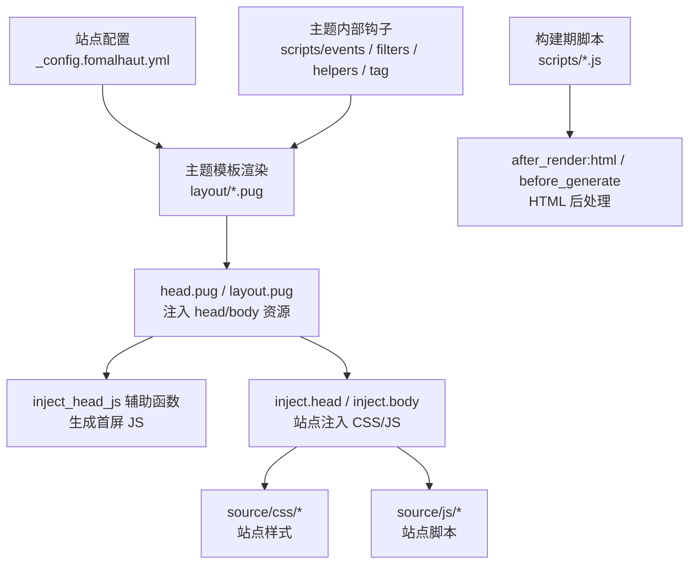
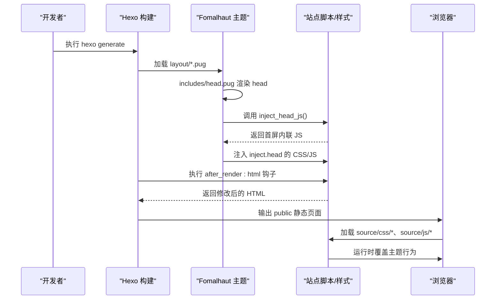
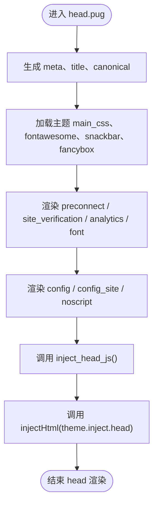
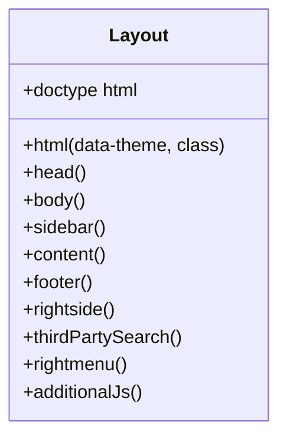
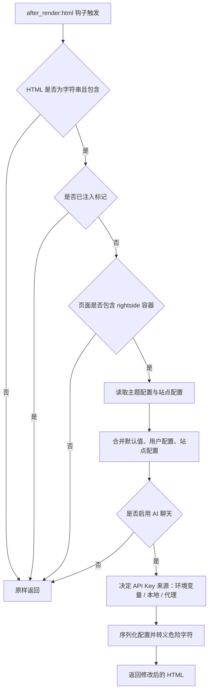
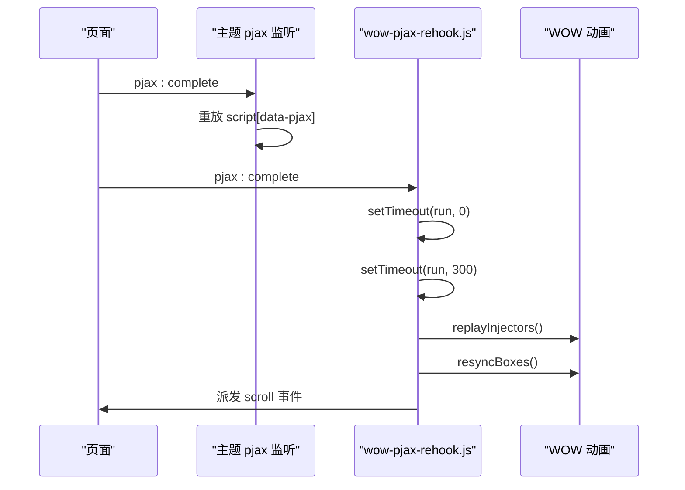
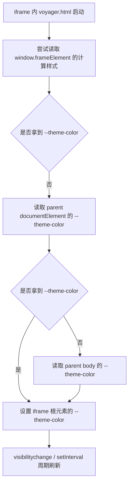
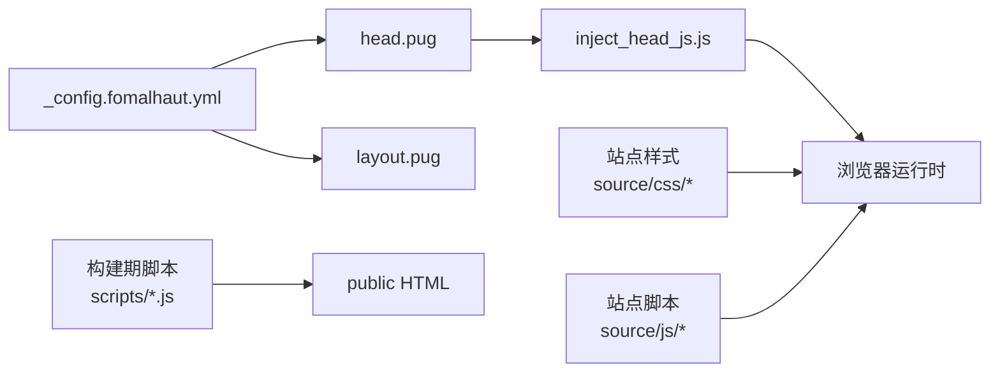

# 主题扩展点

<cite>
**本文引用的文件**   
- [themes/fomalhaut/README.md](file://themes/fomalhaut/README.md)
- [themes/fomalhaut/_config.yml](file://themes/fomalhaut/_config.yml)
- [_config.fomalhaut.yml](file://_config.fomalhaut.yml)
- [themes/fomalhaut/layout/includes/head.pug](file://themes/fomalhaut/layout/includes/head.pug)
- [themes/fomalhaut/layout/includes/layout.pug](file://themes/fomalhaut/layout/includes/layout.pug)
- [themes/fomalhaut/scripts/helpers/inject_head_js.js](file://themes/fomalhaut/scripts/helpers/inject_head_js.js)
- [themes/fomalhaut/scripts/events/init.js](file://themes/fomalhaut/scripts/events/init.js)
- [scripts/wow-pjax-rehook.js](file://scripts/wow-pjax-rehook.js)
- [scripts/ai-chat-inject.js](file://scripts/ai-chat-inject.js)
- [source/css/mobile-drawer.css](file://source/css/mobile-drawer.css)
- [themes/fomalhaut/source/css/_custom/custom.css](file://themes/fomalhaut/source/css/_custom/custom.css)
- [source/js/aside-calendar.js](file://source/js/aside-calendar.js)
- [source/js/inject/daynight-boot.js](file://source/js/inject/daynight-boot.js)
- [source/js/inject/scroll-gap-fix.js](file://source/js/inject/scroll-gap-fix.js)
- [source/box/astronomy/voyager.html](file://source/box/astronomy/voyager.html)
- [README.md](file://README.md)
</cite>

## 目录
1. [引言](#引言)
2. [项目结构](#项目结构)
3. [核心扩展机制](#核心扩展机制)
4. [架构总览](#架构总览)
5. [详细组件分析](#详细组件分析)
6. [依赖关系分析](#依赖关系分析)
7. [性能与升级安全](#性能与升级安全)
8. [常见问题排查](#常见问题排查)
9. [结论](#结论)

## 引言
本指南面向希望在不直接修改主题源码的前提下，对 Fomalhaut 主题进行布局覆盖、样式注入、脚本加载、钩子扩展和事件回调的开发者。仓库采用“主题代码”和“站点改动”分离的设计：主题位于 `themes/fomalhaut/`，站点定制集中在根目录 `_config.fomalhaut.yml`、`source/css/`、`source/js/` 以及 `scripts/` 下的构建期脚本。这样在升级主题时，只需替换 `themes/fomalhaut/`，站点侧的自定义通常无需回抄。

## 项目结构
Fomalhaut 主题基于 Hexo + Butterfly，提供 Pug 模板、Stylus 样式、构建期事件、过滤器、助手和标签插件；站点侧通过配置注入 CSS/JS，并通过 `source/css/_custom/custom.css` 做最终样式覆盖。

**图表来源**
- [themes/fomalhaut/layout/includes/head.pug:49-77](file://themes/fomalhaut/layout/includes/head.pug#L49-L77)
- [themes/fomalhaut/layout/includes/layout.pug:47-127](file://themes/fomalhaut/layout/includes/layout.pug#L47-L127)
- [themes/fomalhaut/scripts/helpers/inject_head_js.js:8-150](file://themes/fomalhaut/scripts/helpers/inject_head_js.js#L8-L150)
- [_config.fomalhaut.yml:1200-1374](file://_config.fomalhaut.yml#L1200-L1374)
- [scripts/ai-chat-inject.js:71-97](file://scripts/ai-chat-inject.js#L71-L97)

**章节来源**
- [themes/fomalhaut/README.md:7-20](file://themes/fomalhaut/README.md#L7-L20)
- [themes/fomalhaut/README.md:33-36](file://themes/fomalhaut/README.md#L33-L36)
- [README.md:249-252](file://README.md#L249-L252)

## 核心扩展机制
主题扩展主要围绕以下四类能力：

| 扩展类型 | 作用 | 推荐位置 | 升级安全性 |
|---|---|---|---|
| 布局覆盖 | 替换或增强页面骨架与组件 | 优先用站点 HTML/CSS/JS 注入；必要时复制 Pug 到站点覆盖层（若框架支持） | 高（不碰主题 layout） |
| 样式注入 | 追加或覆盖主题样式 | `_config.fomalhaut.yml` 的 `inject.head` / `inject.bottom`，以及 `source/css/site-inject.css`、`source/css/_custom/custom.css` | 高 |
| 脚本加载 | 引入站点脚本、第三方库、运行时代码 | `_config.fomalhaut.yml` 的 `inject.head` / `inject.bottom` | 高 |
| 钩子与事件 | 构建期 HTML 后处理、CDN 预解析、评论初始化等 | `scripts/*.js` 使用 `hexo.extend.filter.register`；主题内部使用 `events` / `filters` / `helpers` / `tag` | 中（主题内部钩子可能随版本变化） |

### 布局覆盖
- 主题模板位于 `themes/fomalhaut/layout/`，包括 `index.pug`、`post.pug`、`page.pug`、`archive.pug`、`category.pug`、`tag.pug` 及 `includes/` 组件。
- 站点侧应尽量避免直接改这些 Pug 文件；优先通过 `inject.head` / `inject.bottom` 插入 DOM 节点、CSS 和 JS，再在 `source/js/` 中操作已渲染的 DOM。
- 当必须调整模板顺序或结构时，仓库示例显示：在开发服务器下，主题 `layout` 中的 Pug 改动不会立即生效，而 `source/` 下的 CSS/JS 会快速生效。因此，“顺序调整”“运行时挂载点”更适合放在站点侧脚本里完成。

**章节来源**
- [themes/fomalhaut/README.md:12-18](file://themes/fomalhaut/README.md#L12-L18)
- [source/js/aside-calendar.js:546-552](file://source/js/aside-calendar.js#L546-L552)

### 样式注入
站点样式注入有两种主流方式：

1. **配置注入**  
   在 `_config.fomalhaut.yml` 的 `inject.head` 或 `inject.bottom` 中添加 `<link>` 或 `<script>`。例如导航磨砂、手机端抽屉菜单、关于页样式、归档页样式等都通过这种方式引入独立 CSS/JS，且带版本号避免缓存问题。

2. **主题样式覆盖**  
   - `themes/fomalhaut/source/css/_custom/custom.css` 是主题样式之后的最后一道覆盖层，由主题 Stylus 编译进主 CSS。适合写“对主题样式的覆盖”，并遵循明暗模式前缀、变量派生、块注释地图等约定。
   - `source/css/site-inject.css` 是站点级注入样式，按配置注入顺序层叠，适合放站点功能样式。

**章节来源**
- [_config.fomalhaut.yml:1200-1374](file://_config.fomalhaut.yml#L1200-L1374)
- [themes/fomalhaut/source/css/_custom/custom.css:1-16](file://themes/fomalhaut/source/css/_custom/custom.css#L1-L16)
- [source/css/mobile-drawer.css:1-33](file://source/css/mobile-drawer.css#L1-L33)

### 脚本加载
脚本加载同样通过 `_config.fomalhaut.yml` 的 `inject.head` / `inject.bottom` 管理：

- `inject.head` 常用于首屏关键脚本，如日夜模式预置、打字机覆盖、美化模块启动脚本等。
- `inject.bottom` 用于非阻塞脚本，如统计、图标字体、站点模块、搜索懒加载、锚点滚动补偿等。
- 主题还通过 `inject_head_js` 辅助函数向 `<head>` 注入一段内联 JS，负责本地存储、动态脚本加载、深色模式切换逻辑、侧边栏状态检测等。

**章节来源**
- [_config.fomalhaut.yml:1200-1374](file://_config.fomalhaut.yml#L1200-L1374)
- [themes/fomalhaut/scripts/helpers/inject_head_js.js:8-150](file://themes/fomalhaut/scripts/helpers/inject_head_js.js#L8-L150)

### 钩子与事件系统
Hexo 扩展点在本仓库中被广泛使用：

| 钩子类型 | 用途 | 典型文件 |
|---|---|---|
| `before_generate` | 构建前校验环境、弃用配置检查 | `themes/fomalhaut/scripts/events/init.js` |
| `stylus:renderer` | 主题 Stylus 编译阶段扩展 | `themes/fomalhaut/scripts/events/stylus.js` |
| `after_render:html` | 生成 HTML 后全局替换，如 AI 助手注入、归档索引、磁力链接本地化 | `scripts/ai-chat-inject.js`、`scripts/archive-index.js`、`scripts/magnet-local-links.js` |
| `after_post_render` / `before_post_render` | 文章渲染前后处理，如图片懒加载、随机封面 | `themes/fomalhaut/scripts/filters/post_lazyload.js`、`themes/fomalhaut/scripts/filters/random_cover.js` |
| `after_generate` / `before_exit` / `before_deploy` | 构建完成后拷贝、清理、部署前处理 | `scripts/vercel-api-copy.js`、`scripts/magnet-local-links.js` |
| `body_end` 注入器 | 向 `<body>` 末尾注入脚本片段 | `scripts/wow-pjax-rehook.js`、`scripts/swiper-lazyload-fix.js` |

此外，主题内部还提供：

- **事件**：`scripts/events/` 下的初始化、CDN、评论、欢迎语等。
- **过滤器**：`scripts/filters/` 下的文章级处理。
- **助手**：`scripts/helpers/` 下的模板辅助函数，如归档、分类、ECharts、`inject_head_js`。
- **标签**：`scripts/tag/` 下的 Markdown 标签插件，如 `note`、`tabs`、`timeline`、`gallery`、`mermaid` 等。

**章节来源**
- [themes/fomalhaut/scripts/events/init.js:1-22](file://themes/fomalhaut/scripts/events/init.js#L1-L22)
- [scripts/ai-chat-inject.js:71-97](file://scripts/ai-chat-inject.js#L71-L97)
- [scripts/wow-pjax-rehook.js:107-119](file://scripts/wow-pjax-rehook.js#L107-L119)
- [themes/fomalhaut/scripts/filters/post_lazyload.js:16-23](file://themes/fomalhaut/scripts/filters/post_lazyload.js#L16-L23)
- [themes/fomalhaut/scripts/filters/random_cover.js:8-8](file://themes/fomalhaut/scripts/filters/random_cover.js#L8-L8)

## 架构总览
下图展示一次页面构建与渲染过程中，主题扩展点如何协作：

**图表来源**
- [themes/fomalhaut/layout/includes/head.pug:49-77](file://themes/fomalhaut/layout/includes/head.pug#L49-L77)
- [themes/fomalhaut/scripts/helpers/inject_head_js.js:8-150](file://themes/fomalhaut/scripts/helpers/inject_head_js.js#L8-L150)
- [scripts/ai-chat-inject.js:71-97](file://scripts/ai-chat-inject.js#L71-L97)
- [_config.fomalhaut.yml:1200-1374](file://_config.fomalhaut.yml#L1200-L1374)

## 详细组件分析

### 头部注入与首屏脚本
`head.pug` 负责渲染页面的 `<head>`，包括标题、元信息、主题主 CSS、字体、PWA、验证、分析、全局配置等，并在最后调用 `inject_head_js()` 和 `injectHtml(theme.inject.head)`。

关键点：
- 主题主样式通过 `theme.asset.main_css` 引入。
- 主题通过 `fragment_cache('injectHeadJs', ...)` 缓存首屏内联 JS。
- 站点可通过 `theme.inject.head` 注入额外 HTML，仓库中 `_config.fomalhaut.yml` 的 `inject.head` 就是用来注入站点 CSS/JS 的主要入口。

**图表来源**
- [themes/fomalhaut/layout/includes/head.pug:22-77](file://themes/fomalhaut/layout/includes/head.pug#L22-L77)
- [themes/fomalhaut/scripts/helpers/inject_head_js.js:8-150](file://themes/fomalhaut/scripts/helpers/inject_head_js.js#L8-L150)

**章节来源**
- [themes/fomalhaut/layout/includes/head.pug:22-77](file://themes/fomalhaut/layout/includes/head.pug#L22-L77)
- [themes/fomalhaut/scripts/helpers/inject_head_js.js:8-150](file://themes/fomalhaut/scripts/helpers/inject_head_js.js#L8-L150)

### 页面骨架与内容区域
`layout.pug` 定义整个 HTML 骨架，包括 `html` 根元素、`head`、`body`、侧边栏、主体内容、页脚、右侧工具栏、第三方搜索、右键菜单等。它还负责 Service Worker 注册、背景图、侧边栏显隐、页面类型判断等。

关键点：
- `data-theme` 来自 `theme.display_mode`，配合 `inject_head_js` 生成的深色模式逻辑。
- 内容区域通过 `block content` 或 `body` 渲染具体页面。
- 非 404 页面会包含 header、main、footer；404 页面走独立模板。

**图表来源**
- [themes/fomalhaut/layout/includes/layout.pug:7-127](file://themes/fomalhaut/layout/includes/layout.pug#L7-L127)

**章节来源**
- [themes/fomalhaut/layout/includes/layout.pug:7-127](file://themes/fomalhaut/layout/includes/layout.pug#L7-L127)

### 构建期 HTML 后处理钩子
站点脚本通过 `hexo.extend.filter.register('after_render:html', ...)` 在 HTML 生成后修改输出。例如 AI 助手注入脚本会根据页面是否包含右侧部件、是否启用 AI 聊天、API Key 来源等条件，把配置对象注入到页面中。

**图表来源**
- [scripts/ai-chat-inject.js:71-97](file://scripts/ai-chat-inject.js#L71-L97)

**章节来源**
- [scripts/ai-chat-inject.js:71-97](file://scripts/ai-chat-inject.js#L71-L97)

### Pjax 生命周期重绑定
站点脚本通过 `hexo.extend.injector.register('body_end', ...)` 向 `<body>` 末尾注入脚本片段，并在 `pjax:complete` 事件中重新绑定动画或交互逻辑。例如 WOW 动画的重绑脚本会在主题 pjax 换页后延迟执行，确保主题先重放 `script[data-pjax]`，再补一次滚动轮询。

**图表来源**
- [scripts/wow-pjax-rehook.js:107-119](file://scripts/wow-pjax-rehook.js#L107-L119)

**章节来源**
- [scripts/wow-pjax-rehook.js:88-119](file://scripts/wow-pjax-rehook.js#L88-L119)

### 样式覆盖与命名约定
`themes/fomalhaut/source/css/_custom/custom.css` 明确说明其定位：它是主题样式之后的最后一道覆盖层，由 Stylus 编译进主 CSS，因此修改后需要重新生成站点。文件中强调：

- 能用 `_config.fomalhaut.yml` 开关解决的，优先走配置。
- 新增样式要加块注释和小节标题，并在文件目录中补一行。
- 明暗两套用 `[data-theme="light"]` / `[data-theme="dark"]` 前缀。
- `!important` 只在压不过主题内联样式、Element UI 或运行时 JS 写入时使用。

站点侧的 `source/css/mobile-drawer.css` 也体现了同样的理念：新增独立样式表，不改主题源码，通过 `_config.fomalhaut.yml` 的 `inject.head` 引入，并保留回滚说明。

**章节来源**
- [themes/fomalhaut/source/css/_custom/custom.css:1-16](file://themes/fomalhaut/source/css/_custom/custom.css#L1-L16)
- [source/css/mobile-drawer.css:1-33](file://source/css/mobile-drawer.css#L1-L33)

### 运行时主题色与跨上下文同步
站点脚本通过 CSS 变量 `--theme-color` 统一主题色，iframe 内的外部页面也会尝试从父文档读取该变量并同步到自身根元素。例如 `voyager.html` 会读取 `window.parent.document.documentElement` 或 `body` 上的 `--theme-color`，并在可见性变化、定时轮询时刷新。

**图表来源**
- [source/box/astronomy/voyager.html:1173-1194](file://source/box/astronomy/voyager.html#L1173-L1194)

**章节来源**
- [source/box/astronomy/voyager.html:1173-1194](file://source/box/astronomy/voyager.html#L1173-L1194)

## 依赖关系分析
主题扩展点的依赖关系可以概括为：

- 主题模板依赖配置：`head.pug`、`layout.pug` 读取 `theme.*` 和 `config.*`。
- 主题辅助函数被模板调用：`inject_head_js` 被 `head.pug` 调用。
- 站点配置驱动注入：`_config.fomalhaut.yml` 的 `inject.head` / `inject.bottom` 决定页面实际加载的资源。
- 构建期脚本影响最终 HTML：`after_render:html`、`before_generate`、`after_generate` 等钩子可改写 HTML 或预处理数据。
- 站点脚本依赖主题 DOM 结构：多数站点脚本以主题渲染出的类名、ID 为选择器基础，如 `#nav`、`#sidebar-menus`、`#article-container`、`#rightside`。

**图表来源**
- [_config.fomalhaut.yml:1200-1374](file://_config.fomalhaut.yml#L1200-L1374)
- [themes/fomalhaut/layout/includes/head.pug:49-77](file://themes/fomalhaut/layout/includes/head.pug#L49-L77)
- [themes/fomalhaut/scripts/helpers/inject_head_js.js:8-150](file://themes/fomalhaut/scripts/helpers/inject_head_js.js#L8-L150)
- [scripts/ai-chat-inject.js:71-97](file://scripts/ai-chat-inject.js#L71-L97)

**章节来源**
- [themes/fomalhaut/layout/includes/head.pug:49-77](file://themes/fomalhaut/layout/includes/head.pug#L49-L77)
- [themes/fomalhaut/scripts/helpers/inject_head_js.js:8-150](file://themes/fomalhaut/scripts/helpers/inject_head_js.js#L8-L150)
- [_config.fomalhaut.yml:1200-1374](file://_config.fomalhaut.yml#L1200-L1374)
- [scripts/ai-chat-inject.js:71-97](file://scripts/ai-chat-inject.js#L71-L97)

## 性能与升级安全
### 升级安全原则
- **不要直接改主题源码**：仓库 README 明确指出，主题本体是整套站点的一部分，安装方式是克隆整个仓库；主题默认配置会被站点根目录的 `_config.fomalhaut.yml` 覆盖。
- **优先使用配置注入**：样式和脚本尽量通过 `_config.fomalhaut.yml` 的 `inject.head` / `inject.bottom` 引入独立文件，而不是往主题模板里硬塞代码。
- **使用站点覆盖层**：主题样式覆盖放在 `themes/fomalhaut/source/css/_custom/custom.css`，站点功能样式放在 `source/css/site-inject.css` 或其他独立 CSS。
- **保持文件名与版本号一致**：注入的 CSS/JS 建议带 `?v=` 版本号，避免浏览器缓存旧资源。

**章节来源**
- [themes/fomalhaut/README.md:22-36](file://themes/fomalhaut/README.md#L22-L36)
- [README.md:249-252](file://README.md#L249-L252)
- [_config.fomalhaut.yml:1222-1374](file://_config.fomalhaut.yml#L1222-L1374)

### 性能注意事项
- 首屏关键脚本应避免阻塞：站点脚本多用 `defer`，仅在必须首帧生效时才不加 `defer`，例如日夜模式预置脚本需要在 `<body>` 之前设置 `data-theme`。
- 避免重复请求：主题与站点脚本对同一资源（如夜间壁纸 URL）要保持一致，否则浏览器可能下载两份。
- 运行时开销要可控：特效脚本应监听 `pjax:complete`、`visibilitychange`、`resize` 等事件，在不需要时停止动画循环。
- 选择器稳定性：站点脚本依赖主题 DOM 结构，应尽量使用稳定类名，并在找不到目标节点时优雅降级。

**章节来源**
- [_config.fomalhaut.yml:1268-1281](file://_config.fomalhaut.yml#L1268-L1281)
- [_config.fomalhaut.yml:1210-1212](file://_config.fomalhaut.yml#L1210-L1212)
- [source/js/inject/scroll-gap-fix.js:117-144](file://source/js/inject/scroll-gap-fix.js#L117-L144)

## 常见问题排查
### 改了主题 layout 但页面没变化
原因：Hexo 开发服务器下，主题 `layout` 中的 Pug 改动不会立即反映到页面；而 `source/` 下的 CSS/JS 会更快生效。  
解决：优先在 `source/css/`、`source/js/` 中实现变更；如果必须改模板，请确认构建流程是否重新生成，或改用站点脚本在运行时调整 DOM。

**章节来源**
- [source/js/aside-calendar.js:546-552](file://source/js/aside-calendar.js#L546-L552)

### 注入的样式没有生效
可能原因：
- 只改了 `themes/fomalhaut/source/css/_custom/custom.css` 但没有重新 `hexo generate`。
- 注入顺序不对，站点样式被更早加载的主题样式覆盖。
- 使用了过低的特异性选择器。

解决：
- 重新生成站点。
- 检查 `_config.fomalhaut.yml` 中注入顺序，确保站点样式在主题样式之后。
- 提高选择器特异性或使用 `[data-theme="dark"]` / `[data-theme="light"]` 前缀。

**章节来源**
- [themes/fomalhaut/source/css/_custom/custom.css:1-16](file://themes/fomalhaut/source/css/_custom/custom.css#L1-L16)
- [_config.fomalhaut.yml:1217-1224](file://_config.fomalhaut.yml#L1217-L1224)

### 脚本在 pjax 换页后失效
原因：主题 pjax 换页会替换部分 DOM，但不会重新执行所有脚本。  
解决：监听 `pjax:complete`，在换页后重新绑定事件或重建组件；参考 `wow-pjax-rehook.js` 的做法。

**章节来源**
- [scripts/wow-pjax-rehook.js:107-119](file://scripts/wow-pjax-rehook.js#L107-L119)

### 主题色在 iframe 或嵌入页面中不同步
原因：iframe 内页面无法直接继承父文档的 CSS 变量。  
解决：在 iframe 内主动读取父文档的 `--theme-color`，并写入自身根元素；参考 `voyager.html` 的实现。

**章节来源**
- [source/box/astronomy/voyager.html:1173-1194](file://source/box/astronomy/voyager.html#L1173-L1194)

### 主题配置不生效
原因：直接修改了 `themes/fomalhaut/_config.yml`。  
解决：将配置放到站点根目录的 `_config.fomalhaut.yml`，主题默认配置只作为模板。

**章节来源**
- [themes/fomalhaut/README.md:33-36](file://themes/fomalhaut/README.md#L33-L36)

## 结论
Fomalhaut 主题的扩展体系以“主题模板 + 站点注入 + 构建期钩子”为核心：  
- 布局覆盖优先通过站点脚本操作主题渲染出的 DOM，避免直接改 Pug。  
- 样式注入优先通过 `_config.fomalhaut.yml` 引入独立 CSS，并用 `source/css/_custom/custom.css` 做最终覆盖。  
- 脚本加载通过 `inject.head` / `inject.bottom` 控制加载时机，首屏关键脚本谨慎使用无 defer 的同步脚本。  
- 钩子系统允许在构建期和渲染后扩展 HTML，但要注意主题内部钩子可能随版本变化，应尽量保持站点脚本对主题 DOM 结构的兼容性和降级能力。  

按照本指南实践，可以在不破坏主题升级路径的前提下，实现高度定制化的博客外观与行为。