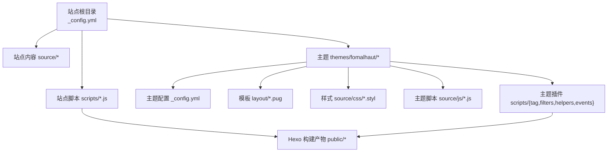
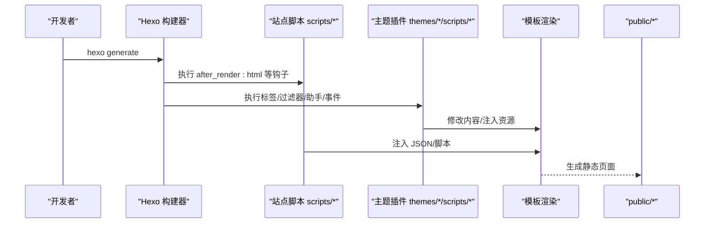
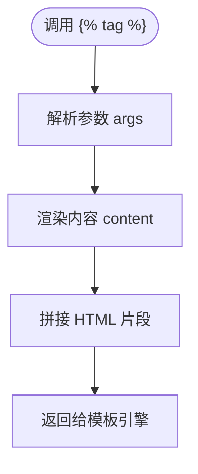
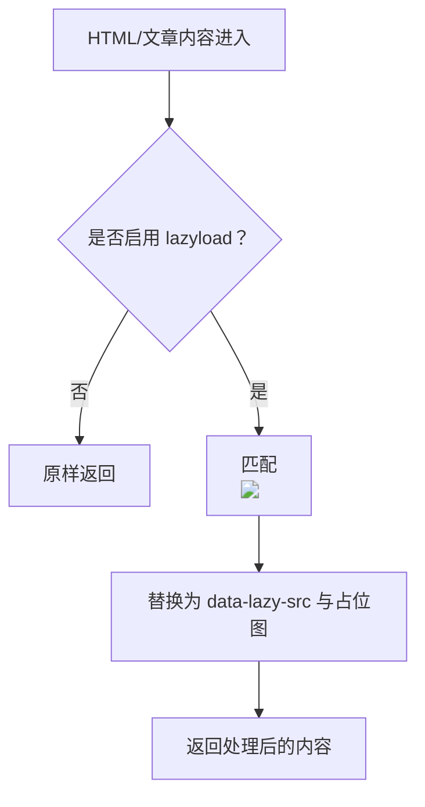
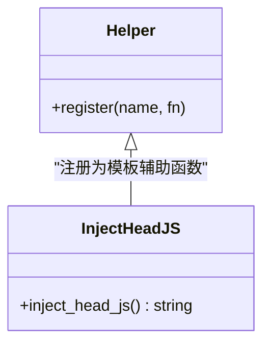
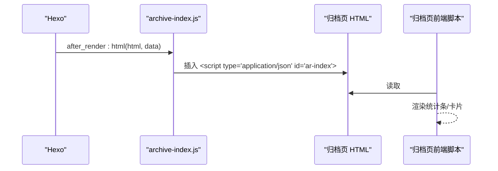
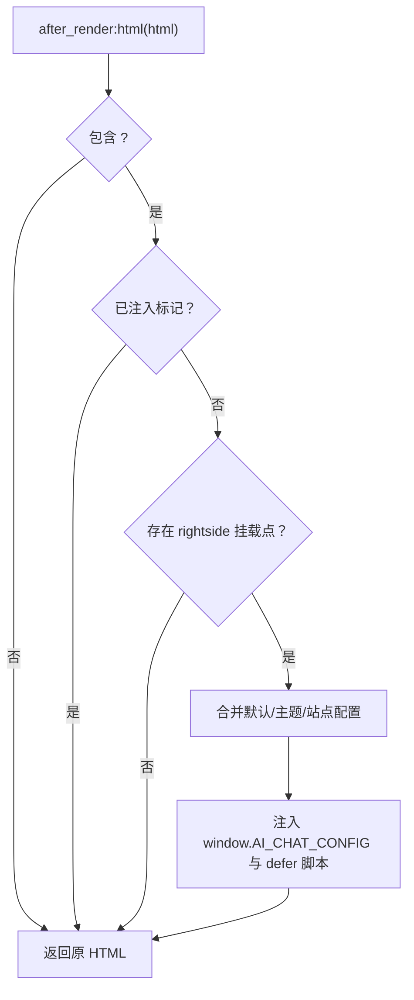
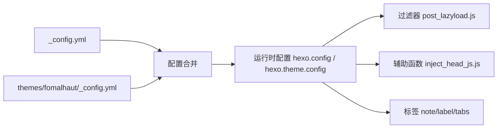

# 插件开发指南

<cite>
**本文引用的文件**   
- [README.md](file://README.md)
- [_config.yml](file://_config.yml)
- [themes/fomalhaut/_config.yml](file://themes/fomalhaut/_config.yml)
- [scripts/archive-index.js](file://scripts/archive-index.js)
- [scripts/ai-chat-inject.js](file://scripts/ai-chat-inject.js)
- [themes/fomalhaut/scripts/tag/note.js](file://themes/fomalhaut/scripts/tag/note.js)
- [themes/fomalhaut/scripts/tag/label.js](file://themes/fomalhaut/scripts/tag/label.js)
- [themes/fomalhaut/scripts/tag/tabs.js](file://themes/fomalhaut/scripts/tag/tabs.js)
- [themes/fomalhaut/scripts/filters/post_lazyload.js](file://themes/fomalhaut/scripts/filters/post_lazyload.js)
- [themes/fomalhaut/scripts/helpers/inject_head_js.js](file://themes/fomalhaut/scripts/helpers/inject_head_js.js)
</cite>

## 目录
1. [引言](#引言)
2. [项目结构](#项目结构)
3. [核心组件](#核心组件)
4. [架构总览](#架构总览)
5. [详细组件分析](#详细组件分析)
6. [依赖关系分析](#依赖关系分析)
7. [性能与优化建议](#性能与优化建议)
8. [故障排查](#故障排查)
9. [结论](#结论)
10. [附录：完整插件示例与发布流程](#附录完整插件示例与发布流程)

## 引言
本指南面向 Hexo 主题与站点开发者，围绕仓库中“站点级脚本”和“主题内 Hexo 插件”两套机制，系统讲解如何编写自定义标签、过滤器与辅助函数，并说明主题扩展方式（布局覆盖、样式注入、脚本加载）。文档以仓库实际实现为依据，给出可复用的开发范式、流程图与最佳实践。

## 项目结构
仓库采用“站点代码 + 主题代码”分离的架构：站点侧通过根目录 `scripts/` 提供构建期增强；主题侧在 `themes/fomalhaut/scripts/` 下组织标签、过滤器、助手与事件钩子。站点配置与主题配置分层，便于升级主题而不丢失站点改动。

**图示来源**
- [README.md:259-284](file://README.md#L259-L284)
- [README.md:472-504](file://README.md#L472-L504)

**章节来源**
- [README.md:259-284](file://README.md#L259-L284)
- [README.md:472-504](file://README.md#L472-L504)

## 核心组件
- 站点级 Hexo 插件：位于根 `scripts/`，用于构建期对 HTML 进行后处理、注入资源或生成数据。
- 主题级 Hexo 插件：位于 `themes/fomalhaut/scripts/`，包含：
  - 标签（Tag）：如 note、label、tabs 等。
  - 过滤器（Filter）：如图片懒加载替换。
  - 辅助函数（Helper）：如向 `<head>` 注入 JS。
  - 事件（Event）：启动横幅、CDN 预解析、评论初始化等。

**章节来源**
- [README.md:590-604](file://README.md#L590-L604)
- [themes/fomalhaut/_config.yml:746-767](file://themes/fomalhaut/_config.yml#L746-L767)

## 架构总览
Hexo 构建时，站点配置与主题配置合并生效；站点脚本与主题脚本均通过 `hexo.extend.*` 注册钩子，参与渲染管线。最终产出到 `public/`，再由 Gulp 压缩并部署。

**图示来源**
- [README.md:259-284](file://README.md#L259-L284)
- [scripts/archive-index.js:104-137](file://scripts/archive-index.js#L104-L137)
- [themes/fomalhaut/scripts/filters/post_lazyload.js:16-29](file://themes/fomalhaut/scripts/filters/post_lazyload.js#L16-L29)

## 详细组件分析

### 自定义标签开发（Tag）
仓库提供了多个标签实现，展示参数解析、内容渲染与样式组合的通用模式。

- note 标签：支持样式风格与图标，将 Markdown 内容渲染为带样式的提示块。
- label 标签：输出高亮标签文本。
- tabs 标签：解析多段 tab 内容，生成导航与内容区，并对每段内容进行 Markdown 渲染。

**图示来源**
- [themes/fomalhaut/scripts/tag/note.js:9-27](file://themes/fomalhaut/scripts/tag/note.js#L9-L27)
- [themes/fomalhaut/scripts/tag/label.js:9-16](file://themes/fomalhaut/scripts/tag/label.js#L9-L16)
- [themes/fomalhaut/scripts/tag/tabs.js:9-62](file://themes/fomalhaut/scripts/tag/tabs.js#L9-L62)

**章节来源**
- [themes/fomalhaut/scripts/tag/note.js:9-27](file://themes/fomalhaut/scripts/tag/note.js#L9-L27)
- [themes/fomalhaut/scripts/tag/label.js:9-16](file://themes/fomalhaut/scripts/tag/label.js#L9-L16)
- [themes/fomalhaut/scripts/tag/tabs.js:9-62](file://themes/fomalhaut/scripts/tag/tabs.js#L9-L62)

### 过滤器开发（Filter）
过滤器用于在渲染阶段前后对内容进行转换。仓库展示了两种典型用法：
- 全局 HTML 后处理：`after_render:html`，按配置决定是否替换图片占位符。
- 文章渲染后处理：`after_post_render`，仅对文章内容做懒加载替换。

**图示来源**
- [themes/fomalhaut/scripts/filters/post_lazyload.js:11-29](file://themes/fomalhaut/scripts/filters/post_lazyload.js#L11-L29)

**章节来源**
- [themes/fomalhaut/scripts/filters/post_lazyload.js:11-29](file://themes/fomalhaut/scripts/filters/post_lazyload.js#L11-L29)

### 辅助函数开发（Helper）
辅助函数在模板中被调用，常用于注入脚本、计算值或封装复用逻辑。仓库中的 `inject_head_js` 演示了如何在 `<head>` 注入本地存储、动态脚本加载器、深色模式与侧栏状态等前端逻辑。

**图示来源**
- [themes/fomalhaut/scripts/helpers/inject_head_js.js:8-151](file://themes/fomalhaut/scripts/helpers/inject_head_js.js#L8-L151)

**章节来源**
- [themes/fomalhaut/scripts/helpers/inject_head_js.js:8-151](file://themes/fomalhaut/scripts/helpers/inject_head_js.js#L8-L151)

### 站点级构建期注入（站点脚本）
站点脚本不修改主题源码，通过 `after_render:html` 钩子在归档页插入结构化索引 JSON，供前端行为层消费。该模式适合“只读/只写特定页面”的增强。

**图示来源**
- [scripts/archive-index.js:104-137](file://scripts/archive-index.js#L104-L137)

**章节来源**
- [scripts/archive-index.js:104-137](file://scripts/archive-index.js#L104-L137)

### 运行时资源注入（站点脚本）
AI 助手注入器在构建期检测页面是否存在挂载点，按需注入配置对象与前端脚本，同时支持代理模式与缓存戳。

**图示来源**
- [scripts/ai-chat-inject.js:71-105](file://scripts/ai-chat-inject.js#L71-L105)

**章节来源**
- [scripts/ai-chat-inject.js:71-105](file://scripts/ai-chat-inject.js#L71-L105)

## 依赖关系分析
- 站点脚本依赖 Hexo 提供的 `hexo.extend.filter.register` 与 `hexo.locals` API，用于访问站点数据与注入 HTML。
- 主题标签/过滤器/助手同样基于 `hexo.extend.*` 扩展点。
- 主题配置与站点配置通过 `_config.yml` 与 `themes/fomalhaut/_config.yml` 分层管理，站点配置优先级更高。

**图示来源**
- [README.md:286-293](file://README.md#L286-L293)
- [themes/fomalhaut/scripts/filters/post_lazyload.js:16-29](file://themes/fomalhaut/scripts/filters/post_lazyload.js#L16-L29)
- [themes/fomalhaut/scripts/helpers/inject_head_js.js:8-151](file://themes/fomalhaut/scripts/helpers/inject_head_js.js#L8-L151)

**章节来源**
- [README.md:286-293](file://README.md#L286-L293)
- [themes/fomalhaut/scripts/filters/post_lazyload.js:16-29](file://themes/fomalhaut/scripts/filters/post_lazyload.js#L16-L29)
- [themes/fomalhaut/scripts/helpers/inject_head_js.js:8-151](file://themes/fomalhaut/scripts/helpers/inject_head_js.js#L8-L151)

## 性能与优化建议
- 仅在需要的页面注入：站点脚本应判断页面类型或 DOM 挂载点，避免无谓注入（参考归档页与 AI 助手注入器的守卫逻辑）。
- 使用 `defer` 与按需加载：前端脚本尽量延迟加载，减少首屏阻塞。
- 避免重复计算：在构建期完成数据聚合（如全站文章索引），前端只做读取与渲染。
- 合理设置懒加载：图片懒加载应在主题配置开启且作用域正确时生效。
- 控制副作用范围：过滤器与注入器应尽量幂等，避免多次运行产生重复节点。

[本节为通用指导，不直接分析具体文件]

## 故障排查
- 归档页索引缺失：检查 `archive-index.js` 是否正确注册 `after_render:html`，以及归档页是否存在目标容器 ID。
- AI 助手未注入：确认页面包含 `rightside` 挂载点，且配置未禁用；检查注入标记是否已存在。
- 图片懒加载无效：检查主题配置 `lazyload.enable` 与 `field` 是否匹配当前场景（site 或 post）。
- 标签样式异常：确认标签对应的 CSS 已引入，且类名与模板输出一致。

**章节来源**
- [scripts/archive-index.js:104-137](file://scripts/archive-index.js#L104-L137)
- [scripts/ai-chat-inject.js:71-105](file://scripts/ai-chat-inject.js#L71-L105)
- [themes/fomalhaut/scripts/filters/post_lazyload.js:16-29](file://themes/fomalhaut/scripts/filters/post_lazyload.js#L16-L29)

## 结论
本仓库展示了 Hexo 插件开发的完整范式：站点脚本负责构建期数据注入与资源装配，主题插件负责标签、过滤器与辅助函数。通过配置分层与注入机制，既能灵活扩展功能，又能保持主题升级的安全性与稳定性。遵循“最小侵入、明确边界、幂等健壮”的原则，可以高效地开发与维护插件。

[本节为总结性内容，不直接分析具体文件]

## 附录：完整插件示例与发布流程

### 标签开发示例（note/label/tabs）
- 参数解析：从 `args` 数组提取样式、颜色、标题等。
- 内容渲染：使用 `hexo.render.renderSync` 将 Markdown 转为 HTML。
- 注册标签：通过 `hexo.extend.tag.register` 绑定名称与回调。

**章节来源**
- [themes/fomalhaut/scripts/tag/note.js:9-27](file://themes/fomalhaut/scripts/tag/note.js#L9-L27)
- [themes/fomalhaut/scripts/tag/label.js:9-16](file://themes/fomalhaut/scripts/tag/label.js#L9-L16)
- [themes/fomalhaut/scripts/tag/tabs.js:9-62](file://themes/fomalhaut/scripts/tag/tabs.js#L9-L62)

### 过滤器开发示例（post_lazyload）
- 监听 `after_render:html` 与 `after_post_render`。
- 根据主题配置决定是否替换图片占位符。
- 使用正则匹配并替换 `src` 与 `data-lazy-src`。

**章节来源**
- [themes/fomalhaut/scripts/filters/post_lazyload.js:11-29](file://themes/fomalhaut/scripts/filters/post_lazyload.js#L11-L29)

### 辅助函数开发示例（inject_head_js）
- 注册模板辅助函数。
- 生成内联脚本，包含本地存储、动态脚本加载、深色模式与侧栏状态。
- 在模板中通过辅助函数调用注入。

**章节来源**
- [themes/fomalhaut/scripts/helpers/inject_head_js.js:8-151](file://themes/fomalhaut/scripts/helpers/inject_head_js.js#L8-L151)

### 站点级构建期注入示例（archive-index、ai-chat-inject）
- archive-index：在归档页插入 JSON 索引，供前端渲染统计与卡片。
- ai-chat-inject：按需注入配置与前端脚本，支持代理模式与缓存戳。

**章节来源**
- [scripts/archive-index.js:104-137](file://scripts/archive-index.js#L104-L137)
- [scripts/ai-chat-inject.js:71-105](file://scripts/ai-chat-inject.js#L71-L105)

### 测试方法
- 使用 Node 自带的 `node:test` 编写回归脚本，验证关键行为（如 Service Worker 缓存策略、日夜模式、特效开关等）。
- 针对构建期脚本，可在本地执行 `hexo clean && hexo generate` 后检查 `public/` 输出是否符合预期。

**章节来源**
- [README.md:605-626](file://README.md#L605-L626)

### 发布流程
- 本地预览：`npx hexo server`。
- 构建产物：`npx hexo clean && npx hexo generate && npx gulp`。
- 部署：根据平台配置（如 Vercel、GitHub Pages）推送 `public/` 或触发 CI/CD。

**章节来源**
- [README.md:357-439](file://README.md#L357-L439)