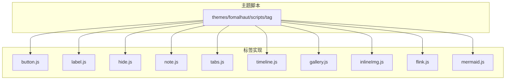
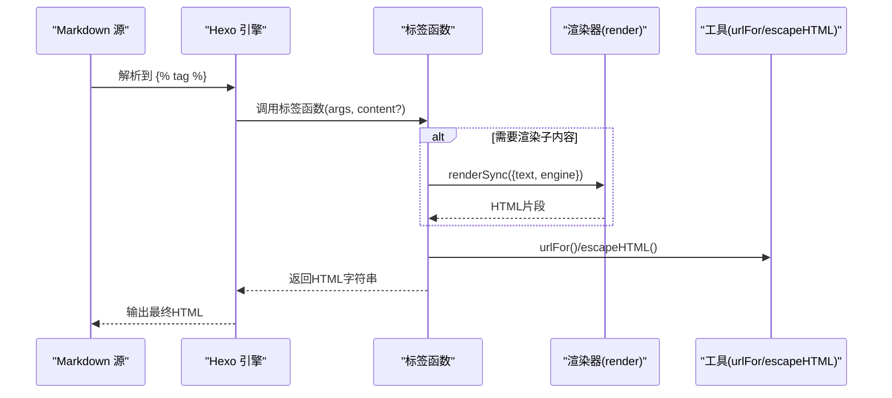
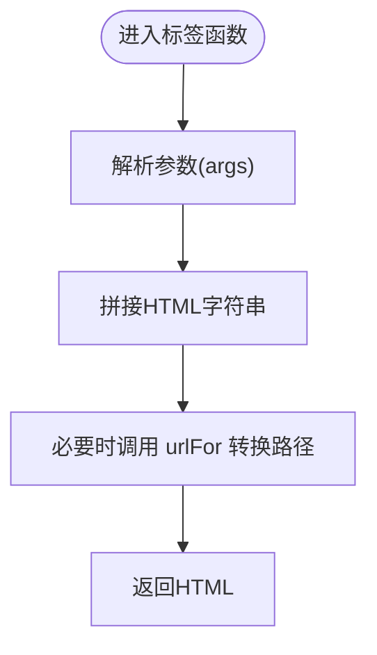
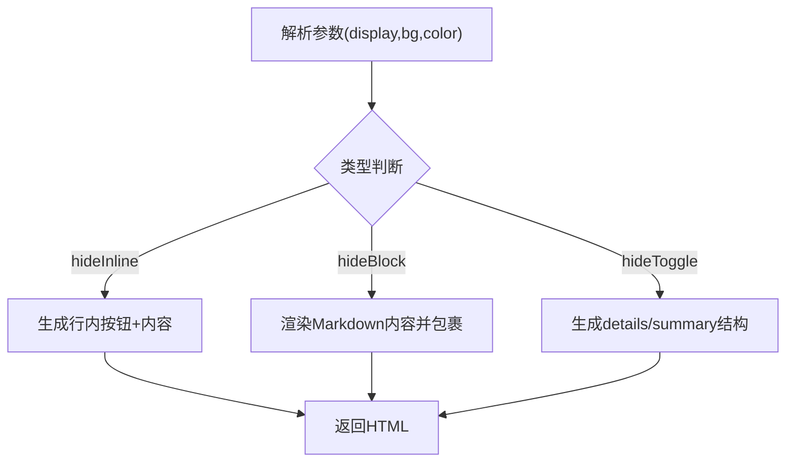
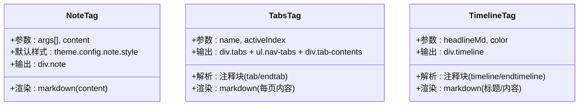
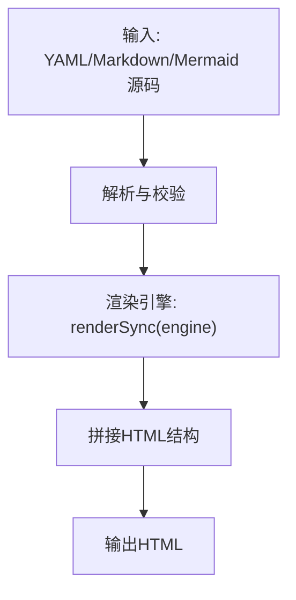
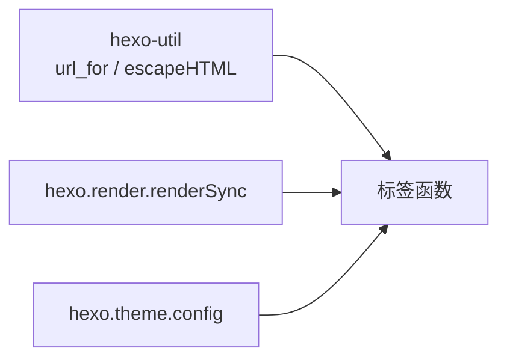

# 自定义标签开发

<cite>
**本文引用的文件**   
- [themes/fomalhaut/scripts/tag/button.js](file://themes/fomalhaut/scripts/tag/button.js)
- [themes/fomalhaut/scripts/tag/label.js](file://themes/fomalhaut/scripts/tag/label.js)
- [themes/fomalhaut/scripts/tag/hide.js](file://themes/fomalhaut/scripts/tag/hide.js)
- [themes/fomalhaut/scripts/tag/note.js](file://themes/fomalhaut/scripts/tag/note.js)
- [themes/fomalhaut/scripts/tag/tabs.js](file://themes/fomalhaut/scripts/tag/tabs.js)
- [themes/fomalhaut/scripts/tag/timeline.js](file://themes/fomalhaut/scripts/tag/timeline.js)
- [themes/fomalhaut/scripts/tag/gallery.js](file://themes/fomalhaut/scripts/tag/gallery.js)
- [themes/fomalhaut/scripts/tag/inlineImg.js](file://themes/fomalhaut/scripts/tag/inlineImg.js)
- [themes/fomalhaut/scripts/tag/flink.js](file://themes/fomalhaut/scripts/tag/flink.js)
- [themes/fomalhaut/scripts/tag/mermaid.js](file://themes/fomalhaut/scripts/tag/mermaid.js)
</cite>

## 目录
1. [简介](#简介)
2. [项目结构](#项目结构)
3. [核心组件](#核心组件)
4. [架构总览](#架构总览)
5. [详细组件分析](#详细组件分析)
6. [依赖关系分析](#依赖关系分析)
7. [性能与优化建议](#性能与优化建议)
8. [测试与调试指南](#测试与调试指南)
9. [结论](#结论)

## 简介
本指南面向希望在 Hexo 主题中扩展“自定义标签”的开发者。文档基于当前主题的标签实现，系统讲解：
- 标签解析、参数处理、渲染输出的完整流程
- 标签函数的编写规范（参数接收、内容处理、HTML 生成）
- 复杂标签的开发模式（嵌套标签、条件渲染、样式注入）
- 从简单按钮到复杂卡片组件的完整示例路径
- 标签测试方法与调试技巧
- 性能优化建议

## 项目结构
主题将自定义标签统一放在 themes/fomalhaut/scripts/tag 目录下，每个标签一个 JS 文件，通过 hexo.extend.tag.register 注册到 Hexo 引擎。

图表来源
- [themes/fomalhaut/scripts/tag/button.js:1-29](file://themes/fomalhaut/scripts/tag/button.js#L1-L29)
- [themes/fomalhaut/scripts/tag/label.js:1-17](file://themes/fomalhaut/scripts/tag/label.js#L1-L17)
- [themes/fomalhaut/scripts/tag/hide.js:1-71](file://themes/fomalhaut/scripts/tag/hide.js#L1-L71)
- [themes/fomalhaut/scripts/tag/note.js:1-28](file://themes/fomalhaut/scripts/tag/note.js#L1-L28)
- [themes/fomalhaut/scripts/tag/tabs.js:1-63](file://themes/fomalhaut/scripts/tag/tabs.js#L1-L63)
- [themes/fomalhaut/scripts/tag/timeline.js:1-42](file://themes/fomalhaut/scripts/tag/timeline.js#L1-L42)
- [themes/fomalhaut/scripts/tag/gallery.js:1-35](file://themes/fomalhaut/scripts/tag/gallery.js#L1-L35)
- [themes/fomalhaut/scripts/tag/inlineImg.js:1-18](file://themes/fomalhaut/scripts/tag/inlineImg.js#L1-L18)
- [themes/fomalhaut/scripts/tag/flink.js:1-40](file://themes/fomalhaut/scripts/tag/flink.js#L1-L40)
- [themes/fomalhaut/scripts/tag/mermaid.js:1-18](file://themes/fomalhaut/scripts/tag/mermaid.js#L1-L18)

章节来源
- [themes/fomalhaut/scripts/tag/button.js:1-29](file://themes/fomalhaut/scripts/tag/button.js#L1-L29)
- [themes/fomalhaut/scripts/tag/label.js:1-17](file://themes/fomalhaut/scripts/tag/label.js#L1-L17)
- [themes/fomalhaut/scripts/tag/hide.js:1-71](file://themes/fomalhaut/scripts/tag/hide.js#L1-L71)
- [themes/fomalhaut/scripts/tag/note.js:1-28](file://themes/fomalhaut/scripts/tag/note.js#L1-L28)
- [themes/fomalhaut/scripts/tag/tabs.js:1-63](file://themes/fomalhaut/scripts/tag/tabs.js#L1-L63)
- [themes/fomalhaut/scripts/tag/timeline.js:1-42](file://themes/fomalhaut/scripts/tag/timeline.js#L1-L42)
- [themes/fomalhaut/scripts/tag/gallery.js:1-35](file://themes/fomalhaut/scripts/tag/gallery.js#L1-L35)
- [themes/fomalhaut/scripts/tag/inlineImg.js:1-18](file://themes/fomalhaut/scripts/tag/inlineImg.js#L1-L18)
- [themes/fomalhaut/scripts/tag/flink.js:1-40](file://themes/fomalhaut/scripts/tag/flink.js#L1-L40)
- [themes/fomalhaut/scripts/tag/mermaid.js:1-18](file://themes/fomalhaut/scripts/tag/mermaid.js#L1-L18)

## 核心组件
- 基础 UI 类标签：按钮、标签、内联图片
- 交互与折叠类标签：隐藏块、手风琴开关
- 结构化容器类标签：笔记、选项卡、时间线、画廊
- 数据驱动类标签：友链、Mermaid 图

这些标签覆盖了从简单到复杂的常见场景，并展示了不同的参数传递方式（逗号分隔、注释标记、YAML/Markdown 内容体）。

章节来源
- [themes/fomalhaut/scripts/tag/button.js:1-29](file://themes/fomalhaut/scripts/tag/button.js#L1-L29)
- [themes/fomalhaut/scripts/tag/label.js:1-17](file://themes/fomalhaut/scripts/tag/label.js#L1-L17)
- [themes/fomalhaut/scripts/tag/inlineImg.js:1-18](file://themes/fomalhaut/scripts/tag/inlineImg.js#L1-L18)
- [themes/fomalhaut/scripts/tag/hide.js:1-71](file://themes/fomalhaut/scripts/tag/hide.js#L1-L71)
- [themes/fomalhaut/scripts/tag/note.js:1-28](file://themes/fomalhaut/scripts/tag/note.js#L1-L28)
- [themes/fomalhaut/scripts/tag/tabs.js:1-63](file://themes/fomalhaut/scripts/tag/tabs.js#L1-L63)
- [themes/fomalhaut/scripts/tag/timeline.js:1-42](file://themes/fomalhaut/scripts/tag/timeline.js#L1-L42)
- [themes/fomalhaut/scripts/tag/gallery.js:1-35](file://themes/fomalhaut/scripts/tag/gallery.js#L1-L35)
- [themes/fomalhaut/scripts/tag/flink.js:1-40](file://themes/fomalhaut/scripts/tag/flink.js#L1-L40)
- [themes/fomalhaut/scripts/tag/mermaid.js:1-18](file://themes/fomalhaut/scripts/tag/mermaid.js#L1-L18)

## 架构总览
Hexo 在解析 Markdown 时遇到自定义标签语法，会调用对应标签函数。标签函数负责：
- 解析参数（args）
- 可选地渲染子内容（content），如 Markdown/YAML
- 拼接 HTML 字符串返回给 Hexo 输出

图表来源
- [themes/fomalhaut/scripts/tag/button.js:10-28](file://themes/fomalhaut/scripts/tag/button.js#L10-L28)
- [themes/fomalhaut/scripts/tag/note.js:9-26](file://themes/fomalhaut/scripts/tag/note.js#L9-L26)
- [themes/fomalhaut/scripts/tag/tabs.js:9-60](file://themes/fomalhaut/scripts/tag/tabs.js#L9-L60)
- [themes/fomalhaut/scripts/tag/mermaid.js:9-17](file://themes/fomalhaut/scripts/tag/mermaid.js#L9-L17)

## 详细组件分析

### 基础 UI 标签：按钮、标签、内联图片
- 按钮标签
  - 参数：url、text、icon、option（逗号分隔）
  - 功能：生成带图标和文本的链接按钮，支持多种样式修饰
  - 关键点：使用 urlFor 处理相对路径；根据 option 追加样式类
- 标签标签
  - 参数：text、className
  - 功能：生成高亮标签，默认 default 类名
- 内联图片标签
  - 参数：src、height
  - 功能：插入内联图片，支持高度控制

图表来源
- [themes/fomalhaut/scripts/tag/button.js:12-26](file://themes/fomalhaut/scripts/tag/button.js#L12-L26)
- [themes/fomalhaut/scripts/tag/label.js:9-13](file://themes/fomalhaut/scripts/tag/label.js#L9-L13)
- [themes/fomalhaut/scripts/tag/inlineImg.js:10-14](file://themes/fomalhaut/scripts/tag/inlineImg.js#L10-L14)

章节来源
- [themes/fomalhaut/scripts/tag/button.js:1-29](file://themes/fomalhaut/scripts/tag/button.js#L1-L29)
- [themes/fomalhaut/scripts/tag/label.js:1-17](file://themes/fomalhaut/scripts/tag/label.js#L1-L17)
- [themes/fomalhaut/scripts/tag/inlineImg.js:1-18](file://themes/fomalhaut/scripts/tag/inlineImg.js#L1-L18)

### 交互与折叠标签：隐藏块、手风琴开关
- hideInline：行内隐藏内容，点击显示
- hideBlock：块级隐藏内容，支持 Markdown 渲染
- hideToggle：原生 details/summary 手风琴，支持背景色与文字颜色

图表来源
- [themes/fomalhaut/scripts/tag/hide.js:19-66](file://themes/fomalhaut/scripts/tag/hide.js#L19-L66)

章节来源
- [themes/fomalhaut/scripts/tag/hide.js:1-71](file://themes/fomalhaut/scripts/tag/hide.js#L1-L71)

### 结构化容器标签：笔记、选项卡、时间线
- note/subnote：可配置样式的笔记容器，支持图标与 Markdown 内容
- tabs/subtabs/subsubtabs：多标签页，支持激活项、图标、标题、滚动回顶按钮
- timeline：时间线条目，支持标题和内容分别渲染为 Markdown

图表来源
- [themes/fomalhaut/scripts/tag/note.js:9-26](file://themes/fomalhaut/scripts/tag/note.js#L9-L26)
- [themes/fomalhaut/scripts/tag/tabs.js:9-60](file://themes/fomalhaut/scripts/tag/tabs.js#L9-L60)
- [themes/fomalhaut/scripts/tag/timeline.js:8-39](file://themes/fomalhaut/scripts/tag/timeline.js#L8-L39)

章节来源
- [themes/fomalhaut/scripts/tag/note.js:1-28](file://themes/fomalhaut/scripts/tag/note.js#L1-L28)
- [themes/fomalhaut/scripts/tag/tabs.js:1-63](file://themes/fomalhaut/scripts/tag/tabs.js#L1-L63)
- [themes/fomalhaut/scripts/tag/timeline.js:1-42](file://themes/fomalhaut/scripts/tag/timeline.js#L1-L42)

### 数据驱动标签：友链、画廊、Mermaid
- flink：读取 YAML 内容，按分类与列表渲染友链卡片，包含头像、名称、描述，支持错误占位图
- gallery/galleryGroup：组合图片组与分组信息，内部支持 Markdown 渲染
- mermaid：安全转义 Mermaid 源码，交由前端库渲染

图表来源
- [themes/fomalhaut/scripts/tag/flink.js:9-37](file://themes/fomalhaut/scripts/tag/flink.js#L9-L37)
- [themes/fomalhaut/scripts/tag/gallery.js:10-31](file://themes/fomalhaut/scripts/tag/gallery.js#L10-L31)
- [themes/fomalhaut/scripts/tag/mermaid.js:11-14](file://themes/fomalhaut/scripts/tag/mermaid.js#L11-L14)

章节来源
- [themes/fomalhaut/scripts/tag/flink.js:1-40](file://themes/fomalhaut/scripts/tag/flink.js#L1-L40)
- [themes/fomalhaut/scripts/tag/gallery.js:1-35](file://themes/fomalhaut/scripts/tag/gallery.js#L1-L35)
- [themes/fomalhaut/scripts/tag/mermaid.js:1-18](file://themes/fomalhaut/scripts/tag/mermaid.js#L1-L18)

## 依赖关系分析
- 外部依赖
  - hexo-util.url_for：用于资源路径规范化
  - hexo-util.escapeHTML：用于安全转义用户输入
  - hexo.render.renderSync：同步渲染 Markdown/YAML 等
- 主题配置
  - hexo.theme.config.note.style：笔记样式默认值
  - hexo.theme.config.error_img.flink：友链图片加载失败时的占位图

图表来源
- [themes/fomalhaut/scripts/tag/button.js:10-28](file://themes/fomalhaut/scripts/tag/button.js#L10-L28)
- [themes/fomalhaut/scripts/tag/inlineImg.js:8-14](file://themes/fomalhaut/scripts/tag/inlineImg.js#L8-L14)
- [themes/fomalhaut/scripts/tag/mermaid.js:9-14](file://themes/fomalhaut/scripts/tag/mermaid.js#L9-L14)
- [themes/fomalhaut/scripts/tag/note.js:10-23](file://themes/fomalhaut/scripts/tag/note.js#L10-L23)
- [themes/fomalhaut/scripts/tag/flink.js:25-25](file://themes/fomalhaut/scripts/tag/flink.js#L25-L25)

章节来源
- [themes/fomalhaut/scripts/tag/button.js:1-29](file://themes/fomalhaut/scripts/tag/button.js#L1-L29)
- [themes/fomalhaut/scripts/tag/inlineImg.js:1-18](file://themes/fomalhaut/scripts/tag/inlineImg.js#L1-L18)
- [themes/fomalhaut/scripts/tag/mermaid.js:1-18](file://themes/fomalhaut/scripts/tag/mermaid.js#L1-L18)
- [themes/fomalhaut/scripts/tag/note.js:1-28](file://themes/fomalhaut/scripts/tag/note.js#L1-L28)
- [themes/fomalhaut/scripts/tag/flink.js:1-40](file://themes/fomalhaut/scripts/tag/flink.js#L1-L40)

## 性能与优化建议
- 避免不必要的重复渲染
  - 对多次使用的 Markdown 片段进行缓存或预处理，减少 renderSync 调用次数
- 合理使用 ends:true
  - 仅对确实包含子内容的标签启用 ends:true，避免误匹配
- 路径与资源优化
  - 使用 urlFor 统一资源路径，配合 CDN 与懒加载策略
- 安全与体积
  - 对用户输入使用 escapeHTML 防止 XSS
  - 按需引入第三方库（如 Mermaid），避免全局加载
- DOM 操作最小化
  - 尽量在构建期生成完整 HTML，减少运行时脚本开销

[本节为通用指导，不直接分析具体文件]

## 测试与调试指南
- 单元测试思路
  - 构造不同参数组合（空值、非法值、边界值）
  - 验证生成的 HTML 结构与类名是否符合预期
  - 对含 Markdown/YAML 的内容，断言渲染结果
- 调试技巧
  - 在标签函数入口打印 args 与 content，确认解析是否正确
  - 对 URL 生成逻辑，单独验证 urlFor 的输出
  - 对样式注入，检查 className/style 属性是否按规则拼接
- 常见问题排查
  - 参数分割错误：检查 split(',') 与 trim 的使用
  - 子内容未渲染：确认是否传入 engine 且 ends:true
  - 样式不生效：检查类名是否与 CSS 一致

章节来源
- [themes/fomalhaut/scripts/tag/button.js:12-26](file://themes/fomalhaut/scripts/tag/button.js#L12-L26)
- [themes/fomalhaut/scripts/tag/hide.js:19-66](file://themes/fomalhaut/scripts/tag/hide.js#L19-L66)
- [themes/fomalhaut/scripts/tag/tabs.js:24-57](file://themes/fomalhaut/scripts/tag/tabs.js#L24-L57)
- [themes/fomalhaut/scripts/tag/flink.js:9-37](file://themes/fomalhaut/scripts/tag/flink.js#L9-L37)

## 结论
通过对主题现有标签的实现分析，可以总结出自定义标签开发的通用范式：
- 明确参数约定与解析策略
- 合理选择渲染引擎（Markdown/YAML）
- 使用工具函数保证路径与安全
- 以模块化方式组织标签，便于维护与扩展
遵循上述模式，即可快速实现从简单按钮到复杂卡片组件的各类标签，并通过测试与调试保障质量与性能。