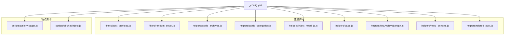
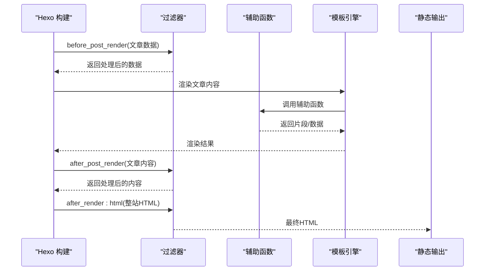
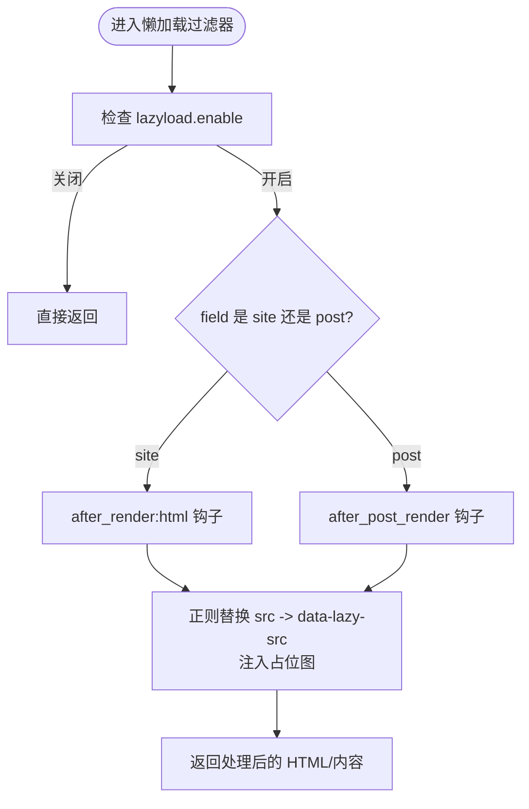
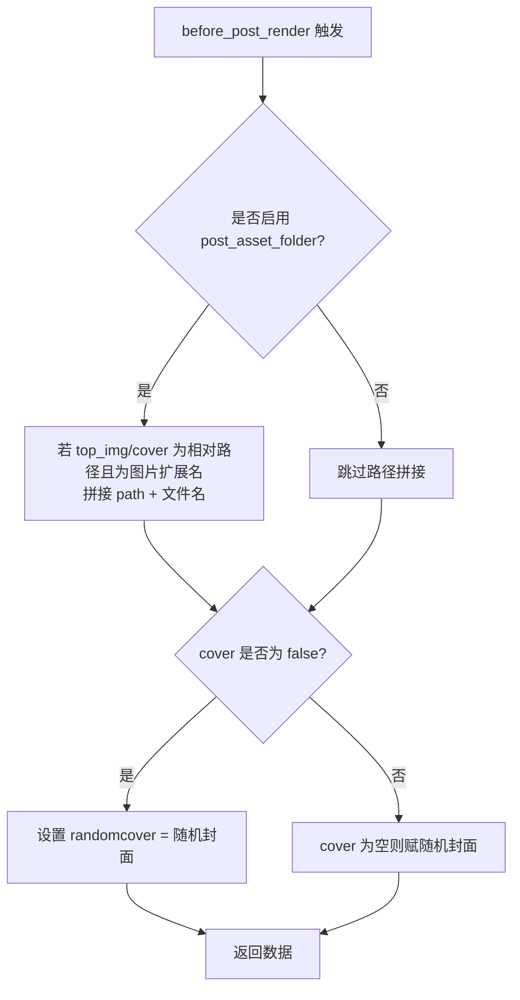
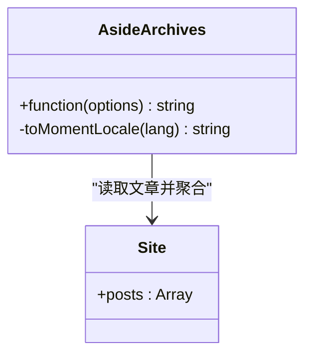
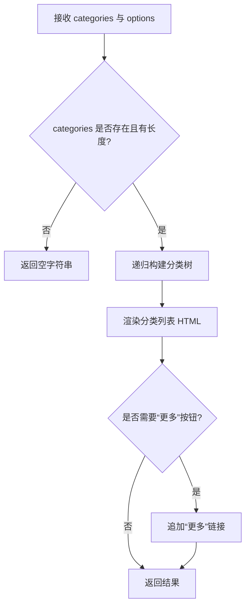
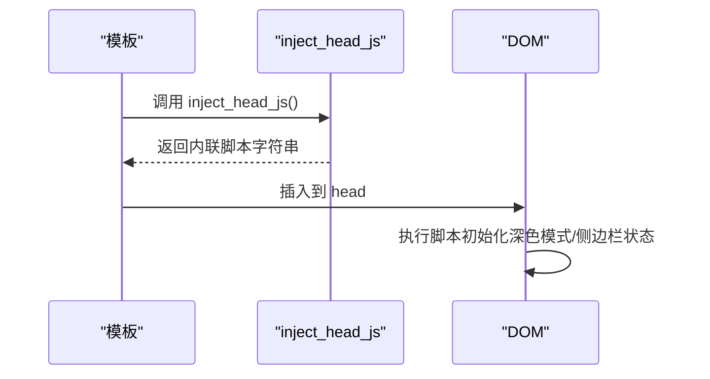
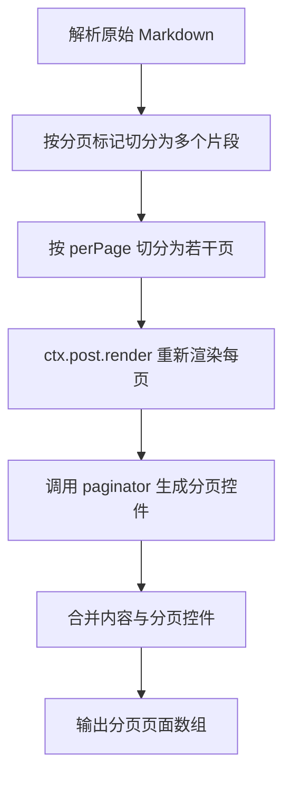
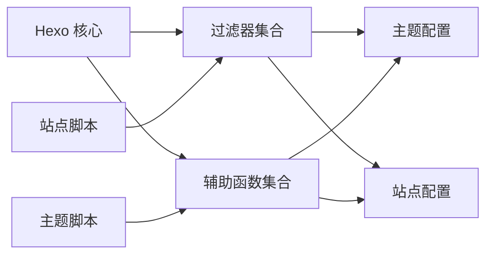

# 过滤器与辅助函数

<cite>
**本文引用的文件**   
- [post_lazyload.js](file://themes/fomalhaut/scripts/filters/post_lazyload.js)
- [random_cover.js](file://themes/fomalhaut/scripts/filters/random_cover.js)
- [aside_archives.js](file://themes/fomalhaut/scripts/helpers/aside_archives.js)
- [aside_categories.js](file://themes/fomalhaut/scripts/helpers/aside_categories.js)
- [inject_head_js.js](file://themes/fomalhaut/scripts/helpers/inject_head_js.js)
- [page.js](file://themes/fomalhaut/scripts/helpers/page.js)
- [findArchiveLength.js](file://themes/fomalhaut/scripts/helpers/findArchiveLength.js)
- [hexo_echarts.js](file://themes/fomalhaut/scripts/helpers/hexo_echarts.js)
- [related_post.js](file://themes/fomalhaut/scripts/helpers/related_post.js)
- [gallery-pager.js](file://scripts/gallery-pager.js)
- [ai-chat-inject.js](file://scripts/ai-chat-inject.js)
- [_config.yml](file://themes/fomalhaut/_config.yml)
</cite>

## 目录
1. [引言](#引言)
2. [项目结构](#项目结构)
3. [核心组件](#核心组件)
4. [架构总览](#架构总览)
5. [详细组件分析](#详细组件分析)
6. [依赖关系分析](#依赖关系分析)
7. [性能考虑](#性能考虑)
8. [故障排查指南](#故障排查指南)
9. [结论](#结论)
10. [附录：开发示例清单](#附录开发示例清单)

## 引言
本文面向 Hexo 主题开发者，系统梳理本仓库中“过滤器”和“辅助函数”的用法、规范与实践。内容覆盖：
- 过滤器：内容过滤、数据转换、事件监听；
- 辅助函数：函数定义、参数传递、返回值处理；
- 应用场景：文章处理、数据格式化、资源注入；
- 实战示例：图片懒加载过滤器、侧边栏数据助手、头部脚本注入器；
- 性能与最佳实践建议。

## 项目结构
本仓库在主题目录下集中维护了过滤器与辅助函数：
- 过滤器位于 themes/fomalhaut/scripts/filters；
- 辅助函数位于 themes/fomalhaut/scripts/helpers；
- 站点级脚本（含部分过滤器）位于 scripts；
- 主题配置位于 themes/fomalhaut/_config.yml。

图表来源
- [post_lazyload.js:1-30](file://themes/fomalhaut/scripts/filters/post_lazyload.js#L1-L30)
- [random_cover.js:1-46](file://themes/fomalhaut/scripts/filters/random_cover.js#L1-L46)
- [aside_archives.js:1-114](file://themes/fomalhaut/scripts/helpers/aside_archives.js#L1-L114)
- [aside_categories.js:1-98](file://themes/fomalhaut/scripts/helpers/aside_categories.js#L1-L98)
- [inject_head_js.js:1-152](file://themes/fomalhaut/scripts/helpers/inject_head_js.js#L1-L152)
- [page.js:1-99](file://themes/fomalhaut/scripts/helpers/page.js#L1-L99)
- [findArchiveLength.js:1-58](file://themes/fomalhaut/scripts/helpers/findArchiveLength.js#L1-L58)
- [hexo_echarts.js:1-249](file://themes/fomalhaut/scripts/helpers/hexo_echarts.js#L1-L249)
- [related_post.js:1-100](file://themes/fomalhaut/scripts/helpers/related_post.js#L1-L100)
- [gallery-pager.js:63-139](file://scripts/gallery-pager.js#L63-L139)
- [ai-chat-inject.js:66-97](file://scripts/ai-chat-inject.js#L66-L97)
- [_config.yml:1-800](file://themes/fomalhaut/_config.yml#L1-L800)

章节来源
- [post_lazyload.js:1-30](file://themes/fomalhaut/scripts/filters/post_lazyload.js#L1-L30)
- [random_cover.js:1-46](file://themes/fomalhaut/scripts/filters/random_cover.js#L1-L46)
- [aside_archives.js:1-114](file://themes/fomalhaut/scripts/helpers/aside_archives.js#L1-L114)
- [aside_categories.js:1-98](file://themes/fomalhaut/scripts/helpers/aside_categories.js#L1-L98)
- [inject_head_js.js:1-152](file://themes/fomalhaut/scripts/helpers/inject_head_js.js#L1-L152)
- [page.js:1-99](file://themes/fomalhaut/scripts/helpers/page.js#L1-L99)
- [findArchiveLength.js:1-58](file://themes/fomalhaut/scripts/helpers/findArchiveLength.js#L1-L58)
- [hexo_echarts.js:1-249](file://themes/fomalhaut/scripts/helpers/hexo_echarts.js#L1-L249)
- [related_post.js:1-100](file://themes/fomalhaut/scripts/helpers/related_post.js#L1-L100)
- [gallery-pager.js:63-139](file://scripts/gallery-pager.js#L63-L139)
- [ai-chat-inject.js:66-97](file://scripts/ai-chat-inject.js#L66-L97)
- [_config.yml:1-800](file://themes/fomalhaut/_config.yml#L1-L800)

## 核心组件
- 图片懒加载过滤器：将正文中的图片 src 替换为 data-lazy-src，并注入占位图，支持按站点或文章范围启用。
- 随机封面过滤器：在文章渲染前统一处理封面路径与随机默认封面。
- 侧边栏归档助手：按年/月聚合文章，生成可点击的归档列表。
- 分类助手：递归构建分类树，支持层级深度、排序、展开等选项。
- 头部脚本注入器：在页面 head 注入本地存储、动态脚本加载、深色模式、侧边栏状态检测等内联脚本。
- 页面工具助手：描述提取、标签云、URL 规范化、MD5、HTML 注入、归档标题查找等。
- 归档长度计算助手：根据归档生成配置计算当前页的文章数量。
- ECharts 数据助手：生成标签排行柱状图、分类玫瑰图、近一年发文趋势折线图。
- 相关文章助手：基于标签权重推荐相关文章。
- 画廊分页脚本：对 Markdown 图片段进行分页，复用 Hexo 渲染管线，确保过滤器继续生效。
- AI 聊天注入过滤器：在 HTML 末尾注入运行时配置，支持代理与密钥管理。

章节来源
- [post_lazyload.js:1-30](file://themes/fomalhaut/scripts/filters/post_lazyload.js#L1-L30)
- [random_cover.js:1-46](file://themes/fomalhaut/scripts/filters/random_cover.js#L1-L46)
- [aside_archives.js:1-114](file://themes/fomalhaut/scripts/helpers/aside_archives.js#L1-L114)
- [aside_categories.js:1-98](file://themes/fomalhaut/scripts/helpers/aside_categories.js#L1-L98)
- [inject_head_js.js:1-152](file://themes/fomalhaut/scripts/helpers/inject_head_js.js#L1-L152)
- [page.js:1-99](file://themes/fomalhaut/scripts/helpers/page.js#L1-L99)
- [findArchiveLength.js:1-58](file://themes/fomalhaut/scripts/helpers/findArchiveLength.js#L1-L58)
- [hexo_echarts.js:1-249](file://themes/fomalhaut/scripts/helpers/hexo_echarts.js#L1-L249)
- [related_post.js:1-100](file://themes/fomalhaut/scripts/helpers/related_post.js#L1-L100)
- [gallery-pager.js:63-139](file://scripts/gallery-pager.js#L63-L139)
- [ai-chat-inject.js:66-97](file://scripts/ai-chat-inject.js#L66-L97)

## 架构总览
Hexo 构建流程中，过滤器与辅助函数分别在“数据准备”“内容渲染”“最终输出”阶段介入：
- before_post_render：预处理文章数据（如封面归一化）。
- after_post_render：处理已渲染的文章内容（如图片懒加载）。
- after_render:html：处理整站 HTML 输出（如全局注入、链接修正）。
- helpers：模板渲染时按需调用，返回字符串或对象供模板使用。

图表来源
- [random_cover.js:8-25](file://themes/fomalhaut/scripts/filters/random_cover.js#L8-L25)
- [post_lazyload.js:16-29](file://themes/fomalhaut/scripts/filters/post_lazyload.js#L16-L29)
- [ai-chat-inject.js:71-97](file://scripts/ai-chat-inject.js#L71-L97)

## 详细组件分析

### 图片懒加载过滤器
职责
- 在站点级 HTML 或文章级内容中将 img 的 src 替换为 data-lazy-src，并注入占位图。
- 通过主题配置 lazyload.enable 与 lazyload.field 控制作用域。

关键点
- 使用 url_for 解析占位图地址；
- 正则匹配 <img ... src= 并改写属性；
- 分别注册 after_render:html 与 after_post_render 两个钩子。

图表来源
- [post_lazyload.js:11-29](file://themes/fomalhaut/scripts/filters/post_lazyload.js#L11-L29)

章节来源
- [post_lazyload.js:1-30](file://themes/fomalhaut/scripts/filters/post_lazyload.js#L1-L30)
- [_config.yml:75-131](file://themes/fomalhaut/_config.yml#L75-L131)

### 随机封面过滤器
职责
- 在文章渲染前统一处理封面路径与默认封面。
- 当开启 post_asset_folder 时，自动拼接相对路径。
- 当 cover 为 false 或未设置时，从主题配置中随机选择默认封面。

图表来源
- [random_cover.js:8-45](file://themes/fomalhaut/scripts/filters/random_cover.js#L8-L45)

章节来源
- [random_cover.js:1-46](file://themes/fomalhaut/scripts/filters/random_cover.js#L1-L46)

### 侧边栏归档助手
职责
- 根据文章日期聚合归档项，支持按月/年分组、排序、限制显示数量、国际化时间格式。
- 输出带“更多”按钮的归档卡片 HTML。

要点
- 使用 site.posts 排序并按年月合并；
- 通过 archive_dir 与 url_for 生成链接；
- 支持 transform 回调自定义名称展示。

图表来源
- [aside_archives.js:8-114](file://themes/fomalhaut/scripts/helpers/aside_archives.js#L8-L114)

章节来源
- [aside_archives.js:1-114](file://themes/fomalhaut/scripts/helpers/aside_archives.js#L1-L114)

### 分类助手
职责
- 递归构建分类树，支持 depth、orderby、order、limit、expand 等选项。
- 输出分类卡片 HTML，包含计数与“更多”按钮。

要点
- 顶层查询 parent 不存在，子节点通过 _id 关联；
- 支持展开折叠样式类名；
- 使用 url_for 生成分类链接。

图表来源
- [aside_categories.js:8-98](file://themes/fomalhaut/scripts/helpers/aside_categories.js#L8-L98)

章节来源
- [aside_categories.js:1-98](file://themes/fomalhaut/scripts/helpers/aside_categories.js#L1-L98)

### 头部脚本注入器
职责
- 在页面 head 注入一段内联脚本，提供：
  - 本地存储封装 saveToLocal；
  - 动态脚本加载 getScript；
  - 深色模式切换逻辑（系统偏好/定时/手动）；
  - 侧边栏显示状态恢复；
  - Apple 设备识别。

要点
- 读取 theme.darkmode 与 theme.aside 配置；
- 根据 meta_theme_color_light/dark 更新浏览器主题色；
- 所有逻辑被包裹在一个 IIFE 中，避免污染全局。

图表来源
- [inject_head_js.js:8-151](file://themes/fomalhaut/scripts/helpers/inject_head_js.js#L8-L151)

章节来源
- [inject_head_js.js:1-152](file://themes/fomalhaut/scripts/helpers/inject_head_js.js#L1-L152)

### 页面工具助手
职责
- page_description：提取页面描述（优先 description，其次 content/title/config.description），清理 HTML 并截断。
- cloudTags：根据标签长度映射字号与颜色，生成标签云。
- urlNoIndex：去除 trailing index/html。
- md5：对 URL 做 MD5 哈希。
- injectHtml：批量注入 HTML 片段。
- findArchivesTitle：根据菜单与页面信息推断归档标题。

要点
- 使用 hexo-util 提供的 stripHTML、escapeHTML、prettyUrls；
- crypto 模块用于 md5；
- 模板上下文 this.url_for、this._p 等可用。

章节来源
- [page.js:1-99](file://themes/fomalhaut/scripts/helpers/page.js#L1-L99)

### 归档长度计算助手
职责
- 根据 archive_generator 配置与当前页面维度（年/月/日）计算文章数量。
- 支持 yearly/monthly/daily 三种粒度组合。

要点
- 遍历 posts 并比较日期字段；
- 返回与当前页面匹配的 count。

章节来源
- [findArchiveLength.js:1-58](file://themes/fomalhaut/scripts/helpers/findArchiveLength.js#L1-L58)

### ECharts 数据助手
职责
- tag_ranking_bar：标签统计柱状图，取 topN 标签，支持 titlePosition 外部标题。
- categories_pic：分类玫瑰图，展示分类分布。
- posts_echarts：近一年每月发文量折线面积图。

要点
- 通过 hexo.locals.get('tags'|'categories'|'posts') 获取数据；
- 生成内嵌 script 块，初始化 echarts 实例并响应 resize；
- 根据 data-theme 切换 dark/light 主题。

章节来源
- [hexo_echarts.js:1-249](file://themes/fomalhaut/scripts/helpers/hexo_echarts.js#L1-L249)

### 相关文章助手
职责
- 基于标签匹配度计算权重，筛选并排序相关文章。
- 输出相关文章卡片 HTML，支持封面、日期类型（created/updated）、数量限制。

要点
- 去重与权重累加；
- 使用 escape_html 与 url_for 安全输出。

章节来源
- [related_post.js:1-100](file://themes/fomalhaut/scripts/helpers/related_post.js#L1-L100)

### 画廊分页脚本（站点级）
职责
- 解析 Markdown 中的图片段落，按每页数量切分，生成多页内容。
- 复用 Hexo 渲染管线，确保 after_post_render 过滤器（如懒加载）继续生效。

要点
- 使用 ctx.post.render 重新渲染每个分页片段；
- 使用 paginator helper 生成分页导航；
- 将分页结果写入 results，供 Hexo 生成页面。

图表来源
- [gallery-pager.js:63-139](file://scripts/gallery-pager.js#L63-L139)

章节来源
- [gallery-pager.js:63-139](file://scripts/gallery-pager.js#L63-L139)

### AI 聊天注入过滤器（站点级）
职责
- 在 HTML 输出阶段注入 AI 聊天运行配置，仅在存在右侧部件的页面注入。
- 支持代理模式与密钥管理，避免前端暴露真实 API Key。

要点
- 使用 after_render:html 钩子；
- 校验 HTML 结构与 rightside 挂载点；
- 合并默认配置、主题配置与站点配置；
- 根据环境变量或本地文件决定走代理或直接调用。

章节来源
- [ai-chat-inject.js:66-97](file://scripts/ai-chat-inject.js#L66-L97)

## 依赖关系分析
- 过滤器与辅助函数均通过 hexo.extend.filter.register 与 hexo.extend.helper.register 注册。
- 过滤器依赖主题配置（hexo.theme.config）与站点配置（hexo.config）。
- 辅助函数依赖模板上下文 this（包含 url_for、_p、date、escape_html 等）。
- 站点级脚本（scripts/*）与主题脚本（themes/*/scripts/*）共同工作，前者侧重站点功能，后者侧重主题行为。

图表来源
- [post_lazyload.js:16-29](file://themes/fomalhaut/scripts/filters/post_lazyload.js#L16-L29)
- [random_cover.js:8-25](file://themes/fomalhaut/scripts/filters/random_cover.js#L8-L25)
- [aside_archives.js:8-114](file://themes/fomalhaut/scripts/helpers/aside_archives.js#L8-L114)
- [inject_head_js.js:8-151](file://themes/fomalhaut/scripts/helpers/inject_head_js.js#L8-L151)
- [ai-chat-inject.js:71-97](file://scripts/ai-chat-inject.js#L71-L97)

章节来源
- [post_lazyload.js:1-30](file://themes/fomalhaut/scripts/filters/post_lazyload.js#L1-L30)
- [random_cover.js:1-46](file://themes/fomalhaut/scripts/filters/random_cover.js#L1-L46)
- [aside_archives.js:1-114](file://themes/fomalhaut/scripts/helpers/aside_archives.js#L1-L114)
- [inject_head_js.js:1-152](file://themes/fomalhaut/scripts/helpers/inject_head_js.js#L1-L152)
- [ai-chat-inject.js:66-97](file://scripts/ai-chat-inject.js#L66-L97)

## 性能考虑
- 正则替换应尽可能精确，避免全量扫描无关节点；懒加载过滤器仅针对 img 标签，减少误伤。
- 在 after_render:html 中进行全站 HTML 修改时，应先判断必要性与目标元素存在性，避免无谓开销。
- 辅助函数应避免在模板中被频繁重复调用；必要时可在过滤器阶段预计算并缓存结果。
- ECharts 助手生成的脚本需监听 resize，但不应在每次渲染时重复创建实例；建议在模板层保证唯一 ID。
- 画廊分页脚本复用 Hexo 渲染管线，注意分页数量与内容体量，避免一次性生成过多页面导致构建缓慢。
- 头部注入脚本应尽量精简，避免阻塞首屏；将非关键逻辑延迟至页面交互后执行。

[本节为通用指导，不直接分析具体文件]

## 故障排查指南
- 懒加载未生效
  - 检查主题配置 lazyload.enable 与 field 是否匹配预期；
  - 确认占位图路径是否正确解析；
  - 若使用画廊分页，确认内容仍经过 after_post_render 管道。
- 随机封面异常
  - 检查 post_asset_folder 是否开启；
  - 确认 cover/top_img 是否为有效图片扩展名；
  - 检查主题配置 default_cover 是否为数组或单值。
- 侧边栏归档/分类不显示
  - 确认 site.posts/site.categories 是否有数据；
  - 检查 url_for 生成的链接是否符合 archive_dir/category_dir 配置。
- 头部脚本未执行
  - 确认模板正确调用 inject_head_js；
  - 检查深色模式/侧边栏相关配置是否启用。
- AI 聊天注入失败
  - 确认页面存在 #rightside 挂载点；
  - 检查代理配置与 API Key 来源（环境变量或本地文件）。

章节来源
- [post_lazyload.js:16-29](file://themes/fomalhaut/scripts/filters/post_lazyload.js#L16-L29)
- [random_cover.js:8-45](file://themes/fomalhaut/scripts/filters/random_cover.js#L8-L45)
- [aside_archives.js:28-99](file://themes/fomalhaut/scripts/helpers/aside_archives.js#L28-L99)
- [aside_categories.js:8-98](file://themes/fomalhaut/scripts/helpers/aside_categories.js#L8-L98)
- [inject_head_js.js:8-151](file://themes/fomalhaut/scripts/helpers/inject_head_js.js#L8-L151)
- [ai-chat-inject.js:71-97](file://scripts/ai-chat-inject.js#L71-L97)

## 结论
本仓库通过过滤器与辅助函数实现了文章内容的精细化处理与模板数据的便捷供给。过滤器负责在构建生命周期中对数据进行预处理与输出后处理，辅助函数则在模板渲染期提供可复用的数据处理能力。二者协同，既保证了构建效率，也提升了主题的可扩展性与可维护性。在实际开发中，建议遵循“最小侵入、最大复用”的原则，合理划分职责，并通过配置开关控制功能边界。

[本节为总结性内容，不直接分析具体文件]

## 附录：开发示例清单
- 图片懒加载过滤器
  - 实现位置：themes/fomalhaut/scripts/filters/post_lazyload.js
  - 作用域：站点/文章（由配置控制）
  - 关键点：after_render:html 与 after_post_render 双钩子、占位图注入、正则替换
- 侧边栏数据助手
  - 归档助手：themes/fomalhaut/scripts/helpers/aside_archives.js
  - 分类助手：themes/fomalhaut/scripts/helpers/aside_categories.js
  - 关键点：聚合与递归、链接生成、国际化时间格式
- 头部脚本注入器
  - 实现位置：themes/fomalhaut/scripts/helpers/inject_head_js.js
  - 关键点：本地存储封装、动态脚本加载、深色模式策略、Apple 设备识别
- 画廊分页（进阶）
  - 实现位置：scripts/gallery-pager.js
  - 关键点：Markdown 分段、分页渲染、复用 Hexo 管线
- AI 聊天注入（进阶）
  - 实现位置：scripts/ai-chat-inject.js
  - 关键点：after_render:html、挂载点检测、代理与密钥管理

章节来源
- [post_lazyload.js:1-30](file://themes/fomalhaut/scripts/filters/post_lazyload.js#L1-L30)
- [aside_archives.js:1-114](file://themes/fomalhaut/scripts/helpers/aside_archives.js#L1-L114)
- [aside_categories.js:1-98](file://themes/fomalhaut/scripts/helpers/aside_categories.js#L1-L98)
- [inject_head_js.js:1-152](file://themes/fomalhaut/scripts/helpers/inject_head_js.js#L1-L152)
- [gallery-pager.js:63-139](file://scripts/gallery-pager.js#L63-L139)
- [ai-chat-inject.js:66-97](file://scripts/ai-chat-inject.js#L66-L97)