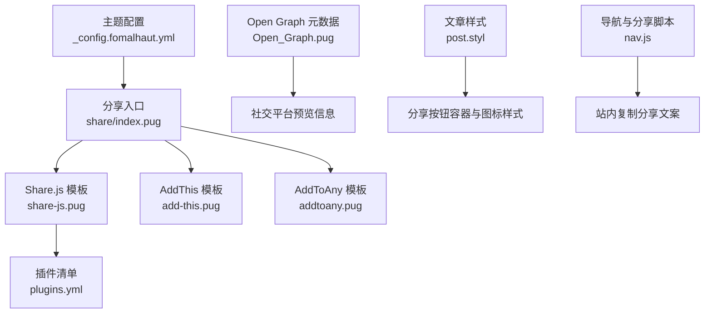
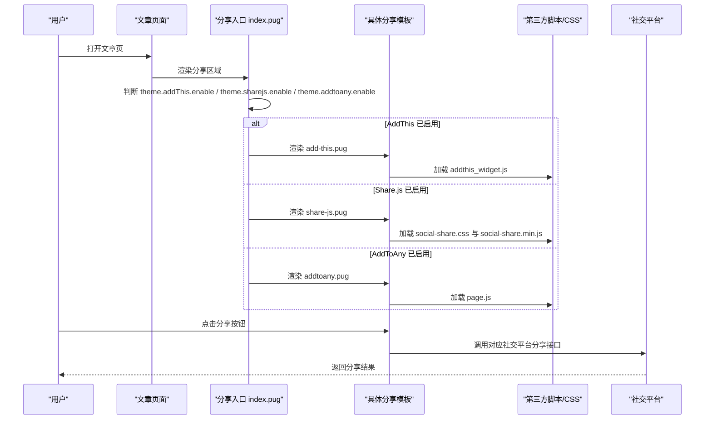
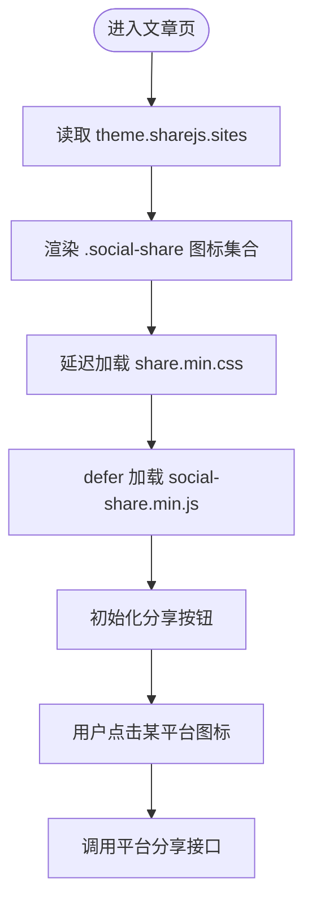
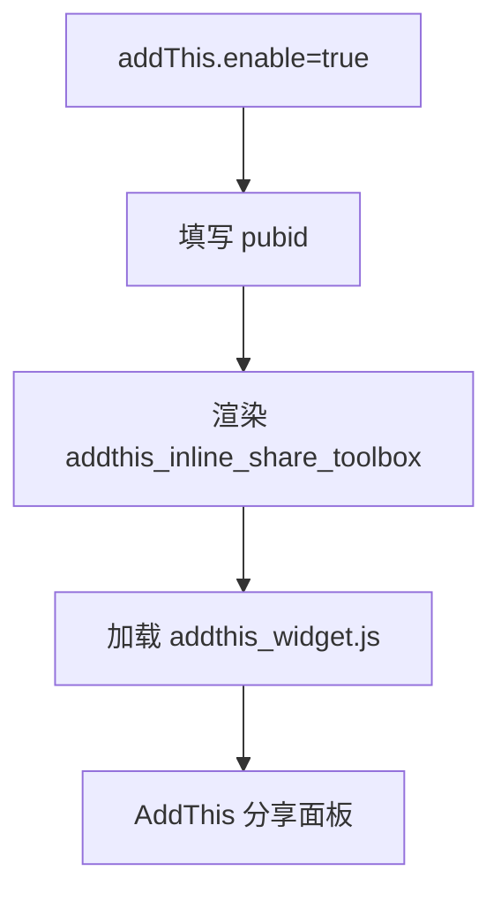
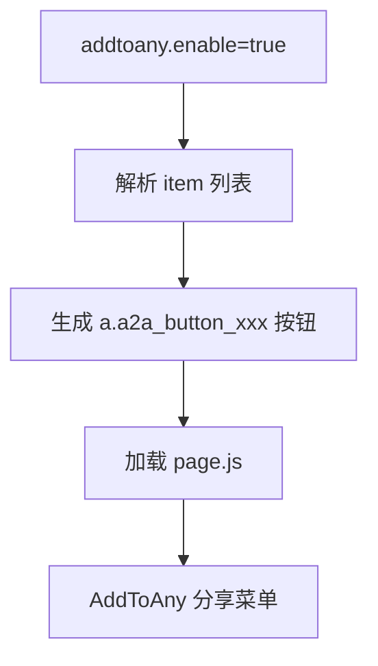
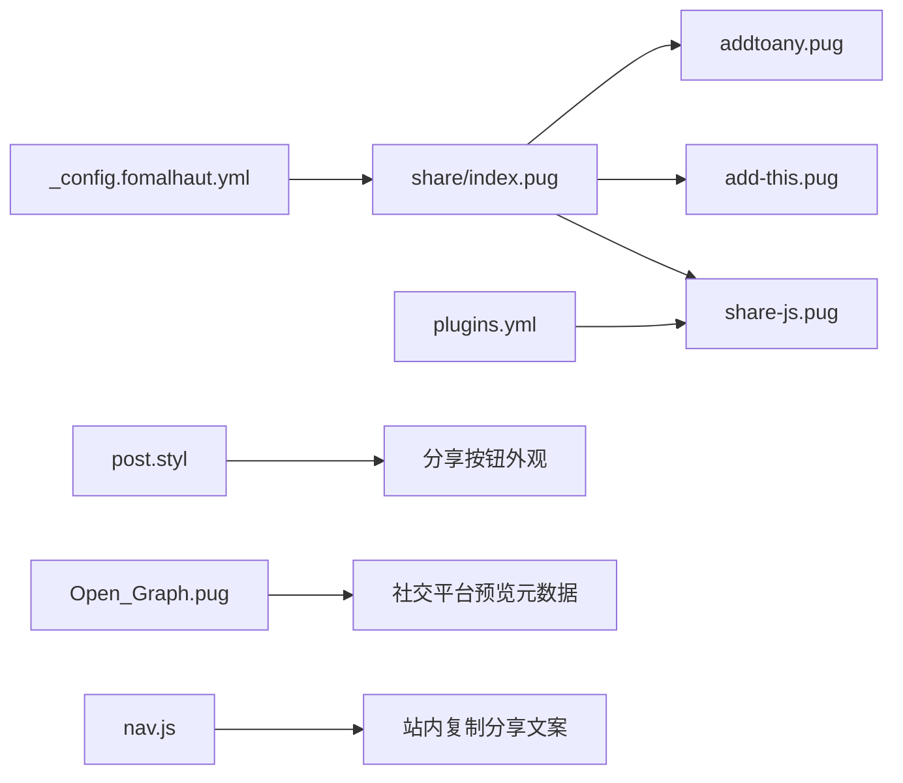
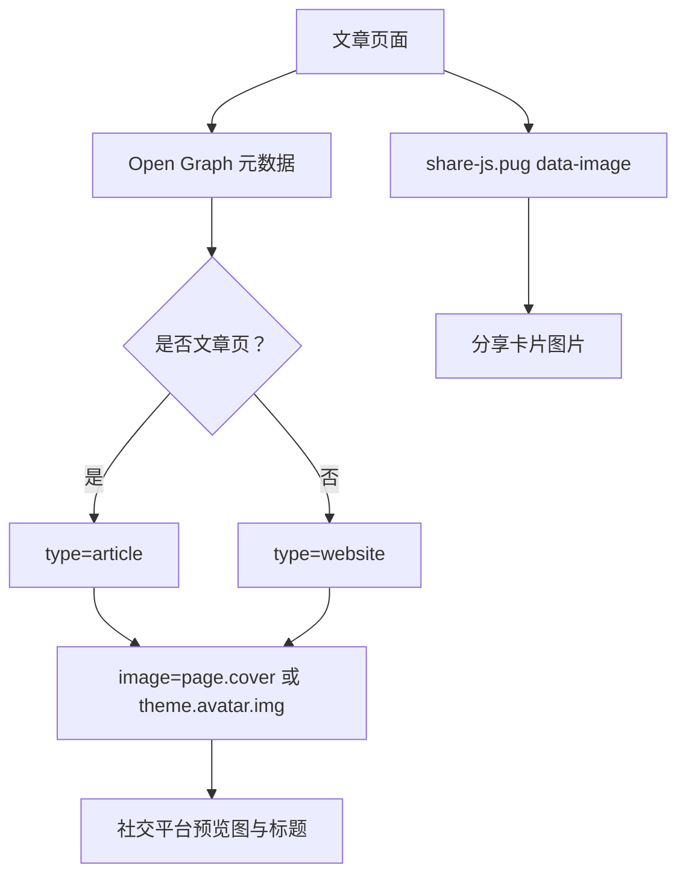

# 分享组件集成

<cite>
**本文引用的文件**   
- [主题配置 _config.fomalhaut.yml](file://_config.fomalhaut.yml)
- [站点根配置 _config.yml](file://_config.yml)
- [主题配置 themes/fomalhaut/_config.yml](file://themes/fomalhaut/_config.yml)
- [插件清单 themes/fomalhaut/plugins.yml](file://themes/fomalhaut/plugins.yml)
- [分享入口 index.pug](file://themes/fomalhaut/layout/includes/third-party/share/index.pug)
- [Share.js 模板 share-js.pug](file://themes/fomalhaut/layout/includes/third-party/share/share-js.pug)
- [AddThis 模板 add-this.pug](file://themes/fomalhaut/layout/includes/third-party/share/add-this.pug)
- [AddToAny 模板 addtoany.pug](file://themes/fomalhaut/layout/includes/third-party/share/addtoany.pug)
- [Open Graph 元数据 Open_Graph.pug](file://themes/fomalhaut/layout/includes/head/Open_Graph.pug)
- [文章样式 post.styl](file://themes/fomalhaut/source/css/_layout/post.styl)
- [导航与分享脚本 nav.js](file://source/js/modules/nav.js)
- [网站统计说明 README.md](file://README.md)
</cite>

## 目录
1. [引言](#引言)
2. [项目结构](#项目结构)
3. [核心组件](#核心组件)
4. [架构总览](#架构总览)
5. [详细组件分析](#详细组件分析)
6. [依赖关系分析](#依赖关系分析)
7. [性能与隐私优化](#性能与隐私优化)
8. [移动端适配与用户体验](#移动端适配与用户体验)
9. [分享链接、标题与描述生成规则](#分享链接标题与描述生成规则)
10. [分享统计与数据分析](#分享统计与数据分析)
11. [常见问题排查](#常见问题排查)
12. [结论](#结论)

## 引言
本文面向在 Hexo + Fomalhaut 主题中集成“分享”功能的开发者与内容作者，系统性说明：
- 当前代码库支持的三种分享方案：Share.js、AddThis、AddToAny。
- 各方案的启用方式、社交平台支持范围、按钮样式与布局定制方法。
- 分享链接、标题、描述、图片的生成与提取逻辑。
- 移动端适配、性能优化、隐私保护策略。
- 如何结合现有站点统计能力做分享行为分析与问题排查。

## 项目结构
分享功能位于主题的第三方组件目录中，由一个统一的入口根据配置选择具体实现；页面渲染时注入对应 CSS/JS，并在文章底部展示分享区域。

**图示来源**
- [主题配置 _config.fomalhaut.yml:517-536](file://_config.fomalhaut.yml#L517-L536)
- [分享入口 index.pug:1-8](file://themes/fomalhaut/layout/includes/third-party/share/index.pug#L1-L8)
- [Share.js 模板 share-js.pug:1-3](file://themes/fomalhaut/layout/includes/third-party/share/share-js.pug#L1-L3)
- [AddThis 模板 add-this.pug:1-2](file://themes/fomalhaut/layout/includes/third-party/share/add-this.pug#L1-L2)
- [AddToAny 模板 addtoany.pug:1-11](file://themes/fomalhaut/layout/includes/third-party/share/addtoany.pug#L1-L11)
- [插件清单 themes/fomalhaut/plugins.yml:51-57](file://themes/fomalhaut/plugins.yml#L51-L57)
- [Open Graph 元数据 Open_Graph.pug:1-12](file://themes/fomalhaut/layout/includes/head/Open_Graph.pug#L1-L12)
- [文章样式 post.styl:413-427](file://themes/fomalhaut/source/css/_layout/post.styl#L413-L427)
- [导航与分享脚本 nav.js:197-229](file://source/js/modules/nav.js#L197-L229)

**章节来源**
- [主题配置 _config.fomalhaut.yml:517-536](file://_config.fomalhaut.yml#L517-L536)
- [分享入口 index.pug:1-8](file://themes/fomalhaut/layout/includes/third-party/share/index.pug#L1-L8)

## 核心组件
本项目的分享能力由以下三个可切换组件构成：

| 组件 | 作用 | 启用开关 | 主要社交平台 | 特点 |
|---|---|---|---|---|
| Share.js | 轻量级前端分享库 | `sharejs.enable` | Facebook、Twitter、微信、微博、QQ | 通过 data-sites 控制平台，资源可本地化或 CDN |
| AddThis | 第三方分享服务 | `addThis.enable` | 由其服务决定（通常覆盖主流平台） | 需要 pubid，服务端托管分享面板 |
| AddToAny | 第三方分享服务 | `addtoany.enable` | Facebook、Twitter、微信、新浪微博、Messenger、邮件、复制链接等 | 通过 item 列表控制按钮 |

优先级顺序为：AddThis → Share.js → AddToAny。当多个开关同时开启时，以 AddThis 优先。

**章节来源**
- [分享入口 index.pug:1-8](file://themes/fomalhaut/layout/includes/third-party/share/index.pug#L1-L8)
- [主题配置 _config.fomalhaut.yml:517-536](file://_config.fomalhaut.yml#L517-L536)

## 架构总览
分享组件的渲染流程如下：

**图示来源**
- [分享入口 index.pug:1-8](file://themes/fomalhaut/layout/includes/third-party/share/index.pug#L1-L8)
- [Share.js 模板 share-js.pug:1-3](file://themes/fomalhaut/layout/includes/third-party/share/share-js.pug#L1-L3)
- [AddThis 模板 add-this.pug:1-2](file://themes/fomalhaut/layout/includes/third-party/share/add-this.pug#L1-L2)
- [AddToAny 模板 addtoany.pug:1-11](file://themes/fomalhaut/layout/includes/third-party/share/addtoany.pug#L1-L11)

## 详细组件分析

### Share.js 组件
- 启用方式：在主题配置中设置 `sharejs.enable = true`，并通过 `sites` 指定平台，例如 `facebook,twitter,wechat,weibo,qq`。
- 资源加载：模板会引入 CSS 与 JS，并给 `.social-share` 元素注入 `data-image` 和 `data-sites`。
- 图片来源：优先使用文章的封面图；若无封面则回退到主题头像。
- 平台扩展：新增平台可在 `sites` 中添加对应名称；若需自定义平台，可参考 Share.js 官方文档扩展。

**图示来源**
- [Share.js 模板 share-js.pug:1-3](file://themes/fomalhaut/layout/includes/third-party/share/share-js.pug#L1-L3)
- [插件清单 themes/fomalhaut/plugins.yml:51-57](file://themes/fomalhaut/plugins.yml#L51-L57)

**章节来源**
- [主题配置 _config.fomalhaut.yml:526-530](file://_config.fomalhaut.yml#L526-L530)
- [Share.js 模板 share-js.pug:1-3](file://themes/fomalhaut/layout/includes/third-party/share/share-js.pug#L1-L3)
- [插件清单 themes/fomalhaut/plugins.yml:51-57](file://themes/fomalhaut/plugins.yml#L51-L57)

### AddThis 组件
- 启用方式：设置 `addThis.enable = true` 并填写 `pubid`。
- 渲染方式：模板输出 `.addthis_inline_share_toolbox` 容器，并异步加载 AddThis 脚本。
- 平台控制：由 AddThis 后台配置决定显示的平台与样式。

**图示来源**
- [AddThis 模板 add-this.pug:1-2](file://themes/fomalhaut/layout/includes/third-party/share/add-this.pug#L1-L2)
- [主题配置 _config.fomalhaut.yml:520-525](file://_config.fomalhaut.yml#L520-L525)

**章节来源**
- [主题配置 _config.fomalhaut.yml:520-525](file://_config.fomalhaut.yml#L520-L525)
- [AddThis 模板 add-this.pug:1-2](file://themes/fomalhaut/layout/includes/third-party/share/add-this.pug#L1-L2)

### AddToAny 组件
- 启用方式：设置 `addtoany.enable = true`，并通过 `item` 指定按钮项，如 `facebook,twitter,wechat,sina_weibo,facebook_messenger,email,copy_link`。
- 渲染方式：模板按逗号分隔生成多个按钮，并异步加载 AddToAny 菜单脚本。
- 平台控制：由 item 列表决定显示的分享入口。

**图示来源**
- [AddToAny 模板 addtoany.pug:1-11](file://themes/fomalhaut/layout/includes/third-party/share/addtoany.pug#L1-L11)
- [主题配置 _config.fomalhaut.yml:532-536](file://_config.fomalhaut.yml#L532-L536)

**章节来源**
- [主题配置 _config.fomalhaut.yml:532-536](file://_config.fomalhaut.yml#L532-L536)
- [AddToAny 模板 addtoany.pug:1-11](file://themes/fomalhaut/layout/includes/third-party/share/addtoany.pug#L1-L11)

## 依赖关系分析
分享组件与主题配置、模板、样式、脚本之间的关系如下：

**图示来源**
- [主题配置 _config.fomalhaut.yml:517-536](file://_config.fomalhaut.yml#L517-L536)
- [分享入口 index.pug:1-8](file://themes/fomalhaut/layout/includes/third-party/share/index.pug#L1-L8)
- [插件清单 themes/fomalhaut/plugins.yml:51-57](file://themes/fomalhaut/plugins.yml#L51-L57)
- [文章样式 post.styl:413-427](file://themes/fomalhaut/source/css/_layout/post.styl#L413-L427)
- [Open Graph 元数据 Open_Graph.pug:1-12](file://themes/fomalhaut/layout/includes/head/Open_Graph.pug#L1-L12)
- [导航与分享脚本 nav.js:197-229](file://source/js/modules/nav.js#L197-L229)

**章节来源**
- [主题配置 _config.fomalhaut.yml:517-536](file://_config.fomalhaut.yml#L517-L536)
- [分享入口 index.pug:1-8](file://themes/fomalhaut/layout/includes/third-party/share/index.pug#L1-L8)
- [插件清单 themes/fomalhaut/plugins.yml:51-57](file://themes/fomalhaut/plugins.yml#L51-L57)
- [文章样式 post.styl:413-427](file://themes/fomalhaut/source/css/_layout/post.styl#L413-L427)
- [Open Graph 元数据 Open_Graph.pug:1-12](file://themes/fomalhaut/layout/includes/head/Open_Graph.pug#L1-L12)
- [导航与分享脚本 nav.js:197-229](file://source/js/modules/nav.js#L197-L229)

## 性能与隐私优化
- 资源加载优化
  - Share.js 的 CSS 使用 print media + onload 切换为 all，避免阻塞首屏；JS 使用 defer 异步加载。
  - AddThis 与 AddToAny 均通过 async 加载脚本，减少主线程阻塞。
- 按需启用
  - 仅启用一种分享方案，避免重复加载多个第三方 SDK。
  - 对不需要的外部平台从 sites/item 中移除，减少初始化开销。
- 隐私保护
  - 第三方分享服务可能向社交平台发送当前 URL、标题等信息；如需最小化数据外发，建议优先使用 Share.js 本地库，并谨慎配置 sites。
  - 对于 AddThis/AddToAny，建议在隐私政策中说明分享行为及第三方数据处理。
- 构建与缓存
  - 将 Share.js 资源纳入站点静态资源构建管线，配合 CDN 缓存提升加载速度。
  - 对第三方脚本使用可靠的国内镜像或自托管，降低网络失败风险。

[本节为通用指导，不直接分析具体代码文件]

## 移动端适配与用户体验
- 布局与尺寸
  - 分享按钮容器 `.post_share` 右浮动，宽度自适应；图标尺寸由 post.styl 统一控制，适合移动端小屏幕。
  - 可通过调整 `.social-share-icon` 的宽高与字号来适配不同设备密度。
- 交互体验
  - 分享按钮应提供明确的视觉反馈（hover/active），并确保触摸目标足够大。
  - 站内“复制分享文案”功能通过导航脚本实现，复制成功后弹出通知提示，提升用户感知。
- 无障碍与可读性
  - 分享图标应有合适的 aria-label 或 title，便于辅助技术识别。
  - 颜色对比度应符合 WCAG 标准，尤其在深色模式下。

**章节来源**
- [文章样式 post.styl:413-427](file://themes/fomalhaut/source/css/_layout/post.styl#L413-L427)
- [导航与分享脚本 nav.js:197-229](file://source/js/modules/nav.js#L197-L229)

## 分享链接、标题与描述生成规则
- 分享链接
  - 社交平台分享通常基于当前页面的 URL；Hexo 的 permalink 配置决定最终链接格式。
  - 站内复制分享文案时，脚本拼接 `window.location.origin + window.location.pathname` 作为链接。
- 标题与描述
  - 社交平台预览信息主要由 Open Graph 元数据提供；主题会根据是否为文章页设置 type，并注入 image、fb_admins、fb_app_id。
  - 若未启用 Open Graph，主题会回退到 description meta。
- 图片
  - Share.js 通过 `data-image` 指定分享图片，优先使用文章封面，否则使用主题头像。
  - Open Graph 中的 image 字段用于社交平台预览图。

**图示来源**
- [Open Graph 元数据 Open_Graph.pug:1-12](file://themes/fomalhaut/layout/includes/head/Open_Graph.pug#L1-L12)
- [Share.js 模板 share-js.pug:1-3](file://themes/fomalhaut/layout/includes/third-party/share/share-js.pug#L1-L3)
- [站点根配置 _config.yml:19-26](file://_config.yml#L19-L26)
- [导航与分享脚本 nav.js:197-229](file://source/js/modules/nav.js#L197-L229)

**章节来源**
- [Open Graph 元数据 Open_Graph.pug:1-12](file://themes/fomalhaut/layout/includes/head/Open_Graph.pug#L1-L12)
- [Share.js 模板 share-js.pug:1-3](file://themes/fomalhaut/layout/includes/third-party/share/share-js.pug#L1-L3)
- [站点根配置 _config.yml:19-26](file://_config.yml#L19-L26)
- [导航与分享脚本 nav.js:197-229](file://source/js/modules/nav.js#L197-L229)

## 分享统计与数据分析
- 分享行为本身通常不由站点后端记录，而是由第三方分享服务或社交平台侧统计。
- 站点层面的访问统计可结合现有方案：
  - 不蒜子：前端 PV/UV，零配置。
  - 百度统计、Google Analytics、CNZZ、Cloudflare Analytics、Microsoft Clarity：通过主题配置填入 ID 即可生效。
  - 51LA + 灵雀监控：需在站点脚本中配置 ID。
- 分享效果评估建议：
  - 使用第三方分享服务的后台查看分享次数、平台分布。
  - 结合站点访问统计，观察分享后流量变化。
  - 对高分享率内容进行专题运营与二次传播。

**章节来源**
- [网站统计说明 README.md:820-863](file://README.md#L820-L863)
- [主题配置 themes/fomalhaut/_config.yml:416-435](file://themes/fomalhaut/_config.yml#L416-L435)

## 常见问题排查
- 分享图片不显示
  - 检查文章是否设置了封面图；若无封面，Share.js 会使用主题头像。
  - 确认 Open Graph 的 image 字段是否正确生成。
  - 检查图片 URL 是否可访问，CDN 是否生效。
- 分享链接失效
  - 检查 Hexo 的 permalink 配置是否合理。
  - 确认部署后的域名与 url 配置一致。
  - 检查外部链接跳转策略（external_link）是否影响分享链接。
- 分享按钮不出现
  - 确认已启用至少一种分享方案。
  - 检查浏览器控制台是否有第三方脚本加载错误。
  - 核对 CSS 是否被主题覆盖或冲突。
- 社交平台预览异常
  - 检查 Open Graph 元数据是否包含必要的 title、description、image。
  - 使用社交平台提供的调试工具（如 Facebook Sharing Debugger）验证元数据。
- 移动端显示异常
  - 检查 post.styl 中分享按钮样式是否被自定义 CSS 覆盖。
  - 确保触摸目标大小符合移动端交互规范。

**章节来源**
- [Share.js 模板 share-js.pug:1-3](file://themes/fomalhaut/layout/includes/third-party/share/share-js.pug#L1-L3)
- [Open Graph 元数据 Open_Graph.pug:1-12](file://themes/fomalhaut/layout/includes/head/Open_Graph.pug#L1-L12)
- [站点根配置 _config.yml:19-26](file://_config.yml#L19-L26)
- [文章样式 post.styl:413-427](file://themes/fomalhaut/source/css/_layout/post.styl#L413-L427)

## 结论
本项目通过 Share.js、AddThis、AddToAny 三种方案提供灵活的分享能力。推荐优先使用 Share.js 以获得更好的可控性与性能；如需更丰富的平台支持与托管面板，可选择 AddThis 或 AddToAny。结合 Open Graph 元数据与站点统计体系，可实现完整的分享链路闭环。在实际部署中，应关注资源加载性能、隐私合规与移动端体验，并根据业务需求持续优化分享内容与传播效果。

[本节为总结性内容，不直接分析具体代码文件]