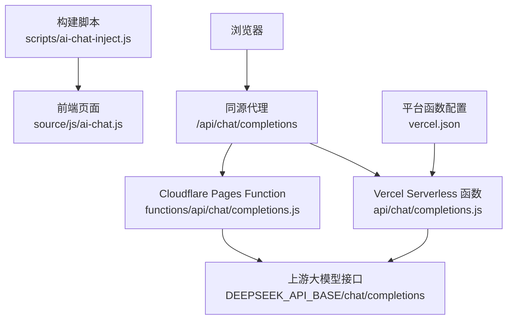
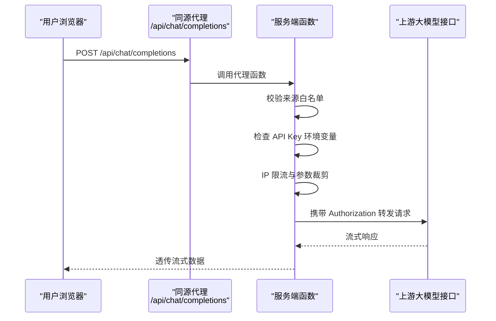
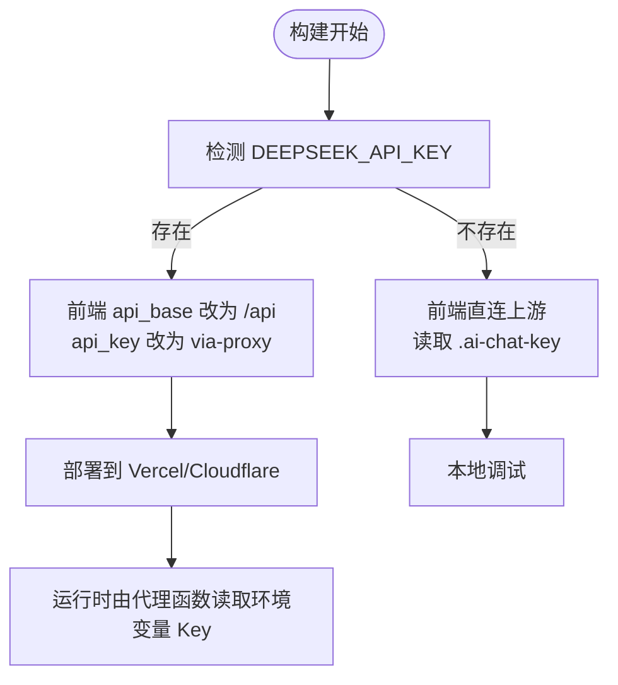
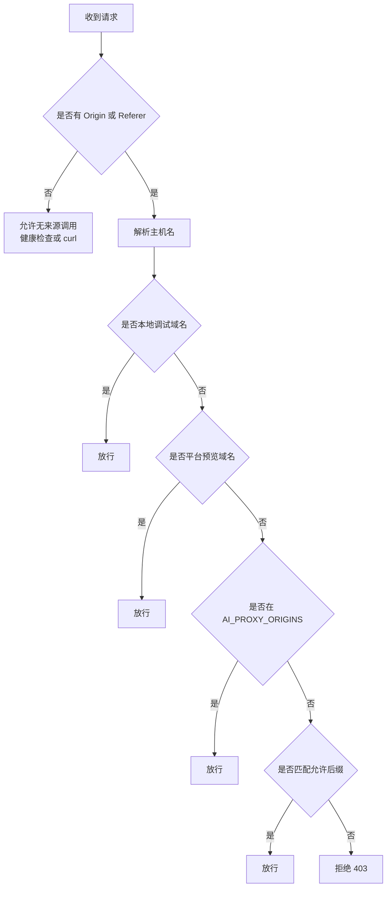
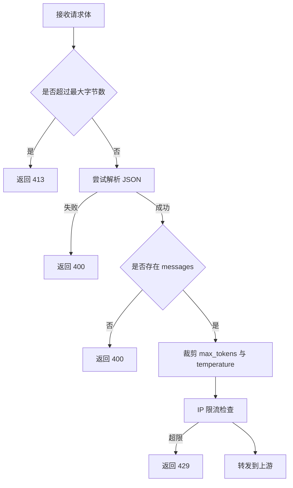
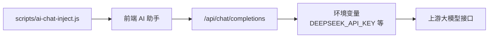

# 安全与隐私配置

<cite>
**本文引用的文件**   
- [api/chat/completions.js](file://api/chat/completions.js)
- [functions/api/chat/completions.js](file://functions/api/chat/completions.js)
- [scripts/ai-chat-inject.js](file://scripts/ai-chat-inject.js)
- [scripts/vercel-api-copy.js](file://scripts/vercel-api-copy.js)
- [vercel.json](file://vercel.json)
- [_config.yml](file://_config.yml)
- [_config.fomalhaut.yml](file://_config.fomalhaut.yml)
- [README.md](file://README.md)
</cite>

## 目录
1. [引言](#引言)
2. [项目结构](#项目结构)
3. [核心组件](#核心组件)
4. [架构总览](#架构总览)
5. [详细组件分析](#详细组件分析)
6. [依赖关系分析](#依赖关系分析)
7. [性能与安全特性](#性能与安全特性)
8. [合规与隐私实践](#合规与隐私实践)
9. [第三方服务风险评估与替代方案](#第三方服务风险评估与替代方案)
10. [安全审计与漏洞扫描建议](#安全审计与漏洞扫描建议)
11. [应急响应与监控告警](#应急响应与监控告警)
12. [故障排查](#故障排查)
13. [结论](#结论)

## 引言
本指导文档面向使用本仓库作为博客或内容站点的团队，聚焦“第三方服务安全与隐私配置”。仓库中已实现一个面向大模型对话的代理函数，并配套前端注入逻辑、部署配置和平台函数定义。本文围绕以下目标展开：
- API Key 与敏感信息的安全管理策略，包括环境变量、密钥轮换和安全存储。
- 跨域请求（CORS）与来源白名单的配置方法。
- 隐私保护合规要求，如 GDPR、CCPA 的最小化收集与匿名化思路。
- 安全审计、漏洞扫描与持续集成建议。
- 第三方服务的风险评估、替代方案选择。
- 安全事件应急响应流程与监控告警配置。

## 项目结构
本项目是 Hexo 静态站点 + 主题 Butterfly/Fomalhaut + Vercel/Cloudflare 函数的组合。与安全相关的关键位置如下：
- 站点根级配置：`_config.yml`、`_config.fomalhaut.yml`。
- 代理函数：`api/chat/completions.js`（Vercel）、`functions/api/chat/completions.js`（Cloudflare Pages）。
- 构建期注入脚本：`scripts/ai-chat-inject.js`、`scripts/vercel-api-copy.js`。
- 平台函数配置：`vercel.json`。
- 使用说明与部署说明：`README.md`。

**图表来源**
- [api/chat/completions.js:1-209](file://api/chat/completions.js#L1-L209)
- [functions/api/chat/completions.js:1-184](file://functions/api/chat/completions.js#L1-L184)
- [scripts/ai-chat-inject.js:28-72](file://scripts/ai-chat-inject.js#L28-L72)
- [vercel.json:1-12](file://vercel.json#L1-L12)

**章节来源**
- [api/chat/completions.js:1-209](file://api/chat/completions.js#L1-L209)
- [functions/api/chat/completions.js:1-184](file://functions/api/chat/completions.js#L1-L184)
- [scripts/ai-chat-inject.js:28-72](file://scripts/ai-chat-inject.js#L28-L72)
- [vercel.json:1-12](file://vercel.json#L1-L12)

## 核心组件
- 代理函数：负责校验来源、限流、参数裁剪、读取服务端环境变量中的 API Key，并转发到上游大模型接口。
- 前端注入脚本：在构建阶段根据是否存在部署环境变量，决定是否把前端请求改为同源代理路径，并把真实 Key 替换为占位符。
- 平台函数配置：限制函数执行时长与内存，指定运行区域。
- 站点配置：包含 Algolia、评论系统、统计等第三方服务开关与占位配置。

**章节来源**
- [api/chat/completions.js:1-209](file://api/chat/completions.js#L1-L209)
- [functions/api/chat/completions.js:1-184](file://functions/api/chat/completions.js#L1-L184)
- [scripts/ai-chat-inject.js:28-72](file://scripts/ai-chat-inject.js#L28-L72)
- [_config.yml:145-167](file://_config.yml#L145-L167)
- [_config.fomalhaut.yml:538-653](file://_config.fomalhaut.yml#L538-L653)

## 架构总览
下图展示一次用户发起 AI 对话的安全边界：浏览器不直接持有上游 Key，而是通过同源代理；代理在服务端读取环境变量中的 Key，并对请求做来源校验、限流、参数约束。

**图表来源**
- [api/chat/completions.js:118-209](file://api/chat/completions.js#L118-L209)
- [functions/api/chat/completions.js:108-184](file://functions/api/chat/completions.js#L108-L184)

## 详细组件分析

### API Key 与敏感信息管理
当前实现遵循“Key 不进前端”的原则：
- 代理函数从环境变量读取 `DEEPSEEK_API_KEY`，并在请求头中加上 `Authorization: Bearer <key>`。
- 前端注入脚本在构建时检测部署环境变量，若存在则把前端的 `api_base` 改为 `/api`，并把 `api_key` 替换为占位符。
- 本地开发可回退到从 `.ai-chat-key` 文件读取 Key，但生产环境应关闭直连模式，只走代理。

**图表来源**
- [scripts/ai-chat-inject.js:28-72](file://scripts/ai-chat-inject.js#L28-L72)
- [api/chat/completions.js:138-140](file://api/chat/completions.js#L138-L140)
- [functions/api/chat/completions.js:121-124](file://functions/api/chat/completions.js#L121-L124)

**章节来源**
- [scripts/ai-chat-inject.js:28-72](file://scripts/ai-chat-inject.js#L28-L72)
- [api/chat/completions.js:1-25](file://api/chat/completions.js#L1-L25)
- [functions/api/chat/completions.js:1-21](file://functions/api/chat/completions.js#L1-L21)
- [_config.fomalhaut.yml:1559-1568](file://_config.fomalhaut.yml#L1559-L1568)

#### 环境变量配置清单
- `DEEPSEEK_API_KEY`：必填，上游服务访问密钥。
- `DEEPSEEK_MODEL`：可选，默认 `deepseek-chat`。
- `DEEPSEEK_API_BASE`：可选，默认 `https://api.deepseek.com`，用于切换上游地址。
- `AI_PROXY_ORIGINS`：可选，额外放行的来源域名，支持逗号分隔、裸域名、通配子域、`*` 全放行。
- `AI_PROXY_ALLOW_SUFFIXES`：可选，修改默认允许的后缀，默认 `example.com`。
- `AI_PROXY_MAX_PER_HOUR`：可选，每 IP 每小时请求上限，默认 120。

**章节来源**
- [api/chat/completions.js:13-21](file://api/chat/completions.js#L13-L21)
- [functions/api/chat/completions.js:13-21](file://functions/api/chat/completions.js#L13-L21)
- [README.md:966-983](file://README.md#L966-L983)

#### 密钥轮换与安全存储建议
- 将 `DEEPSEEK_API_KEY` 仅保存在平台环境变量中，不要写入 `_config.yml`、`_config.fomalhaut.yml` 或前端脚本。
- 定期轮换 Key：在上游服务商控制台生成新 Key，先在预览环境验证，再切换到生产环境。
- 最小权限原则：如果上游支持按用途拆分 Key，则为代理函数单独创建受限 Key。
- 本地开发建议使用 `.ai-chat-key` 文件，并确保该文件加入 `.gitignore`，避免提交到仓库。
- 对 Cloudflare Pages，可将变量类型设置为“加密”，减少泄露风险。

**章节来源**
- [_config.fomalhaut.yml:1559-1568](file://_config.fomalhaut.yml#L1559-L1568)
- [functions/api/chat/completions.js:13-21](file://functions/api/chat/completions.js#L13-L21)

### 跨域请求（CORS）与来源白名单
代理函数实现了基于 `Origin` 和 `Referer` 的来源校验，而不是简单设置 `Access-Control-Allow-Origin: *`。其策略包括：
- 默认放行 `example.com` 及其所有子域。
- 支持通过 `AI_PROXY_ORIGINS` 添加额外域名，支持裸域名、`*.domain` 通配、`*` 全放行。
- 始终放行本地调试地址：`localhost`、`127.0.0.1`、`::1`、`*.local`。
- 放行平台预览域名：`*.vercel.app`、`*.pages.dev`。
- 对非 POST 请求返回明确错误，OPTIONS 预检返回允许的 HTTP 方法。

**图表来源**
- [api/chat/completions.js:47-95](file://api/chat/completions.js#L47-L95)
- [functions/api/chat/completions.js:36-84](file://functions/api/chat/completions.js#L36-L84)

**章节来源**
- [api/chat/completions.js:47-95](file://api/chat/completions.js#L47-L95)
- [functions/api/chat/completions.js:36-84](file://functions/api/chat/completions.js#L36-L84)
- [README.md:972-983](file://README.md#L972-L983)

### 请求限流与参数安全
代理函数对输入做了多层防护：
- 请求体大小限制：防止过大请求占用资源。
- JSON 格式校验：非法 JSON 直接拒绝。
- 消息数量限制：只保留最近若干条消息。
- 单条消息内容长度限制：防止超长内容。
- `max_tokens` 与 `temperature` 范围裁剪：避免异常值导致上游异常或成本飙升。
- 每 IP 每小时请求次数限制：默认 120 次，可通过环境变量调整。

**图表来源**
- [api/chat/completions.js:143-162](file://api/chat/completions.js#L143-L162)
- [functions/api/chat/completions.js:128-146](file://functions/api/chat/completions.js#L128-L146)

**章节来源**
- [api/chat/completions.js:29-35](file://api/chat/completions.js#L29-L35)
- [functions/api/chat/completions.js:23-26](file://functions/api/chat/completions.js#L23-L26)
- [api/chat/completions.js:103-110](file://api/chat/completions.js#L103-L110)
- [functions/api/chat/completions.js:97-106](file://functions/api/chat/completions.js#L97-L106)

### 构建期脚本与部署复制
- `scripts/ai-chat-inject.js`：在 HTML 渲染后注入 AI 助手配置，并根据部署环境变量决定前端走代理还是直连。
- `scripts/vercel-api-copy.js`：在 Hexo 生成后把代理函数和 `vercel.json` 复制到 `public` 目录，便于某些平台读取。
- `vercel.json`：定义函数执行时长、内存和运行区域。

**章节来源**
- [scripts/ai-chat-inject.js:28-72](file://scripts/ai-chat-inject.js#L28-L72)
- [scripts/vercel-api-copy.js:20-46](file://scripts/vercel-api-copy.js#L20-L46)
- [vercel.json:1-12](file://vercel.json#L1-L12)

## 依赖关系分析
- 前端脚本依赖构建期注入逻辑，决定是否使用代理路径。
- 代理函数依赖平台环境变量，不依赖前端代码。
- 站点配置文件中包含多个第三方服务开关，但这些配置本身不应包含真实 Key。

**图表来源**
- [scripts/ai-chat-inject.js:28-72](file://scripts/ai-chat-inject.js#L28-L72)
- [api/chat/completions.js:138-172](file://api/chat/completions.js#L138-L172)

**章节来源**
- [scripts/ai-chat-inject.js:28-72](file://scripts/ai-chat-inject.js#L28-L72)
- [api/chat/completions.js:138-172](file://api/chat/completions.js#L138-L172)

## 性能与安全特性
- 流式响应：代理函数向上游获取流式响应并透传给浏览器，降低首屏等待时间。
- 缓存控制：代理响应设置 `no-store` 或 `no-cache, no-transform`，避免敏感内容被缓存。
- 超时与中断：代理函数监听请求关闭事件，必要时中止上游请求。
- 平台函数限制：`vercel.json` 限制函数最大执行时间和内存，防止资源滥用。

**章节来源**
- [api/chat/completions.js:188-206](file://api/chat/completions.js#L188-L206)
- [functions/api/chat/completions.js:160-175](file://functions/api/chat/completions.js#L160-L175)
- [vercel.json:1-12](file://vercel.json#L1-L12)

## 合规与隐私实践
虽然仓库未内置完整的隐私政策模块，但可从现有第三方服务配置中提炼隐私最佳实践：

### 最小化数据收集
- 优先关闭不必要的第三方服务，例如统计、广告、评论、分享等。
- 对于必须启用的服务，仅启用必要字段，例如搜索插件只索引标题或摘要，而非全文。
- 避免在前端日志、URL 参数、错误消息中记录用户身份信息。

**章节来源**
- [_config.yml:145-167](file://_config.yml#L145-L167)
- [_config.fomalhaut.yml:538-653](file://_config.fomalhaut.yml#L538-L653)

### 匿名化与去标识化
- 统计与分析服务尽量使用匿名 IP、聚合指标，避免持久化个人身份。
- 评论系统优先选择支持匿名评论且需审核的模式，减少邮箱等敏感字段暴露。
- 对用户输入进行长度与字符集限制，避免注入攻击和数据污染。

### GDPR 与 CCPA 遵循要点
- 提供隐私政策链接，说明数据收集目的、第三方共享情况、用户权利。
- 对欧盟用户，提供退出跟踪、删除数据的渠道。
- 对加州用户，提供“不出售个人信息”声明及相应选项。
- 数据跨境传输需评估托管平台所在司法管辖区。

[本节为通用合规指导，不直接分析具体源码]

## 第三方服务风险评估与替代方案

### 当前使用的第三方服务
- 大模型接口：通过代理函数访问上游服务，Key 保存在服务端环境变量。
- 搜索服务：Algolia 配置存在于站点配置中，但 Key 应为占位符。
- 评论系统：主题配置支持多种评论服务，当前默认 Twikoo。
- 统计分析：主题配置包含百度、Google、CNZZ、Cloudflare、Microsoft Clarity 等开关。

**章节来源**
- [_config.yml:145-167](file://_config.yml#L145-L167)
- [_config.fomalhaut.yml:538-653](file://_config.fomalhaut.yml#L538-L653)

### 风险评估维度
- 密钥泄露风险：前端内联 Key 风险最高；服务端环境变量风险较低但仍需访问控制。
- 数据出境风险：上游服务可能位于境外，需评估数据存储与处理地点。
- 供应商锁定风险：过度依赖单一厂商会增加迁移成本。
- 可用性风险：上游服务宕机或限流会影响用户体验。

### 替代方案选择指南
- 上游大模型：可选择支持 OpenAI 兼容接口的国内厂商，通过 `DEEPSEEK_API_BASE` 切换。
- 搜索服务：可考虑本地搜索、自建 Elasticsearch 或更可控的托管方案。
- 评论系统：可优先选择自托管方案，如 Waline、Giscus，减少对第三方账号体系的依赖。
- 统计分析：可优先使用隐私友好的分析工具，或自建埋点上报服务。

**章节来源**
- [README.md:985-987](file://README.md#L985-L987)
- [_config.fomalhaut.yml:538-653](file://_config.fomalhaut.yml#L538-L653)

## 安全审计与漏洞扫描建议
建议在 CI 流水线中加入以下步骤：
- 依赖漏洞扫描：使用 `npm audit` 或企业级 SCA 工具扫描 Node 依赖。
- 敏感信息扫描：禁止提交包含 Key、Token、密码的文件。
- 代码质量检查：对 JS 文件进行语法检查和基础规则校验。
- 构建产物检查：确认 `public` 目录不包含敏感配置文件。
- 部署前检查：确保环境变量已正确配置，代理函数健康检查通过。

[本节为通用安全实践建议，不直接分析具体源码]

## 应急响应与监控告警

### 安全事件分类
- 密钥泄露：立即轮换 Key，撤销旧 Key，检查访问日志。
- 滥用与刷量：收紧来源白名单、降低 `AI_PROXY_MAX_PER_HOUR`、启用上游限流。
- 上游服务不可用：切换 `DEEPSEEK_API_BASE` 或暂时关闭 AI 功能。
- 跨域绕过：检查 `AI_PROXY_ORIGINS` 是否误配为 `*`。

### 监控与告警
- 代理函数健康检查：定期访问 `/api/chat/completions`，检查返回状态与健康字段。
- 错误率监控：统计 400、403、413、429、500、502 比例，设置阈值告警。
- 上游延迟监控：记录上游响应时间，异常升高时触发告警。
- 配额监控：关注上游服务用量，接近限额时提前预警。

**章节来源**
- [api/chat/completions.js:118-141](file://api/chat/completions.js#L118-L141)
- [functions/api/chat/completions.js:108-126](file://functions/api/chat/completions.js#L108-L126)

## 故障排查

### 常见问题
- 提示“服务端没配 DEEPSEEK_API_KEY”：检查平台环境变量是否已添加并重新部署。
- 提示“来源不在白名单”：检查 `AI_PROXY_ORIGINS` 或默认后缀是否包含当前域名。
- 提示“请求太频繁了”：检查 `AI_PROXY_MAX_PER_HOUR` 是否过低，或是否存在自动化脚本刷量。
- 前端仍直连上游：检查构建环境是否设置了 `DEEPSEEK_API_KEY`，以及是否使用了代理模式。

**章节来源**
- [api/chat/completions.js:138-141](file://api/chat/completions.js#L138-L141)
- [functions/api/chat/completions.js:117-126](file://functions/api/chat/completions.js#L117-L126)
- [README.md:966-972](file://README.md#L966-L972)

## 结论
本仓库已经实现了较为完整的安全代理模式：Key 留在服务端、来源白名单、请求限流、参数裁剪、流式响应和平台函数限制。在此基础上，建议团队进一步落实：
- 严格的环境变量管理与密钥轮换机制。
- 明确的隐私政策与第三方服务最小化接入策略。
- 持续的依赖扫描、敏感信息扫描和部署前检查。
- 完善的监控、告警与应急响应流程。
- 对高风险第三方服务制定替代方案和迁移计划。

通过这些措施，可以在保证用户体验的同时，显著降低第三方服务带来的安全与隐私风险。