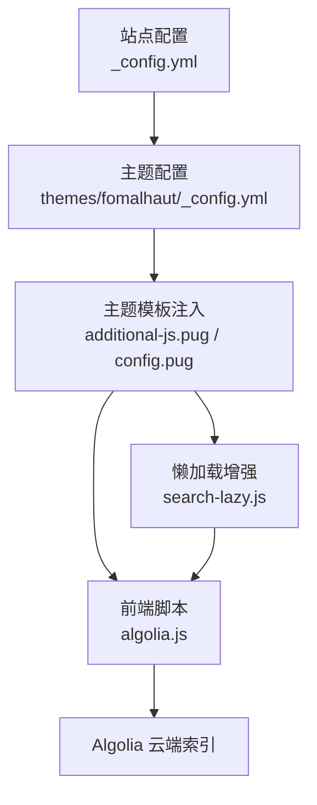
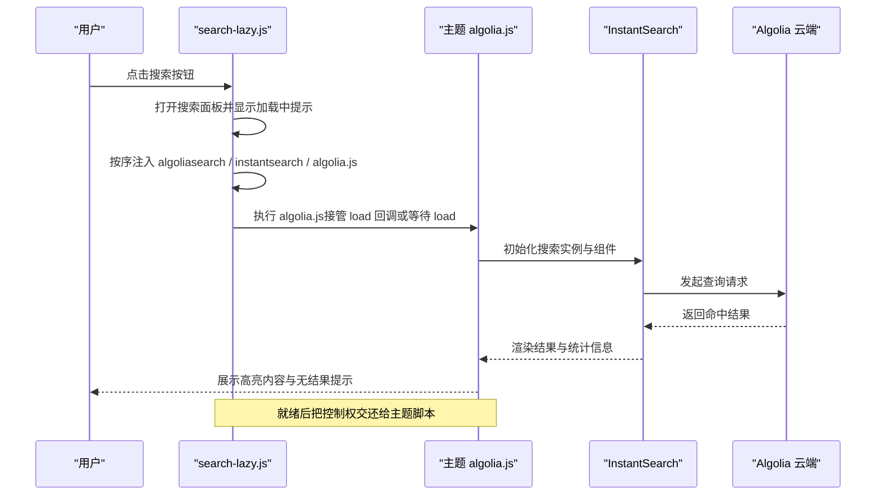
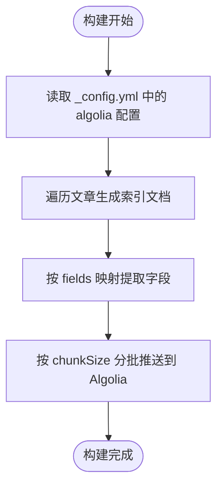
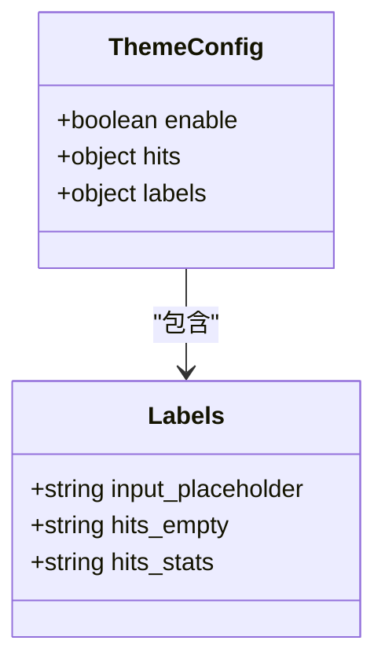
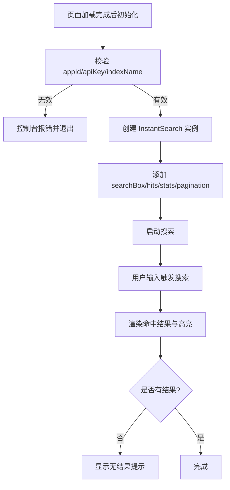
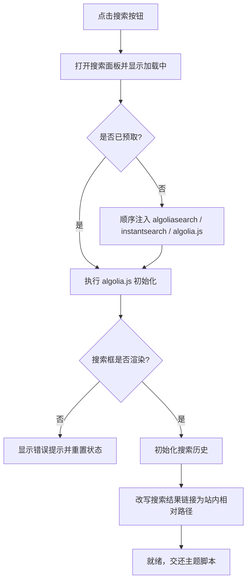
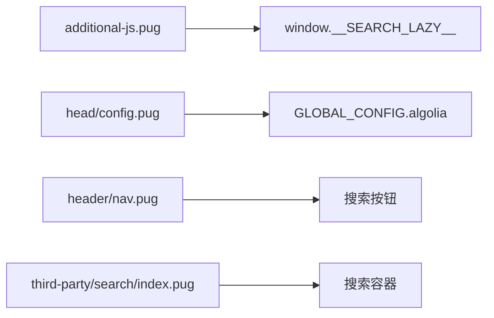
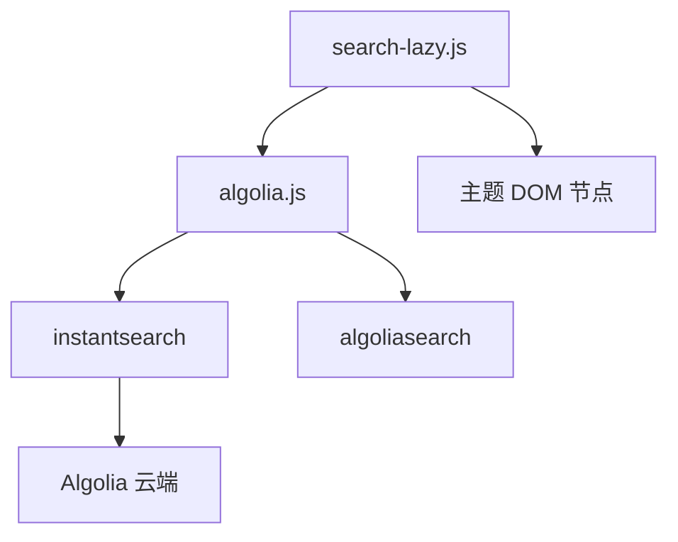

# 搜索服务集成

<cite>
**本文引用的文件**   
- [_config.yml](file://_config.yml)
- [_config.fomalhaut.yml](file://_config.fomalhaut.yml)
- [themes/fomalhaut/_config.yml](file://themes/fomalhaut/_config.yml)
- [themes/fomalhaut/source/js/search/algolia.js](file://themes/fomalhaut/source/js/search/algolia.js)
- [source/js/inject/search-lazy.js](file://source/js/inject/search-lazy.js)
- [themes/fomalhaut/layout/includes/additional-js.pug](file://themes/fomalhaut/layout/includes/additional-js.pug)
- [themes/fomalhaut/layout/includes/head/config.pug](file://themes/fomalhaut/layout/includes/head/config.pug)
- [themes/fomalhaut/layout/includes/header/nav.pug](file://themes/fomalhaut/layout/includes/header/nav.pug)
- [themes/fomalhaut/layout/includes/third-party/search/index.pug](file://themes/fomalhaut/layout/includes/third-party/search/index.pug)
</cite>

## 目录
1. [简介](#简介)
2. [项目结构](#项目结构)
3. [核心组件](#核心组件)
4. [架构总览](#架构总览)
5. [详细组件分析](#详细组件分析)
6. [依赖关系分析](#依赖关系分析)
7. [性能与优化](#性能与优化)
8. [PWA 与离线缓存](#pwa-与离线缓存)
9. [故障排除指南](#故障排除指南)
10. [结论](#结论)

## 简介
本文件面向在本仓库中集成 Algolia 搜索引擎的完整流程，覆盖账户与索引准备、数据同步配置、前端搜索实现、懒加载与性能优化、样式与交互定制、以及 PWA 与离线策略。同时给出常见问题排查路径和最佳实践建议，帮助你在本地预览与线上部署时获得一致、稳定、高性能的搜索体验。

## 项目结构
本项目采用 Hexo + Butterfly 主题（fomalhaut）组织内容，搜索能力由以下层次构成：
- 站点配置层：定义 Algolia 插件参数、字段映射、索引名等。
- 主题配置层：控制是否启用 Algolia 搜索、每页命中数、提示文案等。
- 构建注入层：在页面头部注入全局配置与按需加载脚本入口。
- 前端运行层：Algolia InstantSearch 初始化、结果渲染、交互逻辑。
- 懒加载增强层：空闲预取、点击兜底、错误提示、搜索历史、链接改写。

**图示来源**
- [_config.yml:145-167](file://_config.yml#L145-L167)
- [_config.fomalhaut.yml:69-84](file://_config.fomalhaut.yml#L69-L84)
- [themes/fomalhaut/_config.yml:45-55](file://themes/fomalhaut/_config.yml#L45-L55)
- [themes/fomalhaut/layout/includes/additional-js.pug:31-35](file://themes/fomalhaut/layout/includes/additional-js.pug#L31-L35)
- [themes/fomalhaut/layout/includes/head/config.pug:4-14](file://themes/fomalhaut/layout/includes/head/config.pug#L4-L14)
- [themes/fomalhaut/source/js/search/algolia.js:1-165](file://themes/fomalhaut/source/js/search/algolia.js#L1-L165)
- [source/js/inject/search-lazy.js:1-77](file://source/js/inject/search-lazy.js#L1-L77)

**章节来源**
- [_config.yml:145-167](file://_config.yml#L145-L167)
- [_config.fomalhaut.yml:69-84](file://_config.fomalhaut.yml#L69-L84)
- [themes/fomalhaut/_config.yml:45-55](file://themes/fomalhaut/_config.yml#L45-L55)

## 核心组件
- 站点级 Algolia 插件配置：包含应用 ID、API Key、索引名、字段映射、分块大小等。
- 主题级搜索开关与 UI 文案：控制 Algolia 搜索启用、命中数量、占位符与无结果提示。
- 运行时脚本：
  - algolia.js：基于 InstantSearch 初始化搜索面板、输入框、结果列表、统计信息与分页。
  - search-lazy.js：按需加载 Algolia 库、空闲预取、点击兜底、错误提示、搜索历史、搜索结果链接改写。
- 模板注入：根据主题开关动态注入全局配置与脚本 URL 列表。

**章节来源**
- [_config.yml:145-167](file://_config.yml#L145-L167)
- [_config.fomalhaut.yml:69-84](file://_config.fomalhaut.yml#L69-L84)
- [themes/fomalhaut/source/js/search/algolia.js:1-165](file://themes/fomalhaut/source/js/search/algolia.js#L1-L165)
- [source/js/inject/search-lazy.js:1-77](file://source/js/inject/search-lazy.js#L1-L77)

## 架构总览
下图展示从用户点击搜索按钮到返回结果的完整调用链，包括懒加载与主题脚本协作。

**图示来源**
- [source/js/inject/search-lazy.js:78-177](file://source/js/inject/search-lazy.js#L78-L177)
- [themes/fomalhaut/source/js/search/algolia.js:63-151](file://themes/fomalhaut/source/js/search/algolia.js#L63-L151)

## 详细组件分析

### Algolia 站点配置与索引字段
- 关键配置项：
  - appId、apiKey、adminApiKey：用于构建时推送索引。
  - indexName：目标索引名称。
  - fields：需要索引的字段，如标题、摘要、内容截断、标签、永久链接等。
  - chunkSize：批量写入的分块大小，影响构建期上传吞吐。
- 字段说明要点：
  - contentStripTruncate 用于限制内容长度，减少索引体积与网络传输。
  - permalink 作为结果跳转链接使用。
  - tags 可用于后续筛选扩展。

**图示来源**
- [_config.yml:145-167](file://_config.yml#L145-L167)

**章节来源**
- [_config.yml:145-167](file://_config.yml#L145-L167)

### 主题搜索开关与 UI 文案
- 主题开关：
  - algolia_search.enable：控制是否启用 Algolia 搜索。
  - hits.per_page：默认每页命中数。
- 文案配置：
  - input_placeholder：搜索框占位文本。
  - hits_empty：无结果提示模板。
  - hits_stats：结果统计模板，支持变量替换。

**图示来源**
- [_config.fomalhaut.yml:69-84](file://_config.fomalhaut.yml#L69-L84)
- [themes/fomalhaut/_config.yml:45-55](file://themes/fomalhaut/_config.yml#L45-L55)

**章节来源**
- [_config.fomalhaut.yml:69-84](file://_config.fomalhaut.yml#L69-L84)
- [themes/fomalhaut/_config.yml:45-55](file://themes/fomalhaut/_config.yml#L45-L55)

### 前端搜索初始化与交互（algolia.js）
- 功能要点：
  - 监听搜索按钮，打开遮罩与对话框，ESC 关闭。
  - 使用 InstantSearch 初始化搜索实例，绑定 searchBox、hits、stats、poweredBy、pagination。
  - 通过 configure 设置每页命中数。
  - 自定义 hit 模板，优先使用高亮后的内容片段，否则回退到普通内容。
  - 无结果时渲染空状态提示。
  - 兼容 pjax 刷新与面板关闭。

**图示来源**
- [themes/fomalhaut/source/js/search/algolia.js:1-165](file://themes/fomalhaut/source/js/search/algolia.js#L1-L165)

**章节来源**
- [themes/fomalhaut/source/js/search/algolia.js:1-165](file://themes/fomalhaut/source/js/search/algolia.js#L1-L165)

### 懒加载增强（search-lazy.js）
- 设计目标：
  - 避免首屏阻塞：将 Algolia 相关脚本改为按需加载。
  - 空闲预取：页面空闲时用 link rel=prefetch 预下载脚本。
  - 点击兜底：用户快速点击时先打开面板，再顺序注入脚本。
  - 健壮性：脚本失败时显示错误提示并可重试；若主题脚本因配置缺失静默退出，也给出明确提示。
  - 搜索历史：localStorage 存储最近 8 条去重历史，支持单条删除与清空。
  - 链接改写：将不同源的搜索结果链接改写为站内相对路径，避免跳出当前站点。

**图示来源**
- [source/js/inject/search-lazy.js:78-177](file://source/js/inject/search-lazy.js#L78-L177)
- [source/js/inject/search-lazy.js:227-262](file://source/js/inject/search-lazy.js#L227-L262)
- [source/js/inject/search-lazy.js:305-468](file://source/js/inject/search-lazy.js#L305-L468)

**章节来源**
- [source/js/inject/search-lazy.js:1-77](file://source/js/inject/search-lazy.js#L1-L77)
- [source/js/inject/search-lazy.js:78-177](file://source/js/inject/search-lazy.js#L78-L177)
- [source/js/inject/search-lazy.js:227-262](file://source/js/inject/search-lazy.js#L227-L262)
- [source/js/inject/search-lazy.js:305-468](file://source/js/inject/search-lazy.js#L305-L468)

### 模板注入与全局配置
- additional-js.pug：
  - 当主题启用 Algolia 搜索时，向 window.__SEARCH_LAZY__ 注入三条脚本 URL（algoliasearch、instantsearch、algolia.js）。
  - 否则注入本地搜索脚本。
- head/config.pug：
  - 将主题搜索配置注入全局 GLOBAL_CONFIG.algolia，包含 hits、labels 等。
- header/nav.pug：
  - 根据主题开关决定是否渲染搜索入口。
- third-party/search/index.pug：
  - 根据主题开关选择渲染 Algolia 或本地搜索容器。

**图示来源**
- [themes/fomalhaut/layout/includes/additional-js.pug:31-35](file://themes/fomalhaut/layout/includes/additional-js.pug#L31-L35)
- [themes/fomalhaut/layout/includes/head/config.pug:4-14](file://themes/fomalhaut/layout/includes/head/config.pug#L4-L14)
- [themes/fomalhaut/layout/includes/header/nav.pug:12](file://themes/fomalhaut/layout/includes/header/nav.pug#L12)
- [themes/fomalhaut/layout/includes/third-party/search/index.pug:1-3](file://themes/fomalhaut/layout/includes/third-party/search/index.pug#L1-L3)

**章节来源**
- [themes/fomalhaut/layout/includes/additional-js.pug:31-35](file://themes/fomalhaut/layout/includes/additional-js.pug#L31-L35)
- [themes/fomalhaut/layout/includes/head/config.pug:4-14](file://themes/fomalhaut/layout/includes/head/config.pug#L4-L14)
- [themes/fomalhaut/layout/includes/header/nav.pug:12](file://themes/fomalhaut/layout/includes/header/nav.pug#L12)
- [themes/fomalhaut/layout/includes/third-party/search/index.pug:1-3](file://themes/fomalhaut/layout/includes/third-party/search/index.pug#L1-L3)

## 依赖关系分析
- 模块耦合：
  - search-lazy.js 依赖主题提供的 DOM 节点（#algolia-search、#algolia-hits、#algolia-search-input）与全局动画函数 btf。
  - algolia.js 依赖 InstantSearch 与 algoliasearch 库，并通过 GLOBAL_CONFIG 读取主题配置。
- 外部依赖：
  - Algolia 云端 API（appId、apiKey、indexName）。
  - 第三方库：algoliasearch、instantsearch。
- 潜在循环：
  - 无直接循环依赖；search-lazy.js 在 algolia.js 之前注入，并在就绪后将控制权交还主题脚本。

**图示来源**
- [source/js/inject/search-lazy.js:78-177](file://source/js/inject/search-lazy.js#L78-L177)
- [themes/fomalhaut/source/js/search/algolia.js:63-151](file://themes/fomalhaut/source/js/search/algolia.js#L63-L151)

**章节来源**
- [source/js/inject/search-lazy.js:78-177](file://source/js/inject/search-lazy.js#L78-L177)
- [themes/fomalhaut/source/js/search/algolia.js:63-151](file://themes/fomalhaut/source/js/search/algolia.js#L63-L151)

## 性能与优化
- 懒加载与空闲预取：
  - 使用 link rel=prefetch 在空闲时预下载脚本，不阻塞主线程。
  - 点击兜底保证最差体验等于原方案，最好体验接近零等待。
- 构建期索引优化：
  - 使用 contentStripTruncate 限制内容长度，降低索引体积。
  - 合理设置 chunkSize，平衡构建速度与稳定性。
- 前端渲染优化：
  - 仅渲染必要字段（title、contentStripTruncate、permalink）。
  - 使用 searchAsYouType=false 配合提交按钮或回车触发，减少频繁请求。
- 链接改写：
  - 将不同源链接改写为站内相对路径，避免跨域跳转带来的额外开销与体验问题。

[本节为通用性能建议，不直接分析具体代码文件]

## PWA 与离线缓存
- 当前仓库未提供 Service Worker 对 Algolia 脚本或搜索结果的离线缓存策略。
- 建议：
  - 如需离线可用，可在 Service Worker 中对 algoliasearch、instantsearch 与 algolia.js 进行缓存，但需注意版本更新与缓存失效策略。
  - 搜索结果本身不建议长期离线缓存，因为内容可能变化；可考虑短 TTL 缓存或仅在弱网下降级。
  - 若启用离线，需确保 Algolia 密钥不在客户端暴露于离线缓存中，应结合后端代理或最小权限 API Key。

[本节为通用 PWA 建议，不直接分析具体代码文件]

## 故障排除指南
- 搜索面板一直显示“正在加载”：
  - 检查 search-lazy.js 的错误提示分支是否正确显示，确认脚本 onerror 不再被当作成功处理。
  - 确认主题 algolia.js 已通过配置校验（appId/apiKey/indexName），否则会 console.error 并退出。
- 搜索框未出现或面板空白：
  - 检查 GLOBAL_CONFIG.algolia 是否被正确注入（head/config.pug）。
  - 确认 additional-js.pug 已注入正确的脚本 URL 列表到 window.__SEARCH_LAZY__。
- 搜索结果跳转到正式站而非当前站点：
  - 确认 search-lazy.js 的链接改写逻辑已生效，将不同源链接改写为站内相对路径。
- 无结果提示不显示：
  - 检查 algolia.js 的 hits.empty 模板是否正确使用 GLOBAL_CONFIG.algolia.languages.hits_empty。
- 搜索历史不保存或不显示：
  - 检查 localStorage 是否可用（隐私模式会受限）。
  - 确认 setupHistory 已执行且 historyNode 已插入 DOM。

**章节来源**
- [source/js/inject/search-lazy.js:35-77](file://source/js/inject/search-lazy.js#L35-L77)
- [source/js/inject/search-lazy.js:157-176](file://source/js/inject/search-lazy.js#L157-L176)
- [themes/fomalhaut/source/js/search/algolia.js:63-67](file://themes/fomalhaut/source/js/search/algolia.js#L63-L67)
- [themes/fomalhaut/source/js/search/algolia.js:109-116](file://themes/fomalhaut/source/js/search/algolia.js#L109-L116)

## 结论
本项目通过站点配置、主题开关、模板注入与前端脚本四层协同，实现了 Algolia 搜索的完整集成。search-lazy.js 提供了关键的懒加载与健壮性增强，algolia.js 负责 InstantSearch 的初始化与渲染。建议在构建期优化索引字段与分块大小，在前端保持按需加载与最小化渲染，并结合 PWA 策略谨慎处理离线缓存。遇到问题时，优先检查配置注入、脚本加载状态与 DOM 节点是否存在，通常能快速定位根因。