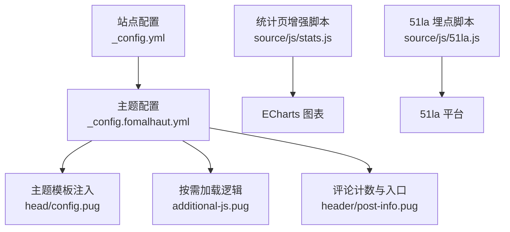
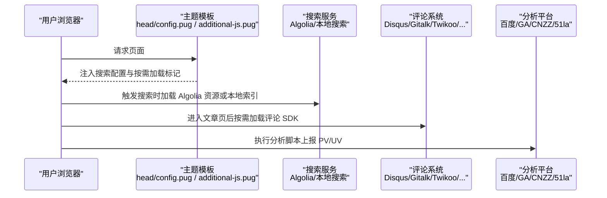
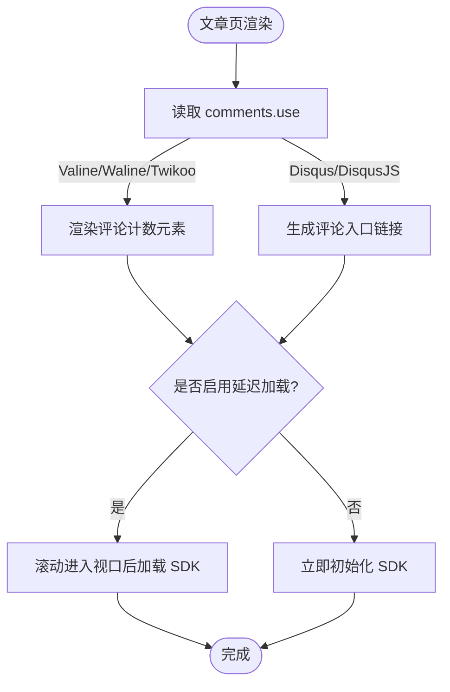
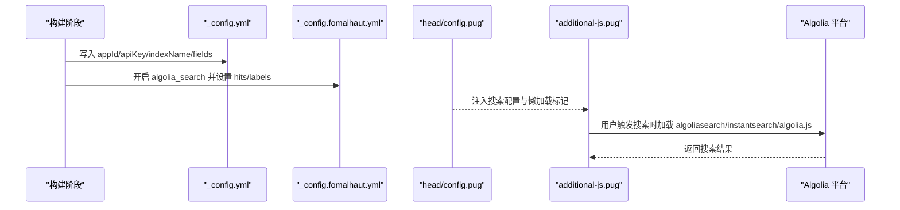
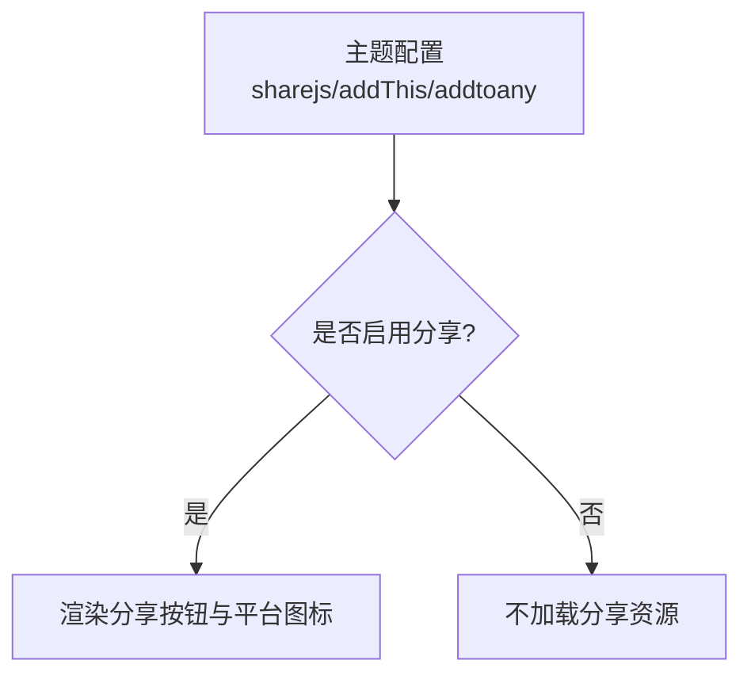
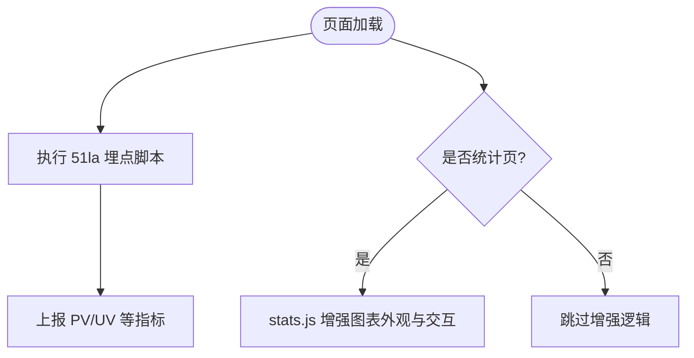
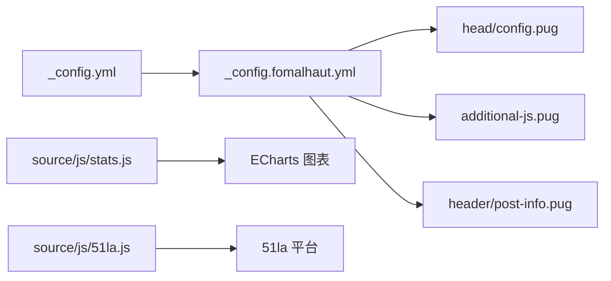

# 第三方服务集成

<cite>
**本文引用的文件**   
- [_config.yml](file://_config.yml)
- [_config.fomalhaut.yml](file://_config.fomalhaut.yml)
- [themes/fomalhaut/_config.yml](file://themes/fomalhaut/_config.yml)
- [source/js/stats.js](file://source/js/stats.js)
- [source/js/51la.js](file://source/js/51la.js)
- [themes/fomalhaut/layout/includes/additional-js.pug](file://themes/fomalhaut/layout/includes/additional-js.pug)
- [themes/fomalhaut/layout/includes/head/config.pug](file://themes/fomalhaut/layout/includes/head/config.pug)
- [themes/fomalhaut/layout/includes/header/post-info.pug](file://themes/fomalhaut/layout/includes/header/post-info.pug)
</cite>

## 目录
1. [引言](#引言)
2. [项目结构](#项目结构)
3. [核心组件](#核心组件)
4. [架构总览](#架构总览)
5. [详细组件分析](#详细组件分析)
6. [依赖关系分析](#依赖关系分析)
7. [性能考虑](#性能考虑)
8. [故障排查指南](#故障排查指南)
9. [结论](#结论)
10. [附录](#附录)

## 引言
本文件面向在本仓库中接入第三方服务的读者，覆盖评论系统、搜索服务、分享组件、统计分析工具与安全配置，并给出常见问题与性能优化建议。本项目基于 Hexo + Butterfly 主题（fomalhaut），在站点级与主题级分别提供配置入口；同时包含若干前端脚本用于增强统计页面与埋点。

## 项目结构
与第三方服务相关的关键位置如下：
- 站点级配置：_config.yml（Algolia、本地搜索、插件等）
- 主题级配置：_config.fomalhaut.yml（评论、分享、分析、搜索 UI 等）
- 主题源码配置注入：themes/fomalhaut/layout/includes/head/config.pug（将 Algolia/本地搜索参数注入到前端）
- 按需加载逻辑：themes/fomalhaut/layout/includes/additional-js.pug（Algolia 资源懒加载、本地搜索直引）
- 评论计数与展示：themes/fomalhaut/layout/includes/header/post-info.pug（根据所选评论系统渲染计数与入口）
- 统计页增强脚本：source/js/stats.js（ECharts 图表主题化与标题装饰）
- 51la 埋点示例：source/js/51la.js（替换占位 ID/CK 即可启用）

**图示来源**
- [_config.yml:145-190](file://_config.yml#L145-L190)
- [_config.fomalhaut.yml:65-84](file://_config.fomalhaut.yml#L65-L84)
- [themes/fomalhaut/layout/includes/head/config.pug:1-26](file://themes/fomalhaut/layout/includes/head/config.pug#L1-L26)
- [themes/fomalhaut/layout/includes/additional-js.pug:26-35](file://themes/fomalhaut/layout/includes/additional-js.pug#L26-L35)
- [themes/fomalhaut/layout/includes/header/post-info.pug:76-124](file://themes/fomalhaut/layout/includes/header/post-info.pug#L76-L124)
- [source/js/stats.js:1-17](file://source/js/stats.js#L1-L17)
- [source/js/51la.js:1-10](file://source/js/51la.js#L1-L10)

**章节来源**
- [_config.yml:145-190](file://_config.yml#L145-L190)
- [_config.fomalhaut.yml:65-84](file://_config.fomalhaut.yml#L65-L84)

## 核心组件
- 评论系统：支持 Disqus、DisqusJS、Gitalk、Valine、Waline、Twikoo、Giscus、Remark42 等，通过主题配置选择并注入对应资源与计数逻辑。
- 搜索服务：支持 Algolia 与本地搜索；Algolia 采用按需加载，避免首屏阻塞；本地搜索可预加载或按需加载。
- 分享组件：支持 Share.js、AddThis、AddToAny，可在主题配置中开启并指定平台。
- 统计分析：支持百度统计、Google Analytics、CNZZ、Cloudflare、Microsoft Clarity；另有 51la 示例脚本。
- 安全与隐私：API Key 管理、跨域与隐私保护策略见后文“安全配置”。

**章节来源**
- [_config.fomalhaut.yml:517-654](file://_config.fomalhaut.yml#L517-L654)
- [_config.fomalhaut.yml:704-737](file://_config.fomalhaut.yml#L704-L737)
- [_config.yml:145-190](file://_config.yml#L145-L190)

## 架构总览
下图展示了从配置到运行时加载的整体流程：站点与主题配置决定启用的第三方能力；主题模板负责注入前端配置与按需加载脚本；评论系统在文章页按配置渲染计数与交互；统计脚本在特定页面增强图表体验；51la 脚本完成埋点上报。

**图示来源**
- [themes/fomalhaut/layout/includes/head/config.pug:1-26](file://themes/fomalhaut/layout/includes/head/config.pug#L1-L26)
- [themes/fomalhaut/layout/includes/additional-js.pug:26-35](file://themes/fomalhaut/layout/includes/additional-js.pug#L26-L35)
- [themes/fomalhaut/layout/includes/header/post-info.pug:76-124](file://themes/fomalhaut/layout/includes/header/post-info.pug#L76-L124)
- [source/js/51la.js:1-10](file://source/js/51la.js#L1-L10)

## 详细组件分析

### 评论系统集成
- 支持的评论系统：Disqus、DisqusJS、Gitalk、Valine、Waline、Twikoo、Giscus、Remark42 等。
- 启用方式：在主题配置 comments.use 中设置首选评论系统，并可开启 lazyload 延迟加载以提升首屏性能。
- 计数显示：主题模板会根据所选评论系统输出对应的计数元素与链接。

**图示来源**
- [_config.fomalhaut.yml:538-551](file://_config.fomalhaut.yml#L538-L551)
- [themes/fomalhaut/layout/includes/header/post-info.pug:76-124](file://themes/fomalhaut/layout/includes/header/post-info.pug#L76-L124)

#### 各评论平台配置要点
- Disqus/DisqusJS：填写 shortname 与 apikey；适合需要海外访问或替代方案的用户。
- Gitalk：需 GitHub OAuth App 的 client_id/client_secret、repo/owner/admin 等。
- Valine/Waline：需 appId/appKey 或 serverURL；可配置 visitor/pageview 等开关。
- Twikoo：填写 envId/region，可选 visitor 开关。
- Giscus：填写 repo/repo_id/category_id，支持明暗主题切换。
- Remark42：填写 host/siteId。

**章节来源**
- [_config.fomalhaut.yml:538-654](file://_config.fomalhaut.yml#L538-L654)
- [themes/fomalhaut/layout/includes/header/post-info.pug:76-124](file://themes/fomalhaut/layout/includes/header/post-info.pug#L76-L124)

### 搜索服务集成
- Algolia 搜索：
  - 站点配置：_config.yml 中配置 appId/apiKey/indexName 等字段，并声明 fields 以控制索引内容。
  - 主题配置：_config.fomalhaut.yml 中开启 algolia_search，并设置 hits 与文案标签。
  - 前端注入：head/config.pug 将 Algolia 配置注入 window.__SEARCH_CONFIG__；additional-js.pug 实现 Algolia 资源的按需加载，避免首屏阻塞。
- 本地搜索：
  - 站点配置：_config.yml 中 search.path/field/content 控制本地索引生成。
  - 主题配置：_config.fomalhaut.yml 中 local_search.enable/preload 控制加载行为。

**图示来源**
- [_config.yml:145-167](file://_config.yml#L145-L167)
- [_config.fomalhaut.yml:65-84](file://_config.fomalhaut.yml#L65-L84)
- [themes/fomalhaut/layout/includes/head/config.pug:1-26](file://themes/fomalhaut/layout/includes/head/config.pug#L1-L26)
- [themes/fomalhaut/layout/includes/additional-js.pug:26-35](file://themes/fomalhaut/layout/includes/additional-js.pug#L26-L35)

**章节来源**
- [_config.yml:145-190](file://_config.yml#L145-L190)
- [_config.fomalhaut.yml:65-84](file://_config.fomalhaut.yml#L65-L84)
- [themes/fomalhaut/layout/includes/head/config.pug:1-26](file://themes/fomalhaut/layout/includes/head/config.pug#L1-L26)
- [themes/fomalhaut/layout/includes/additional-js.pug:26-35](file://themes/fomalhaut/layout/includes/additional-js.pug#L26-L35)

### 分享组件配置
- 支持 Share.js、AddThis、AddToAny。
- 在主题配置中开启 sharejs/addThis/addtoany，并指定 sites/item 等平台列表。
- 当前主题默认开启 sharejs，并包含 facebook/twitter/wechat/weibo/qq 等平台。

**图示来源**
- [_config.fomalhaut.yml:517-537](file://_config.fomalhaut.yml#L517-L537)
- [themes/fomalhaut/_config.yml:236-255](file://themes/fomalhaut/_config.yml#L236-L255)

**章节来源**
- [_config.fomalhaut.yml:517-537](file://_config.fomalhaut.yml#L517-L537)
- [themes/fomalhaut/_config.yml:236-255](file://themes/fomalhaut/_config.yml#L236-L255)

### 统计分析工具接入
- 主题内置分析开关：百度统计、Google Analytics、CNZZ、Cloudflare、Microsoft Clarity。
- 51la 示例脚本：source/js/51la.js 提供初始化代码，需替换 id/ck 为真实值。
- 统计页增强：source/js/stats.js 对 ECharts 图表进行主题色适配与标题美化，仅在统计页生效。

**图示来源**
- [_config.fomalhaut.yml:704-737](file://_config.fomalhaut.yml#L704-L737)
- [source/js/51la.js:1-10](file://source/js/51la.js#L1-L10)
- [source/js/stats.js:1-17](file://source/js/stats.js#L1-L17)

**章节来源**
- [_config.fomalhaut.yml:704-737](file://_config.fomalhaut.yml#L704-L737)
- [source/js/51la.js:1-10](file://source/js/51la.js#L1-L10)
- [source/js/stats.js:1-17](file://source/js/stats.js#L1-L17)

### 安全配置指南
- API Key 管理
  - Algolia：apiKey 仅用于前端搜索，建议使用只读 key；adminApiKey 仅用于构建阶段推送索引，不要暴露到前端。
  - 评论系统：如 Gitalk 的 client_secret、Valine 的 appKey 等敏感信息应放在后端或构建环境变量中，避免直接写在前端配置。
- 跨域与隐私
  - 第三方 SDK 可能发起跨域请求，确保域名白名单与 CORS 策略正确。
  - 分析脚本默认会收集基础访问数据，如需合规，应在隐私政策中说明并在必要时提供关闭选项。
- 最小权限原则
  - 仅启用必要的第三方功能，减少外部依赖与潜在风险面。
  - 对评论系统启用延迟加载，降低首屏攻击面与资源占用。

[本节为通用安全建议，不直接分析具体文件]

## 依赖关系分析
- 站点配置 _config.yml 提供 Algolia 与本地搜索的基础字段，主题配置 _config.fomalhaut.yml 控制前端行为与 UI。
- 主题模板 head/config.pug 将 Algolia 配置注入前端；additional-js.pug 控制 Algolia 资源懒加载。
- header/post-info.pug 根据 comments.use 渲染评论计数与入口。
- source/js/stats.js 与 source/js/51la.js 作为独立脚本，分别在统计页与全站执行埋点与增强。

**图示来源**
- [_config.yml:145-190](file://_config.yml#L145-L190)
- [_config.fomalhaut.yml:65-84](file://_config.fomalhaut.yml#L65-L84)
- [themes/fomalhaut/layout/includes/head/config.pug:1-26](file://themes/fomalhaut/layout/includes/head/config.pug#L1-L26)
- [themes/fomalhaut/layout/includes/additional-js.pug:26-35](file://themes/fomalhaut/layout/includes/additional-js.pug#L26-L35)
- [themes/fomalhaut/layout/includes/header/post-info.pug:76-124](file://themes/fomalhaut/layout/includes/header/post-info.pug#L76-L124)
- [source/js/stats.js:1-17](file://source/js/stats.js#L1-L17)
- [source/js/51la.js:1-10](file://source/js/51la.js#L1-L10)

**章节来源**
- [_config.yml:145-190](file://_config.yml#L145-L190)
- [_config.fomalhaut.yml:65-84](file://_config.fomalhaut.yml#L65-L84)

## 性能考虑
- 搜索资源按需加载：Algolia 的 algoliasearch/instantsearch/algolia.js 通过 additional-js.pug 懒加载，避免首屏阻塞。
- 评论系统延迟加载：comments.lazyload=true 可减少首屏开销，但评论计数可能失效。
- 本地搜索预加载：local_search.preload=true 可提升首次搜索速度，但会增加初始体积。
- 统计页图表主题化：stats.js 在 pjax 换页与主题色变化时重绘图表，避免重复初始化导致的错误。

**章节来源**
- [themes/fomalhaut/layout/includes/additional-js.pug:26-35](file://themes/fomalhaut/layout/includes/additional-js.pug#L26-L35)
- [_config.fomalhaut.yml:538-551](file://_config.fomalhaut.yml#L538-L551)
- [source/js/stats.js:383-429](file://source/js/stats.js#L383-L429)

## 故障排查指南
- Algolia 搜索无结果
  - 检查 _config.yml 中 appId/apiKey/indexName 是否正确。
  - 确认 head/config.pug 已注入配置且 additional-js.pug 已触发懒加载。
- 本地搜索无法使用
  - 确认 _config.yml 中 search.path/field/content 已配置。
  - 检查 _config.fomalhaut.yml 中 local_search.enable 与 preload 设置。
- 评论计数不显示
  - 若启用 comments.lazyload，则计数可能无效；可临时关闭 lazyload 验证。
  - 检查 header/post-info.pug 是否输出了对应平台的计数元素。
- 51la 未上报数据
  - 检查 source/js/51la.js 中的 id/ck 是否替换为真实值。
- 统计页图表样式异常
  - 确认 stats.js 已加载且在统计页运行；pjax 换页后会自动重绘。

**章节来源**
- [_config.yml:145-190](file://_config.yml#L145-L190)
- [_config.fomalhaut.yml:65-84](file://_config.fomalhaut.yml#L65-L84)
- [themes/fomalhaut/layout/includes/head/config.pug:1-26](file://themes/fomalhaut/layout/includes/head/config.pug#L1-L26)
- [themes/fomalhaut/layout/includes/additional-js.pug:26-35](file://themes/fomalhaut/layout/includes/additional-js.pug#L26-L35)
- [themes/fomalhaut/layout/includes/header/post-info.pug:76-124](file://themes/fomalhaut/layout/includes/header/post-info.pug#L76-L124)
- [source/js/51la.js:1-10](file://source/js/51la.js#L1-L10)
- [source/js/stats.js:383-429](file://source/js/stats.js#L383-L429)

## 结论
本项目通过站点与主题两级配置，提供了完善的第三方服务集成能力。搜索采用 Algolia 按需加载与本地搜索双轨；评论系统多平台可选并支持延迟加载；分享与分析工具可按需启用。配合安全配置与性能优化策略，可在保证用户体验的同时降低风险与开销。

[本节为总结性内容，不直接分析具体文件]

## 附录
- 常用配置路径速查
  - Algolia 站点配置：_config.yml
  - Algolia 主题配置与本地搜索：_config.fomalhaut.yml
  - 搜索前端注入与懒加载：head/config.pug、additional-js.pug
  - 评论系统与计数：_config.fomalhaut.yml、header/post-info.pug
  - 分析与埋点：_config.fomalhaut.yml、source/js/51la.js、source/js/stats.js

[本节为参考信息，不直接分析具体文件]