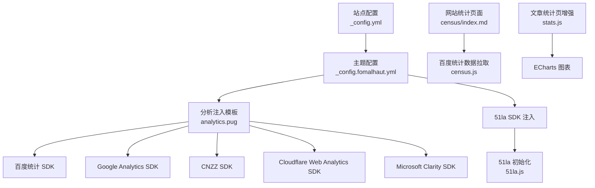
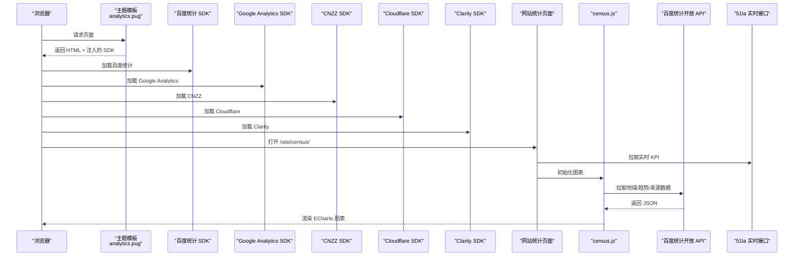
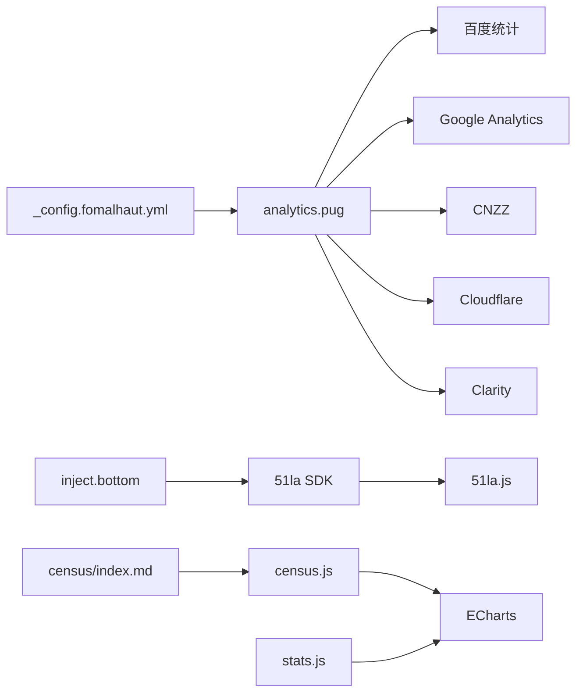

# 统计分析工具

<cite>
**本文引用的文件**   
- [站点配置 _config.yml](file://_config.yml)
- [主题配置 _config.fomalhaut.yml](file://_config.fomalhaut.yml)
- [分析脚本注入模板 analytics.pug](file://themes/fomalhaut/layout/includes/head/analytics.pug)
- [51la 初始化脚本 51la.js](file://source/js/51la.js)
- [百度统计数据拉取与图表 census.js](file://source/js/census.js)
- [网站统计页面 census/index.md](file://source/site/census/index.md)
- [文章统计页增强脚本 stats.js](file://source/js/stats.js)
- [项目说明 README.md](file://README.md)
</cite>

## 目录
1. [引言](#引言)
2. [项目结构](#项目结构)
3. [核心组件](#核心组件)
4. [架构总览](#架构总览)
5. [详细组件分析](#详细组件分析)
6. [依赖关系分析](#依赖关系分析)
7. [性能考虑](#性能考虑)
8. [隐私合规与用户同意](#隐私合规与用户同意)
9. [故障排查指南](#故障排查指南)
10. [结论](#结论)

## 引言
本文件面向博客站点的“统计分析工具集成”，覆盖以下目标：
- 接入主流分析平台，包括百度统计、Google Analytics、51la、友盟 CNZZ、Cloudflare Web Analytics、Microsoft Clarity。
- 说明统计代码的注入方式、配置参数和加载策略。
- 解释页面访问统计、用户行为追踪和流量分析的收集机制。
- 提供统计数据可视化看板与报表生成思路。
- 说明隐私保护合规要求，尤其是 GDPR 和用户同意机制。
- 给出异步加载、数据压缩、传输优化等性能建议。
- 提供异常排查方法和性能监控技巧。

本项目基于 Hexo + Butterfly/Fomalhaut 主题，统计能力分为三层：
1. **站点级埋点注入层**：在 `<head>` 中按需注入各平台 SDK。
2. **前端数据展示层**：通过 51la 实时数据接口和百度统计开放 API 拉取数据并渲染图表。
3. **业务增强层**：对主题内嵌 ECharts 图表进行主题色适配、标题装饰和 PJAX 场景修复。

## 项目结构
统计分析相关代码主要分布在以下位置：
- 站点根配置 `_config.yml`：定义站点基础信息、部署插件、搜索索引、站点地图等。
- 主题配置 `_config.fomalhaut.yml`：定义菜单、主题外观、第三方服务开关，以及分析平台 ID 占位字段。
- 主题布局 `themes/fomalhaut/layout/includes/head/analytics.pug`：根据主题配置动态注入百度统计、Google Analytics、CNZZ、Cloudflare、Clarity 的 SDK。
- 前端脚本 `source/js/51la.js`：初始化 51la 与灵雀应用监控。
- 前端脚本 `source/js/census.js`：调用百度统计开放 API，绘制地域分布、访问趋势、来源构成等图表。
- 统计页面 `source/site/census/index.md`：聚合 51la 实时 KPI、GitHub 贡献日历、百度统计图表。
- 文章统计增强脚本 `source/js/stats.js`：美化主题自带的“文章统计”ECharts 图表，使其跟随主题色和明暗模式。

**图示来源**
- [主题配置 _config.fomalhaut.yml:704-726](file://_config.fomalhaut.yml#L704-L726)
- [分析脚本注入模板 analytics.pug:1-31](file://themes/fomalhaut/layout/includes/head/analytics.pug#L1-L31)
- [51la 初始化脚本 51la.js:1-10](file://source/js/51la.js#L1-L10)
- [网站统计页面 census/index.md:1-10](file://source/site/census/index.md#L1-L10)
- [百度统计数据拉取与图表 census.js:1-15](file://source/js/census.js#L1-L15)
- [文章统计页增强脚本 stats.js:1-17](file://source/js/stats.js#L1-L17)

**章节来源**
- [站点配置 _config.yml:1-319](file://_config.yml#L1-L319)
- [主题配置 _config.fomalhaut.yml:704-726](file://_config.fomalhaut.yml#L704-L726)

## 核心组件
### 分析平台注入层
主题通过 Pug 模板判断是否启用对应分析平台，并在 `<head>` 中插入 SDK。当前支持：
- 百度统计：通过 `_hmt` 数组和动态创建 script 标签注入。
- Google Analytics：使用 gtag.js，async 加载并初始化 dataLayer。
- 友盟 CNZZ：通过 async 脚本加载统计接口。
- Cloudflare Web Analytics：通过 defer 脚本加载 beacon.min.js。
- Microsoft Clarity：通过异步脚本加载 Clarity tag。

这些注入逻辑完全由主题配置中的对应字段控制，未配置时不会输出任何 SDK。

**章节来源**
- [分析脚本注入模板 analytics.pug:1-31](file://themes/fomalhaut/layout/includes/head/analytics.pug#L1-L31)
- [主题配置 _config.fomalhaut.yml:704-726](file://_config.fomalhaut.yml#L704-L726)

### 51la 与灵雀监控
51la 的 SDK 通过主题配置的 `inject.bottom` 段引入，并延迟加载；随后执行 `source/js/51la.js` 完成初始化。该脚本同时初始化灵雀应用监控，用于 SPA 场景下的页面访问追踪。

关键要点：
- SDK 使用 `defer`，避免阻塞首屏渲染。
- 初始化参数包含站点 ID、CK 值和 hashMode。
- 灵雀监控开启 `sendSpaPv`，适合单页应用或 PJAX 切换场景。

**章节来源**
- [主题配置 _config.fomalhaut.yml:1323-1326](file://_config.fomalhaut.yml#L1323-L1326)
- [51la 初始化脚本 51la.js:1-10](file://source/js/51la.js#L1-L10)

### 百度统计数据看板
网站统计页面 `/site/census/` 通过 51la 的 quote 接口获取实时 KPI，并通过百度统计开放 API 拉取地域分布、访问趋势、来源构成数据，最终用 ECharts 渲染。

关键要点：
- 51la 实时数据通过 fetch 抓取 quote.js 文本，再正则提取数字。
- 百度统计数据通过自定义后端代理接口拉取，避免前端直接暴露 access_token。
- 图表配色跟随主题色和明暗模式，保证视觉一致性。

**章节来源**
- [网站统计页面 census/index.md:1-122](file://source/site/census/index.md#L1-L122)
- [百度统计数据拉取与图表 census.js:1-579](file://source/js/census.js#L1-L579)

### 文章统计页增强
主题自带“文章统计”页面，使用 ECharts 展示文章发布量、标签 Top 10、分类占比。`stats.js` 负责：
- 将原生标题拆分为图标胶囊 + 标题 + 说明。
- 重新设置 ECharts 实例的主题色、网格线、图例、提示框样式。
- 处理 PJAX 换页后图表重建导致的重复声明问题。
- 监听主题色和明暗模式变化，动态重绘图表。

**章节来源**
- [文章统计页增强脚本 stats.js:1-430](file://source/js/stats.js#L1-L430)

## 架构总览
统计分析的整体流程如下：

**图示来源**
- [分析脚本注入模板 analytics.pug:1-31](file://themes/fomalhaut/layout/includes/head/analytics.pug#L1-L31)
- [网站统计页面 census/index.md:1-122](file://source/site/census/index.md#L1-L122)
- [百度统计数据拉取与图表 census.js:1-579](file://source/js/census.js#L1-L579)

## 详细组件分析

### 百度统计接入与配置
百度统计通过主题配置字段 `baidu_analytics` 控制注入。若配置了该字段，模板会动态创建 script 标签，指向 `https://hm.baidu.com/hm.js?{id}`。

配置步骤：
1. 在百度统计后台获取站点 ID。
2. 在 `_config.fomalhaut.yml` 的 `baidu_analytics` 字段填入 ID。
3. 重新构建站点，确认 `<head>` 中出现百度统计 SDK。

注意事项：
- 该注入是条件性的，未配置则不输出。
- 百度统计默认采集页面访问、来源、设备等信息。
- 如需隐私合规，可在用户拒绝同意后跳过注入。

**章节来源**
- [主题配置 _config.fomalhaut.yml:704-711](file://_config.fomalhaut.yml#L704-L711)
- [分析脚本注入模板 analytics.pug:1-9](file://themes/fomalhaut/layout/includes/head/analytics.pug#L1-L9)

### Google Analytics 接入与配置
Google Analytics 通过 `google_analytics` 字段控制注入。模板使用 gtag.js，async 加载并初始化 dataLayer。

配置步骤：
1. 在 Google Analytics 后台获取衡量 ID（GA4）。
2. 在 `_config.fomalhaut.yml` 的 `google_analytics` 字段填入 ID。
3. 构建站点后，确认 gtag.js 已加载。

注意事项：
- gtag.js 使用 async，不影响首屏渲染。
- 可结合 Consent Mode 实现 GDPR 合规。
- 可通过 `gtag('event', ...)` 自定义事件追踪。

**章节来源**
- [主题配置 _config.fomalhaut.yml:712-715](file://_config.fomalhaut.yml#L712-L715)
- [分析脚本注入模板 analytics.pug:11-17](file://themes/fomalhaut/layout/includes/head/analytics.pug#L11-L17)

### 51la 接入与配置
51la 的接入分为两部分：
1. SDK 注入：通过主题配置的 `inject.bottom` 段引入 `sdk.51.la` 和 `js-sdk-perf.min.js`。
2. 初始化：执行 `source/js/51la.js`，传入站点 ID 和 CK。

配置步骤：
1. 在 51la 后台申请站点 ID 和 CK。
2. 修改 `source/js/51la.js`，替换 `YOUR_51LA_ID` 和 `YOUR_51LA_CK`。
3. 如需灵雀监控，同样替换 `YOUR_LINGQUE_ID`。

注意事项：
- SDK 使用 `defer`，避免阻塞渲染。
- 51la 实时数据通过 quote 接口拉取，适合展示 KPI。
- 灵雀监控适合 SPA 场景，开启 `sendSpaPv`。

**章节来源**
- [主题配置 _config.fomalhaut.yml:1323-1326](file://_config.fomalhaut.yml#L1323-L1326)
- [51la 初始化脚本 51la.js:1-10](file://source/js/51la.js#L1-L10)
- [项目说明 README.md:841-850](file://README.md#L841-L850)

### 百度统计数据看板
网站统计页面 `/site/census/` 聚合多源数据：
- 51la 实时 KPI：总访问量、本月访问、今日人数、今日访问、昨日人数、昨日访问。
- GitHub 贡献日历：展示近一年提交活跃度。
- 百度统计图表：地域分布、访问趋势、来源构成。

数据流：
1. 页面加载后，fetch 51la 的 quote 接口，解析文本并更新 KPI。
2. 调用 `census.js`，根据配置拉取百度统计开放 API。
3. 使用 ECharts 渲染地图、折线图、饼图。

配置步骤：
1. 在百度统计开放平台申请 API Key 和 Secret Key。
2. 生成 refresh_token 和 access_token。
3. 修改 `source/js/census.js` 中的 `access_token` 和 `site_id`。
4. 部署后端代理接口，返回百度统计数据。

**章节来源**
- [网站统计页面 census/index.md:1-122](file://source/site/census/index.md#L1-L122)
- [百度统计数据拉取与图表 census.js:1-579](file://source/js/census.js#L1-L579)

### 文章统计页增强
主题自带“文章统计”页面，使用 ECharts 展示文章发布量、标签 Top 10、分类占比。`stats.js` 负责增强体验：
- 标题装饰：将原生标题拆分为图标胶囊 + 标题 + 说明。
- 图表重绘：根据主题色重新设置 ECharts 实例。
- PJAX 兼容：处理换页后图表重建导致的重复声明问题。
- 主题监听：监听主题色和明暗模式变化，动态重绘。

**章节来源**
- [文章统计页增强脚本 stats.js:1-430](file://source/js/stats.js#L1-L430)

## 依赖关系分析
统计分析模块的依赖关系如下：

**图示来源**
- [主题配置 _config.fomalhaut.yml:704-726](file://_config.fomalhaut.yml#L704-L726)
- [分析脚本注入模板 analytics.pug:1-31](file://themes/fomalhaut/layout/includes/head/analytics.pug#L1-L31)
- [51la 初始化脚本 51la.js:1-10](file://source/js/51la.js#L1-L10)
- [网站统计页面 census/index.md:1-10](file://source/site/census/index.md#L1-L10)
- [百度统计数据拉取与图表 census.js:1-15](file://source/js/census.js#L1-L15)
- [文章统计页增强脚本 stats.js:1-17](file://source/js/stats.js#L1-L17)

**章节来源**
- [主题配置 _config.fomalhaut.yml:704-726](file://_config.fomalhaut.yml#L704-L726)
- [分析脚本注入模板 analytics.pug:1-31](file://themes/fomalhaut/layout/includes/head/analytics.pug#L1-L31)

## 性能考虑
### 异步加载
- Google Analytics 使用 `async` 加载 gtag.js，避免阻塞首屏。
- Cloudflare Web Analytics 使用 `defer` 加载 beacon.min.js。
- 51la SDK 通过 `defer` 注入，减少主线程阻塞。

### 数据压缩与传输优化
- 百度统计开放 API 建议使用后端代理，避免前端直接暴露 token。
- 51la 实时数据通过 quote 接口拉取，文本格式较轻量。
- ECharts 图表数据建议在服务端预处理，减少前端计算开销。

### 渲染优化
- 图表容器在 PJAX 换页后需重新初始化，避免重复声明。
- 主题色和明暗模式变化时，应防抖重绘图表，避免频繁计算。

**章节来源**
- [分析脚本注入模板 analytics.pug:11-23](file://themes/fomalhaut/layout/includes/head/analytics.pug#L11-L23)
- [主题配置 _config.fomalhaut.yml:1323-1326](file://_config.fomalhaut.yml#L1323-L1326)
- [百度统计数据拉取与图表 census.js:143-173](file://source/js/census.js#L143-L173)

## 隐私合规与用户同意
### GDPR 合规要点
- 在用户未明确同意的情况下，不应加载第三方分析 SDK。
- 提供用户同意弹窗，允许用户选择是否启用分析功能。
- 对于 Google Analytics，可使用 Consent Mode 限制数据采集。
- 对于百度统计、51la 等，应在用户同意后动态注入 SDK。

### 用户同意机制建议
1. 页面加载时显示同意弹窗。
2. 用户同意后，再执行 SDK 注入逻辑。
3. 用户拒绝后，跳过所有分析平台加载。
4. 提供“隐私设置”入口，允许用户随时更改同意状态。

### 本项目现状
当前项目的分析 SDK 注入是条件性的，但未内置用户同意弹窗。如需 GDPR 合规，需额外实现同意管理逻辑，并在用户同意后动态执行 `analytics.pug` 中的注入逻辑。

**章节来源**
- [分析脚本注入模板 analytics.pug:1-31](file://themes/fomalhaut/layout/includes/head/analytics.pug#L1-L31)

## 故障排查指南
### 百度统计数据不可用
现象：
- 网站统计页面显示“统计服务暂不可用”。
- 控制台报错：`error_code 111`。

原因：
- access_token 过期。
- site_id 配置错误。
- 后端代理接口不可用。

解决步骤：
1. 检查 `source/js/census.js` 中的 `access_token` 和 `site_id`。
2. 刷新 refresh_token，重新生成 access_token。
3. 验证后端代理接口是否正常返回数据。

**章节来源**
- [百度统计数据拉取与图表 census.js:143-173](file://source/js/census.js#L143-L173)

### 51la 实时数据为空
现象：
- 网站统计页面的 KPI 显示为 `--`。
- 控制台报错：`51la: NetworkError`。

原因：
- 51la 站点 ID 或 CK 配置错误。
- quote 接口被跨域限制。
- 网络请求失败。

解决步骤：
1. 检查 `source/js/51la.js` 中的 `YOUR_51LA_ID` 和 `YOUR_51LA_CK`。
2. 确认 51la 后台已正确配置站点。
3. 检查浏览器控制台的网络请求状态。

**章节来源**
- [51la 初始化脚本 51la.js:1-10](file://source/js/51la.js#L1-L10)
- [网站统计页面 census/index.md:90-120](file://source/site/census/index.md#L90-L120)

### 图表主题色不匹配
现象：
- 文章统计页或网站统计页的图表颜色与主题不一致。
- 明暗模式切换后，图表颜色未更新。

原因：
- 主题色变量读取失败。
- 图表实例未重新渲染。
- PJAX 换页后图表重建失败。

解决步骤：
1. 检查 `stats.js` 和 `census.js` 中的主题色读取逻辑。
2. 确认明暗模式切换时触发了图表重绘。
3. 检查 PJAX 换页后是否正确重建图表实例。

**章节来源**
- [文章统计页增强脚本 stats.js:20-54](file://source/js/stats.js#L20-L54)
- [百度统计数据拉取与图表 census.js:19-36](file://source/js/census.js#L19-L36)

## 结论
本项目的统计分析体系以主题配置为核心，通过条件注入的方式接入多个主流分析平台，并结合 51la 和百度统计开放 API 构建了可视化的数据看板。整体架构清晰，扩展性强，但需注意以下几点：
- 确保各平台 ID 配置正确，避免 SDK 注入失败。
- 实现用户同意机制以满足 GDPR 合规要求。
- 优化数据拉取和图表渲染性能，提升用户体验。
- 建立完善的故障排查流程，快速定位和解决问题。