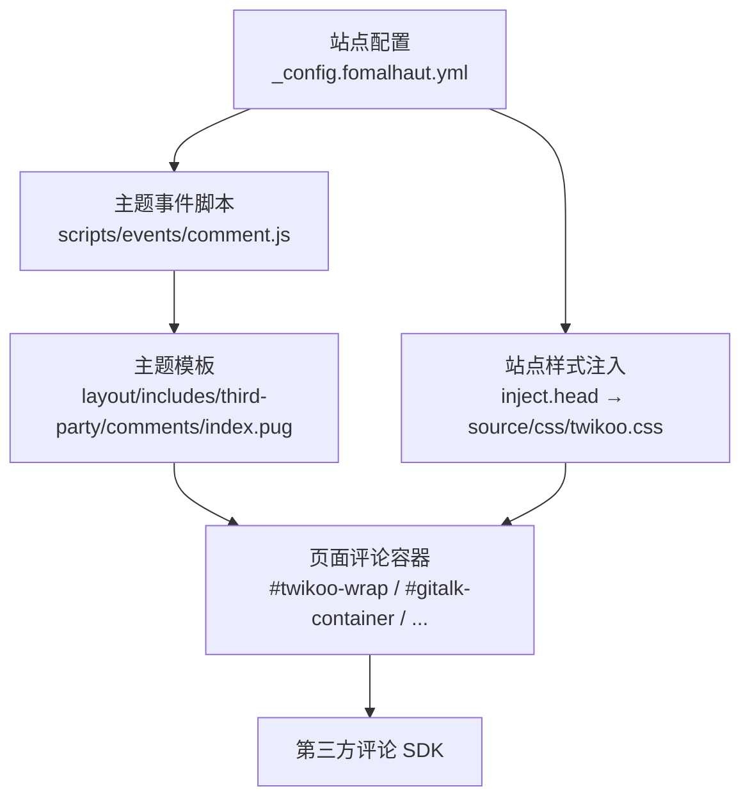
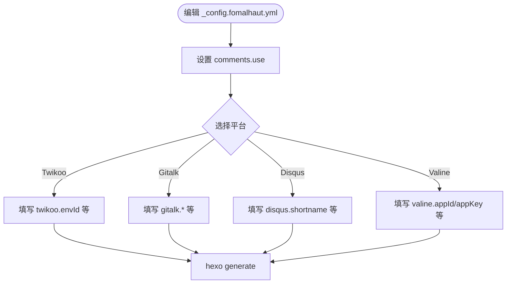
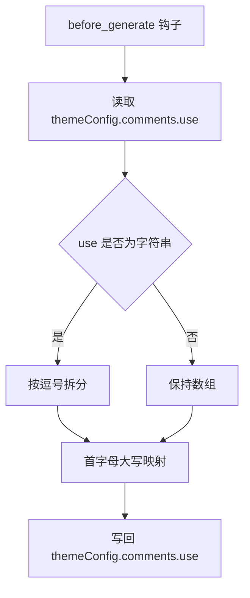
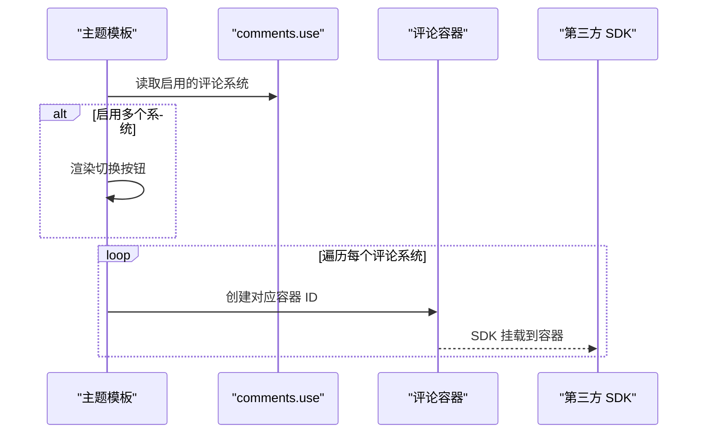
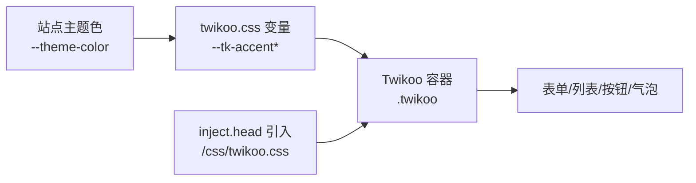
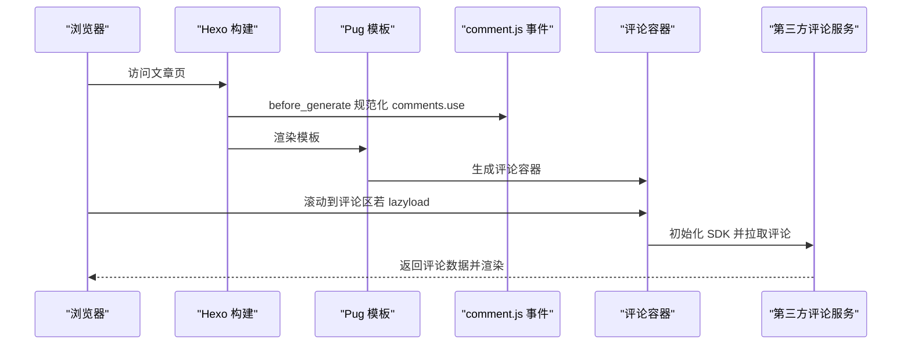
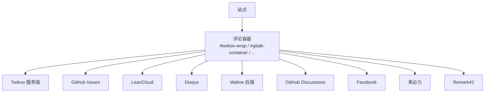

# 评论系统集成

<cite>
**本文引用的文件**   
- [README.md](file://README.md)
- [_config.fomalhaut.yml](file://_config.fomalhaut.yml)
- [source/css/twikoo.css](file://source/css/twikoo.css)
- [themes/fomalhaut/layout/includes/third-party/comments/index.pug](file://themes/fomalhaut/layout/includes/third-party/comments/index.pug)
- [themes/fomalhaut/scripts/events/comment.js](file://themes/fomalhaut/scripts/events/comment.js)
</cite>

## 目录
1. [引言](#引言)
2. [项目结构中的评论集成点](#项目结构中的评论集成点)
3. [支持的评论平台与配置总览](#支持的评论平台与配置总览)
4. [核心组件分析](#核心组件分析)
5. [架构总览](#架构总览)
6. [详细接入指南](#详细接入指南)
7. [数据模型与存储方式](#数据模型与存储方式)
8. [样式定制与响应式适配](#样式定制与响应式适配)
9. [性能优化技巧](#性能优化技巧)
10. [常见问题排查](#常见问题排查)
11. [结论](#结论)

## 引言
本文面向使用本仓库的 Hexo 站点，说明如何在主题中启用、配置和定制评论系统。仓库主题基于 Butterfly 二次开发，已内置多平台评论支持，并通过站点级配置文件 `_config.fomalhaut.yml` 统一管理。文档重点覆盖：
- 支持的评论平台清单与配置键位；
- Twikoo、Gitalk、Disqus、Valine 等主流平台的接入步骤；
- 评论容器渲染逻辑与主题注入位置；
- 评论数据存储、备份与迁移思路；
- 样式定制、移动端适配与性能优化；
- 跨域、加载失败、样式冲突等常见问题的排查方法。

## 项目结构中的评论集成点
评论功能在本仓库中由“配置 + 模板 + 事件脚本 + 站点样式”共同组成：
- 配置层：在站点根目录的 `_config.fomalhaut.yml` 中声明启用的评论系统及其参数；
- 模板层：主题模板根据配置生成对应评论容器；
- 构建期：主题事件脚本对 `comments.use` 做规范化处理；
- 样式层：站点级 CSS（如 Twikoo 美化）通过 `inject.head` 引入。

**图表来源**
- [_config.fomalhaut.yml:538-654](file://_config.fomalhaut.yml#L538-L654)
- [themes/fomalhurst/scripts/events/comment.js:1-14](file://themes/fomalhurst/scripts/events/comment.js#L1-L14)
- [themes/fomalhurst/layout/includes/third-party/comments/index.pug:1-45](file://themes/fomalhurst/layout/includes/third-party/comments/index.pug#L1-L45)
- [source/css/twikoo.css:1-9](file://source/css/twikoo.css#L1-L9)

**章节来源**
- [_config.fomalhaut.yml:538-654](file://_config.fomalhaut.yml#L538-L654)
- [themes/fomalhurst/scripts/events/comment.js:1-14](file://themes/fomalhurst/scripts/events/comment.js#L1-L14)
- [themes/fomalhurst/layout/includes/third-party/comments/index.pug:1-45](file://themes/fomalhurst/layout/includes/third-party/comments/index.pug#L1-L45)
- [source/css/twikoo.css:1-9](file://source/css/twikoo.css#L1-L9)

## 支持的评论平台与配置总览
主题支持以下评论系统：
- Disqus
- Disqusjs
- Livere
- Gitalk
- Valine
- Waline
- Utterances
- Facebook Comments
- Twikoo
- Giscus
- Remark42

在站点配置中，通过 `comments.use` 指定启用的评论系统，最多可同时启用两个，第一个作为默认显示。其余各平台的具体参数以独立段落形式提供，键名与官方文档保持一致。

| 平台 | 关键配置段 | 主要必填项 | 备注 |
| --- | --- | --- | --- |
| Twikoo | `twikoo` | `envId` | 推荐方案，无需自建后端；可开启访客统计 |
| Gitalk | `gitalk` | `client_id`、`client_secret`、`repo`、`owner`、`admin` | 基于 GitHub Issues |
| Disqus | `disqus` | `shortname` | 经典海外评论系统 |
| Disqusjs | `disqusjs` | `shortname`、`apikey` | 兼容原版 Disqus 的替代方案 |
| Valine | `valine` | `appId`、`appKey` | 基于 LeanCloud |
| Waline | `waline` | `serverURL` | Valine 分支，支持后端 |
| Utterances | `utterances` | `repo` | 基于 GitHub Issues |
| Facebook Comments | `facebook_comments` | `app_id` | 需按 Facebook 插件要求配置 |
| Livere | `livere` | `uid` | 来必力 |
| Giscus | `giscus` | `repo`、`repo_id`、`category_id` | 基于 GitHub Discussions |
| Remark42 | `remark42` | `host`、`siteId` | 自托管评论服务 |

**章节来源**
- [_config.fomalhaut.yml:538-654](file://_config.fomalhaut.yml#L538-L654)
- [README.md:750-784](file://README.md#L750-L784)

## 核心组件分析

### 配置层：`_config.fomalhaut.yml`
该文件是评论系统的唯一入口。它负责：
- 声明启用的评论系统列表；
- 控制评论按钮文案、懒加载、评论数展示等通用行为；
- 为每个平台提供独立的参数段。

关键点：
- `comments.use` 支持字符串或数组；
- `lazyload: true` 会延迟加载评论，但会导致评论数失效；
- 各平台参数段直接透传给对应 SDK。

**图表来源**
- [_config.fomalhaut.yml:538-654](file://_config.fomalhaut.yml#L538-L654)

**章节来源**
- [_config.fomalhaut.yml:538-654](file://_config.fomalhaut.yml#L538-L654)

### 构建期事件脚本：`themes/fomalhurst/scripts/events/comment.js`
该脚本在构建前执行，作用是把用户配置的评论名称统一为首字母大写的规范格式。例如：
- 输入 `twikoo` → 输出 `Twikoo`；
- 输入 `gitalk,disqus` → 输出 `['Gitalk','Disqus']`。

这保证了模板层的 `case name` 能稳定匹配。

**图表来源**
- [themes/fomalhurst/scripts/events/comment.js:1-14](file://themes/fomalhurst/scripts/events/comment.js#L1-L14)

**章节来源**
- [themes/fomalhurst/scripts/events/comment.js:1-14](file://themes/fomalhurst/scripts/events/comment.js#L1-L14)

### 模板层：`themes/fomalhurst/layout/includes/third-party/comments/index.pug`
模板根据 `theme.comments.use` 动态生成评论容器。核心逻辑：
- 取第一个评论系统作为默认显示；
- 如果启用两个系统，则显示切换按钮；
- 遍历所有启用的评论系统，按名称渲染对应容器 ID；
- 不同平台对应不同容器 ID，供各自 SDK 挂载。

**图表来源**
- [themes/fomalhurst/layout/includes/third-party/comments/index.pug:1-45](file://themes/fomalhurst/layout/includes/third-party/comments/index.pug#L1-L45)

**章节来源**
- [themes/fomalhurst/layout/includes/third-party/comments/index.pug:1-45](file://themes/fomalhurst/layout/includes/third-party/comments/index.pug#L1-L45)

### 站点样式层：`source/css/twikoo.css`
该文件是站点级样式，专门美化 Twikoo 评论 UI，不修改主题源码。它通过 CSS 变量把表单、列表、按钮统一到主题色，并处理深色模式、移动端布局、表情面板层级等问题。

要点：
- 使用 `.tk-*` 类名，兼容 Twikoo 2.x；
- 主色调来自 `--theme-color`；
- 通过 `data-theme="dark"` 切换深色变量；
- 通过 `inject.head` 引入，随站点主题色实时生效。

**图表来源**
- [source/css/twikoo.css:1-9](file://source/css/twikoo.css#L1-L9)
- [source/css/twikoo.css:12-50](file://source/css/twikoo.css#L12-L50)

**章节来源**
- [source/css/twikoo.css:1-9](file://source/css/twikoo.css#L1-L9)
- [source/css/twikoo.css:12-50](file://source/css/twikoo.css#L12-L50)

## 架构总览
从请求到评论渲染的整体流程如下：

**图表来源**
- [themes/fomalhurst/scripts/events/comment.js:1-14](file://themes/fomalhurst/scripts/events/comment.js#L1-L14)
- [themes/fomalhurst/layout/includes/third-party/comments/index.pug:1-45](file://themes/fomalhurst/layout/includes/third-party/comments/index.pug#L1-L45)
- [_config.fomalhaut.yml:538-654](file://_config.fomalhaut.yml#L538-L654)

## 详细接入指南

### Twikoo 接入
Twikoo 是仓库推荐方案，无需自建后端，适合快速上线。

步骤：
1. 部署 Twikoo 服务端：
   - Vercel 一键部署；
   - Docker 部署；
   - 云函数部署。
2. 在站点配置中填写 `twikoo.envId`。
3. 将 `comments.use` 设为 `Twikoo`。
4. 可选：启用访客统计、自定义语言等。
5. 可选：保留站点自带的 Twikoo 美化样式。

参考配置位置：
- 评论开关与通用选项：`comments`
- Twikoo 专用参数：`twikoo`

**章节来源**
- [README.md:750-784](file://README.md#L750-L784)
- [_config.fomalhaut.yml:538-654](file://_config.fomalhaut.yml#L538-L654)

### Gitalk 接入
Gitalk 基于 GitHub Issues，适合开发者博客。

步骤：
1. 在 GitHub 创建应用，获取 `client_id` 与 `client_secret`。
2. 准备一个用于存放评论的 GitHub 仓库。
3. 在站点配置中填写：
   - `gitalk.client_id`
   - `gitalk.client_secret`
   - `gitalk.repo`
   - `gitalk.owner`
   - `gitalk.admin`
4. 将 `comments.use` 设为 `Gitalk`。

注意事项：
- 首次评论需要授权；
- 评论数据存储在 GitHub Issues；
- 注意仓库权限与 Issue 标签限制。

**章节来源**
- [_config.fomalhaut.yml:573-581](file://_config.fomalhaut.yml#L573-L581)

### Disqus 接入
Disqus 是海外常用评论系统，国内访问可能受限。

步骤：
1. 注册 Disqus 账号并创建站点。
2. 获取 `shortname`。
3. 在站点配置中填写 `disqus.shortname`。
4. 将 `comments.use` 设为 `Disqus`。

如需绕过网络限制，可使用 Disqusjs。

**章节来源**
- [_config.fomalhaut.yml:553-566](file://_config.fomalhaut.yml#L553-L566)

### Valine 接入
Valine 基于 LeanCloud，适合国内环境。

步骤：
1. 在 LeanCloud 创建应用，获取 `appId` 与 `appKey`。
2. 在站点配置中填写：
   - `valine.appId`
   - `valine.appKey`
3. 可选：配置头像风格、服务器地址、访客统计等。
4. 将 `comments.use` 设为 `Valine`。

**章节来源**
- [_config.fomalhaut.yml:583-592](file://_config.fomalhaut.yml#L583-L592)

### 其他平台简要说明
- **Waline**：Valine 分支，支持后端，适合需要更强扩展性的场景。
- **Utterances**：基于 GitHub Issues，轻量且免费。
- **Giscus**：基于 GitHub Discussions，适合 Discussion 生态。
- **Facebook Comments**：适合海外站点，需按 Facebook 插件要求配置。
- **Livere**：来必力，国内可用但服务稳定性需注意。
- **Remark42**：自托管评论服务，适合隐私敏感场景。

**章节来源**
- [_config.fomalhaut.yml:594-654](file://_config.fomalhaut.yml#L594-L654)

## 数据模型与存储方式
评论数据并不存储在本仓库中，而是由各评论平台的服务端管理：
- Twikoo：数据存储在 Twikoo 服务端（Vercel、Docker、云函数等）；
- Gitalk / Utterances：数据存储在 GitHub Issues；
- Valine：数据存储在 LeanCloud；
- Disqus / Disqusjs：数据存储在 Disqus；
- Waline：数据存储在 Waline 后端；
- Giscus：数据存储在 GitHub Discussions；
- Facebook Comments：数据存储在 Facebook；
- Livere：数据存储在来必力；
- Remark42：数据存储在 Remark42 服务端。

因此，备份与迁移策略应围绕评论平台本身：
- 导出评论数据（多数平台提供导出工具）；
- 更换平台时先在新平台导入历史数据；
- 确认新平台评论正常后再切换 `comments.use`；
- 对于 GitHub 系平台，可直接备份对应仓库的 Issues/Discussions。

**图表来源**
- [themes/fomalhurst/layout/includes/third-party/comments/index.pug:19-45](file://themes/fomalhurst/layout/includes/third-party/comments/index.pug#L19-L45)

**章节来源**
- [themes/fomalhurst/layout/includes/third-party/comments/index.pug:19-45](file://themes/fomalhurst/layout/includes/third-party/comments/index.pug#L19-L45)

## 样式定制与响应式适配
### Twikoo 样式定制
站点已提供 `source/css/twikoo.css`，通过 `inject.head` 引入。你可以：
- 修改主题色以影响整个评论区；
- 调整卡片圆角、阴影、边框；
- 调整表单字段布局；
- 调整气泡颜色与对比度；
- 调整深色模式变量。

### 响应式适配
Twikoo 样式已包含移动端适配：
- 昵称、邮箱、网址字段在小屏竖排；
- 操作按钮常驻可见；
- 内容宽度自适应；
- 容器查询用于窄输入带自动换行。

### 自定义建议
- 优先通过 CSS 变量调整主题色；
- 避免直接覆盖第三方 SDK 内部类名；
- 使用更具体的选择器提高特异性；
- 在深色模式下单独校验对比度。

**章节来源**
- [source/css/twikoo.css:1-9](file://source/css/twikoo.css#L1-L9)
- [source/css/twikoo.css:577-635](file://source/css/twikoo.css#L577-L635)

## 性能优化技巧
- 使用 `comments.lazyload: true` 实现滚动到评论区才加载；
- 注意：开启懒加载后，文章顶部评论数可能失效；
- 避免同时启用过多评论系统；
- 优先选择轻量方案（如 Twikoo、Utterances）；
- 合理使用 CDN 与缓存；
- 避免在 head 中阻塞加载大型评论 SDK；
- 对图片、字体等资源做好预连接与懒加载。

**章节来源**
- [_config.fomalhaut.yml:538-551](file://_config.fomalhaut.yml#L538-L551)

## 常见问题排查

### 评论不显示
可能原因：
- `comments.use` 未正确填写；
- 平台参数缺失（如 `envId`、`shortname`、`appId` 等）；
- 容器 ID 被其他脚本覆盖；
- 模板未正确渲染评论区域。

排查步骤：
1. 检查 `_config.fomalhaut.yml` 中 `comments.use`；
2. 检查对应平台参数是否完整；
3. 打开浏览器控制台查看是否有 JS 错误；
4. 检查页面是否存在对应评论容器 ID。

**章节来源**
- [_config.fomalhaut.yml:538-654](file://_config.fomalhaut.yml#L538-L654)
- [themes/fomalhurst/layout/includes/third-party/comments/index.pug:19-45](file://themes/fomalhurst/layout/includes/third-party/comments/index.pug#L19-L45)

### 跨域问题
可能原因：
- 评论服务域名未配置白名单；
- 使用了错误的 `envId` 或 `serverURL`；
- 本地预览时域名与生产环境不一致。

解决建议：
- 在评论平台后台添加站点域名；
- 确保 `envId` 指向正确的服务端；
- 生产环境重新部署验证。

**章节来源**
- [_config.fomalhaut.yml:538-654](file://_config.fomalhaut.yml#L538-L654)

### 样式冲突
可能原因：
- 第三方 CSS 与主题样式优先级冲突；
- 自定义样式覆盖了 SDK 内部类名；
- 深色模式变量未正确覆盖。

解决建议：
- 使用更具体的选择器；
- 避免直接覆盖 `.tk-*` 内部结构；
- 在深色模式下单独校验样式；
- 使用 `source/css/twikoo.css` 作为定制起点。

**章节来源**
- [source/css/twikoo.css:1-9](file://source/css/twikoo.css#L1-L9)
- [source/css/twikoo.css:552-575](file://source/css/twikoo.css#L552-L575)

### 评论数不显示
可能原因：
- 开启了 `lazyload`；
- 评论平台未提供评论数接口；
- 评论数接口被拦截。

解决建议：
- 关闭 `lazyload` 测试；
- 检查评论平台是否支持评论数；
- 使用浏览器开发者工具检查 API 请求。

**章节来源**
- [_config.fomalhaut.yml:538-551](file://_config.fomalhaut.yml#L538-L551)

## 结论
本仓库通过统一的站点配置与主题模板，实现了对多种评论系统的灵活接入。Twikoo 作为推荐方案，配合站点级美化样式，能快速搭建美观、稳定的评论区。对于其他平台，只需在 `_config.fomalhaut.yml` 中填写对应参数即可。实际使用中，应重点关注：
- 配置完整性；
- 平台域名白名单；
- 样式与深色模式适配；
- 懒加载与性能平衡；
- 数据备份与迁移策略。