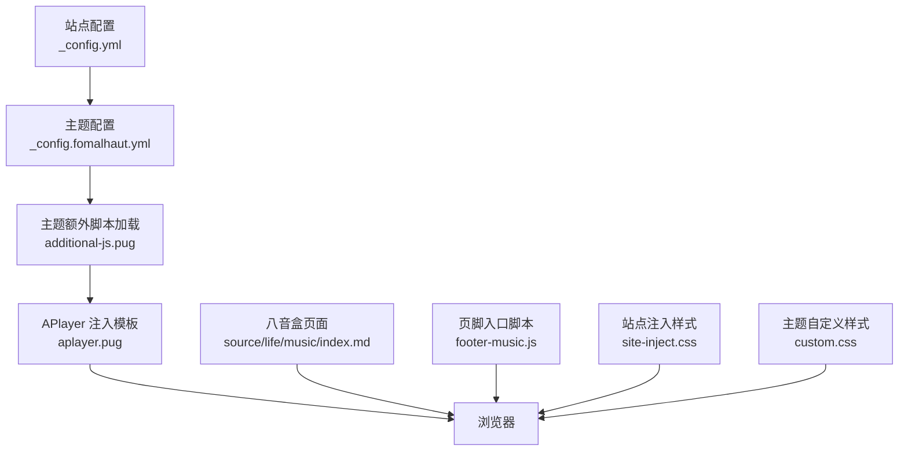
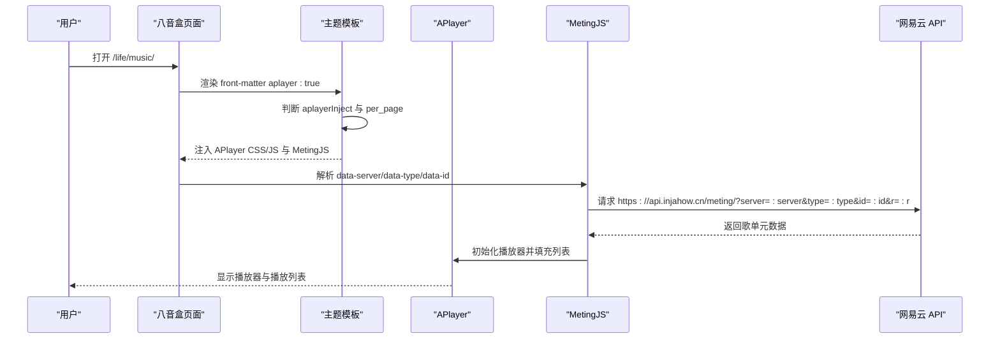
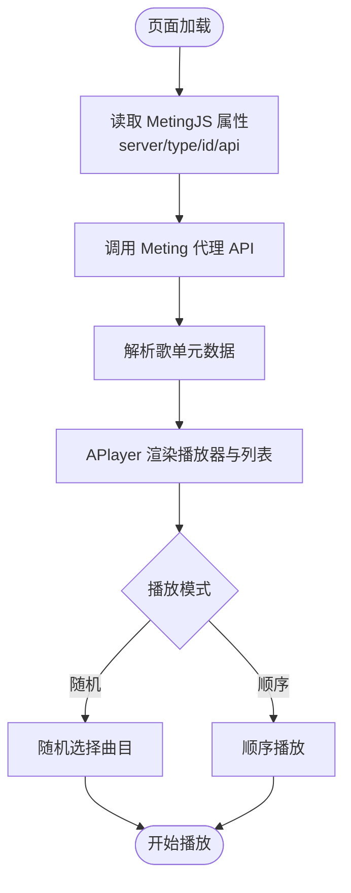
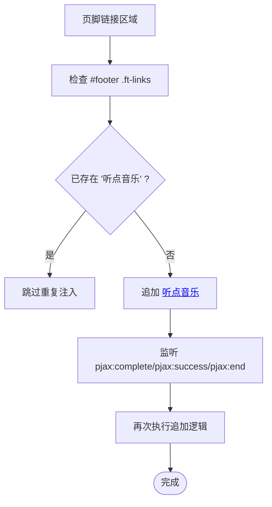
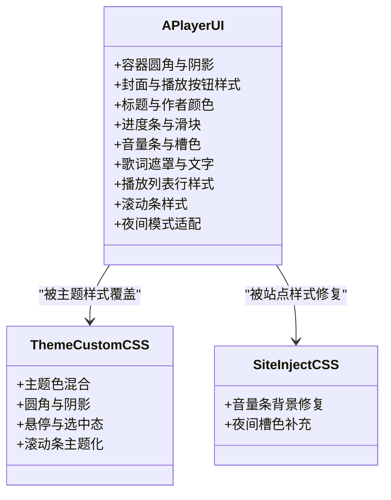

# 音乐播放器集成

<cite>
**本文引用的文件**   
- [站点配置 _config.yml](file://_config.yml)
- [主题配置 _config.fomalhaut.yml](file://_config.fomalhaut.yml)
- [主题 APlayer 注入模板 aplayer.pug](file://themes/fomalhaut/layout/includes/third-party/aplayer.pug)
- [主题额外脚本加载 additional-js.pug](file://themes/fomalhaut/layout/includes/additional-js.pug)
- [八音盒页面 source/life/music/index.md](file://source/life/music/index.md)
- [页脚音乐入口 footer-music.js](file://source/js/footer-music.js)
- [站点注入样式 site-inject.css](file://source/css/site-inject.css)
- [主题自定义样式 custom.css](file://themes/fomalhaut/source/css/_custom/custom.css)
</cite>

## 目录
1. [简介](#简介)
2. [项目结构与集成位置](#项目结构与集成位置)
3. [核心组件与数据流](#核心组件与数据流)
4. [APlayer 与 MetingJS 配置说明](#aplayer-与-metingjs-配置说明)
5. [音频源与播放列表管理](#音频源与播放列表管理)
6. [播放器嵌入位置与显示控制](#播放器嵌入位置与显示控制)
7. [播放器样式定制与主题覆盖](#播放器样式定制与主题覆盖)
8. [移动端适配与触摸操作](#移动端适配与触摸操作)
9. [音频格式、播放质量与加载优化](#音频格式播放质量与加载优化)
10. [性能优化、内存管理与资源预加载](#性能优化内存管理与资源预加载)
11. [常见问题排查](#常见问题排查)
12. [结论](#结论)

## 简介
本项目基于 Hexo 和 fomalhaut 主题，通过 APlayer 与 MetingJS 实现“八音盒”音乐页面。站点在根配置中启用 APlayer 插件开关，主题负责按需注入 APlayer 的 CSS/JS 与 MetingJS，并在指定页面渲染 MetingJS 歌单容器。站点级样式修复了音量条颜色问题，主题自定义样式统一了播放器外观，并与站点主题色联动。

## 项目结构与集成位置
音乐播放器相关代码分布在三层：
- 站点层：站点配置开启 APlayer；站点样式修复 APlayer 音量条；站点脚本为页脚补入“听点音乐”入口。
- 主题层：主题模板根据配置决定是否注入 APlayer/MetingJS；主题自定义样式统一播放器外观。
- 内容层：八音盒页面提供 MetingJS 容器与歌单来源信息。

**图表来源**
- [站点配置 _config.yml:76-79](file://_config.yml#L76-L79)
- [主题配置 _config.fomalhaut.yml:784-788](file://_config.fomalhaut.yml#L784-L788)
- [主题额外脚本加载 additional-js.pug:66-70](file://themes/fomalhaut/layout/includes/additional-js.pug#L66-L70)
- [主题 APlayer 注入模板 aplayer.pug:1-3](file://themes/fomalhaut/layout/includes/third-party/aplayer.pug#L1-L3)
- [八音盒页面 source/life/music/index.md:1-36](file://source/life/music/index.md#L1-L36)
- [页脚音乐入口 footer-music.js:1-40](file://source/js/footer-music.js#L1-L40)
- [站点注入样式 site-inject.css:336-349](file://source/css/site-inject.css#L336-L349)
- [主题自定义样式 custom.css:1442-1649](file://themes/fomalhaut/source/css/_custom/custom.css#L1442-L1649)

**章节来源**
- [站点配置 _config.yml:76-79](file://_config.yml#L76-L79)
- [主题配置 _config.fomalhaut.yml:784-788](file://_config.fomalhaut.yml#L784-L788)
- [主题额外脚本加载 additional-js.pug:66-70](file://themes/fomalhaut/layout/includes/additional-js.pug#L66-L70)
- [主题 APlayer 注入模板 aplayer.pug:1-3](file://themes/fomalhaut/layout/includes/third-party/aplayer.pug#L1-L3)
- [八音盒页面 source/life/music/index.md:1-36](file://source/life/music/index.md#L1-L36)
- [页脚音乐入口 footer-music.js:1-40](file://source/js/footer-music.js#L1-L40)
- [站点注入样式 site-inject.css:336-349](file://source/css/site-inject.css#L336-L349)
- [主题自定义样式 custom.css:1442-1649](file://themes/fomalhaut/source/css/_custom/custom.css#L1442-L1649)

## 核心组件与数据流
APlayer 与 MetingJS 的集成流程如下：
1. 站点配置 `_config.yml` 设置 `aplayer.metaling=true` 与 `aplayer.asset_inject=false`，表示使用主题提供的注入通道而非站点直接注入。
2. 主题配置 `_config.fomalhaut.yml` 中的 `aplayerInject.enable` 与 `per_page` 控制是否全局或按页注入 APlayer/MetingJS。
3. 主题模板 `additional-js.pug` 根据主题开关与页面标记 `page.aplayer` 决定是否包含 `aplayer.pug`。
4. `aplayer.pug` 引入 APlayer CSS、APlayer JS 与 MetingJS。
5. 八音盒页面 `source/life/music/index.md` 设置 front-matter `aplayer: true`，并提供 MetingJS 容器 `
`，由 MetingJS 从网易云歌单拉取播放列表并交给 APlayer 渲染。
6. 站点样式 `site-inject.css` 修复 APlayer 音量条颜色；主题样式 `custom.css` 统一播放器外观。
7. 页脚脚本 `footer-music.js` 动态插入“听点音乐”链接，引导用户进入八音盒页面。

**图表来源**
- [站点配置 _config.yml:76-79](file://_config.yml#L76-L79)
- [主题配置 _config.fomalhaut.yml:784-788](file://_config.fomalhaut.yml#L784-L788)
- [主题额外脚本加载 additional-js.pug:66-70](file://themes/fomalhaut/layout/includes/additional-js.pug#L66-L70)
- [主题 APlayer 注入模板 aplayer.pug:1-3](file://themes/fomalhaut/layout/includes/third-party/aplayer.pug#L1-L3)
- [八音盒页面 source/life/music/index.md:1-36](file://source/life/music/index.md#L1-L36)

**章节来源**
- [站点配置 _config.yml:76-79](file://_config.yml#L76-L79)
- [主题配置 _config.fomalhaut.yml:784-788](file://_config.fomalhaut.yml#L784-L788)
- [主题额外脚本加载 additional-js.pug:66-70](file://themes/fomalhaut/layout/includes/additional-js.pug#L66-L70)
- [主题 APlayer 注入模板 aplayer.pug:1-3](file://themes/fomalhaut/layout/includes/third-party/aplayer.pug#L1-L3)
- [八音盒页面 source/life/music/index.md:1-36](file://source/life/music/index.md#L1-L36)

## APlayer 与 MetingJS 配置说明
### 站点配置
- `aplayer.metaling=true`：启用 MetingJS 能力。
- `aplayer.asset_inject=false`：不通过站点直接注入，改用主题注入通道。

### 主题配置
- `aplayerInject.enable=false`：默认关闭全局注入。
- `aplayerInject.per_page=true`：允许按页注入（配合页面 `aplayer: true`）。
- 主题 CDN 配置中预留 `aplayer_css`、`aplayer_js`、`meting_js` 字段，但当前实际路径由主题 asset 映射决定。

### 页面配置
- 八音盒页面 front-matter 设置 `aplayer: true`，触发主题模板注入 APlayer/MetingJS。
- 页面 HTML 中包含一个带 MetingJS 属性的容器，用于挂载播放器。

**章节来源**
- [站点配置 _config.yml:76-79](file://_config.yml#L76-L79)
- [主题配置 _config.fomalhaut.yml:784-788](file://_config.fomalhaut.yml#L784-L788)
- [主题配置 _config.fomalhaut.yml:848-918](file://_config.fomalhaut.yml#L848-L918)
- [八音盒页面 source/life/music/index.md:1-6](file://source/life/music/index.md#L1-L6)

## 音频源与播放列表管理
八音盒页面使用 MetingJS 从网易云音乐拉取歌单：
- `data-server="netease"`：指定音乐平台为网易云。
- `data-type="playlist"`：类型为歌单。
- `data-id="13257994678"`：网易云歌单 ID。
- `data-api="https://api.injahow.cn/meting/?server=:server&type=:type&id=:id&r=:r"`：通过第三方代理接口获取歌单元数据。
- `data-mode="random"`：随机播放模式。
- `data-volume="0.4"`：初始音量。
- `data-preload="auto"`：预加载策略。
- `data-theme="#e3f2f5"`：播放器主题色。
- `data-listmaxheight="340px"`：播放列表最大高度。
- `mutex="true"`：避免多个播放器实例冲突。

**图表来源**
- [八音盒页面 source/life/music/index.md:16-16](file://source/life/music/index.md#L16-L16)

**章节来源**
- [八音盒页面 source/life/music/index.md:16-16](file://source/life/music/index.md#L16-L16)

## 播放器嵌入位置与显示控制
- 嵌入位置：八音盒页面 `/life/music/` 的文章容器中，由 MetingJS 自动创建 APlayer DOM。
- 显示控制：
  - `data-autoplay="false"`：禁止自动播放。
  - `data-listmaxheight="340px"`：限制播放列表高度。
  - `data-volume="0.4"`：默认音量较低，适合安静环境。
  - `data-theme="#e3f2f5"`：浅色主题背景。
  - `mutex="true"`：确保同一时间只有一个播放器实例活跃。
- 导航入口：页脚脚本 `footer-music.js` 在页脚链接列表末尾追加“听点音乐”，指向 `/life/music/`，并在 pjax 事件后重新注入，保证换页后仍可见。

**图表来源**
- [页脚音乐入口 footer-music.js:18-39](file://source/js/footer-music.js#L18-L39)

**章节来源**
- [八音盒页面 source/life/music/index.md:16-16](file://source/life/music/index.md#L16-L16)
- [页脚音乐入口 footer-music.js:1-40](file://source/js/footer-music.js#L1-L40)

## 播放器样式定制与主题覆盖
### 主题自定义样式
主题 `custom.css` 对 APlayer 进行了全面美化：
- 容器圆角、阴影与边框使用主题色混合。
- 封面图与播放按钮圆角与阴影。
- 标题、作者、时间与图标颜色使用主题色混合。
- 进度条、已播放条、滑块使用主题色。
- 音量条背景与填充色使用主题色。
- 歌词遮罩与歌词文字颜色适配主题。
- 播放列表行高、圆角、悬停与选中态使用主题色。
- 滚动条样式与主题色一致。
- 夜间模式下的播放器元素颜色与背景进行适配。

### 站点注入样式修复
站点 `site-inject.css` 修复了 APlayer 音量条颜色不可见的问题：
- 强制 `.aplayer-volume` 的背景为主题色，解决内联样式优先级问题。
- 补充夜间模式下 `.aplayer-volume-bar` 的背景色，使音量条槽色与主题一致。

**图表来源**
- [主题自定义样式 custom.css:1442-1649](file://themes/fomalhaut/source/css/_custom/custom.css#L1442-L1649)
- [站点注入样式 site-inject.css:336-349](file://source/css/site-inject.css#L336-L349)

**章节来源**
- [主题自定义样式 custom.css:1442-1649](file://themes/fomalhaut/source/css/_custom/custom.css#L1442-L1649)
- [站点注入样式 site-inject.css:336-349](file://source/css/site-inject.css#L336-L349)

## 移动端适配与触摸操作
- 播放列表高度限制为 `340px`，在移动端可滚动查看完整列表。
- 主题样式对播放器各元素使用相对单位与主题色混合，适配不同屏幕尺寸。
- 站点样式未对移动端播放器做特殊裁剪，保持与桌面端一致的交互体验。
- 触摸操作由 APlayer 原生支持，包括点击播放、拖动进度条、调节音量等。

[本节为通用说明，不直接分析具体文件]

## 音频格式、播放质量与加载优化
### 音频格式支持
- APlayer 依赖浏览器原生 `<audio>` 支持，常见格式如 MP3、OGG、AAC、FLAC 等取决于浏览器兼容性。
- MetingJS 从网易云 API 获取的音频 URL 通常由平台提供，格式由平台决定。

### 播放质量控制
- 本项目未显式设置音质参数，音质由 MetingJS 与网易云 API 返回的音频地址决定。
- 如需控制音质，可在 MetingJS 配置或后端代理中调整，但当前仓库未包含该逻辑。

### 加载优化策略
- `data-preload="auto"`：启用预加载，减少首曲等待时间。
- 主题模板中 APlayer CSS 使用 `media="print" onload="this.media='all'"` 延迟加载样式，提升首屏渲染性能。
- 站点 CDN 配置预留第三方库版本与自定义格式，便于后续切换 CDN 或缓存策略。

**章节来源**
- [主题 APlayer 注入模板 aplayer.pug:1-3](file://themes/fomalhaut/layout/includes/third-party/aplayer.pug#L1-L3)
- [八音盒页面 source/life/music/index.md:16-16](file://source/life/music/index.md#L16-L16)
- [主题配置 _config.fomalhaut.yml:848-918](file://_config.fomalhaut.yml#L848-L918)

## 性能优化、内存管理与资源预加载
### 资源加载优化
- APlayer CSS 延迟加载，避免阻塞首屏。
- MetingJS 仅在需要时注入（按页或全局开关控制）。
- 页脚脚本使用幂等标记 `data-ft-music`，避免重复插入链接。

### 内存管理
- `mutex="true"` 防止多播放器实例同时运行，降低内存占用。
- 播放列表高度限制为 `340px`，避免长列表导致 DOM 节点过多。

### 预加载策略
- `data-preload="auto"` 预加载音频元数据与首段数据。
- 可通过浏览器开发者工具观察网络请求，确认预加载行为。

**章节来源**
- [主题 APlayer 注入模板 aplayer.pug:1-3](file://themes/fomalhaut/layout/includes/third-party/aplayer.pug#L1-L3)
- [八音盒页面 source/life/music/index.md:16-16](file://source/life/music/index.md#L16-L16)
- [页脚音乐入口 footer-music.js:18-39](file://source/js/footer-music.js#L18-L39)

## 常见问题排查
### 音频加载失败
- 检查 MetingJS 代理 API 是否可达：`https://api.injahow.cn/meting/?server=:server&type=:type&id=:id&r=:r`。
- 确认网易云歌单 ID 有效且公开。
- 检查浏览器控制台是否有跨域或 404 错误。

### 播放卡顿
- 检查网络状况与 CDN 可用性。
- 确认 `data-preload="auto"` 已启用。
- 避免同时加载大量媒体资源。

### 音量条无视觉变化
- 站点样式已修复 `.aplayer-volume` 背景色，若仍无效，检查是否被其他样式覆盖。
- 确认夜间模式下 `.aplayer-volume-bar` 背景色已应用。

### 播放器未显示
- 确认页面 front-matter 设置了 `aplayer: true`。
- 检查主题配置 `aplayerInject.enable` 与 `per_page`。
- 确认 `aplayer.pug` 已被包含。

### 页脚“听点音乐”链接缺失
- 检查 `footer-music.js` 是否加载。
- 确认页脚结构 `#footer .ft-links` 存在。
- 检查 pjax 事件是否正常触发。

**章节来源**
- [八音盒页面 source/life/music/index.md:16-16](file://source/life/music/index.md#L16-L16)
- [站点注入样式 site-inject.css:336-349](file://source/css/site-inject.css#L336-L349)
- [主题额外脚本加载 additional-js.pug:66-70](file://themes/fomalhaut/layout/includes/additional-js.pug#L66-L70)
- [页脚音乐入口 footer-music.js:1-40](file://source/js/footer-music.js#L1-L40)

## 结论
本项目通过 Hexo 站点配置、fomalhaut 主题模板与站点样式协作，实现了基于 APlayer 与 MetingJS 的音乐播放器集成。八音盒页面提供网易云歌单源，主题负责样式美化与资源注入，站点样式修复了关键 UI 问题，页脚脚本提供了便捷的导航入口。整体方案结构清晰、扩展性强，适合在静态博客中复用与定制。

[本节为总结性内容，不直接分析具体文件]