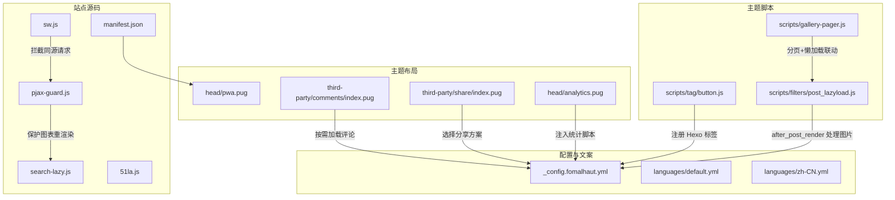
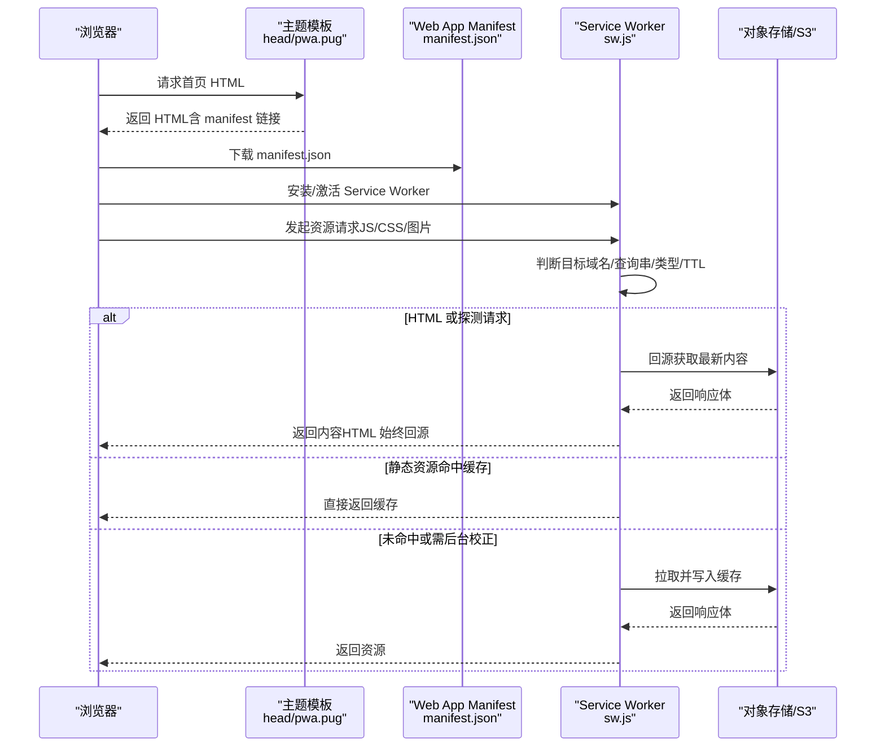
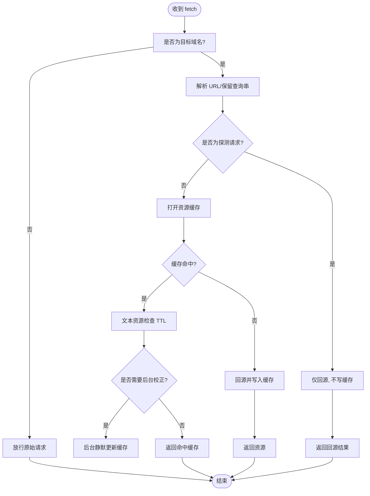
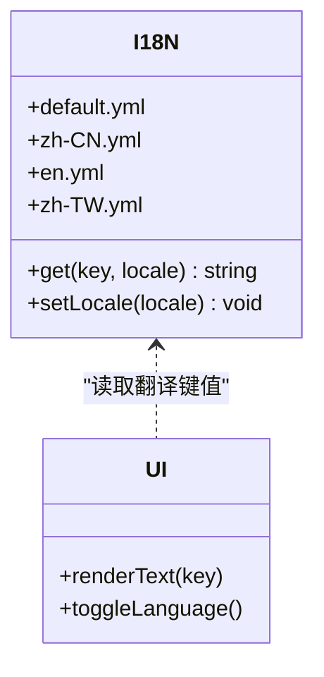
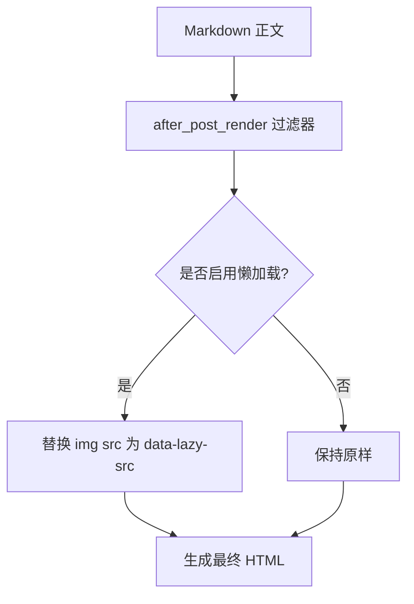
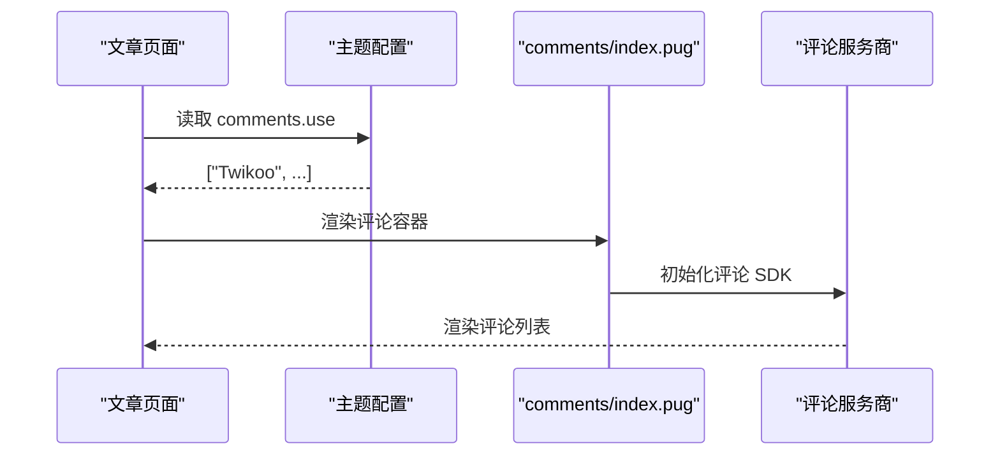
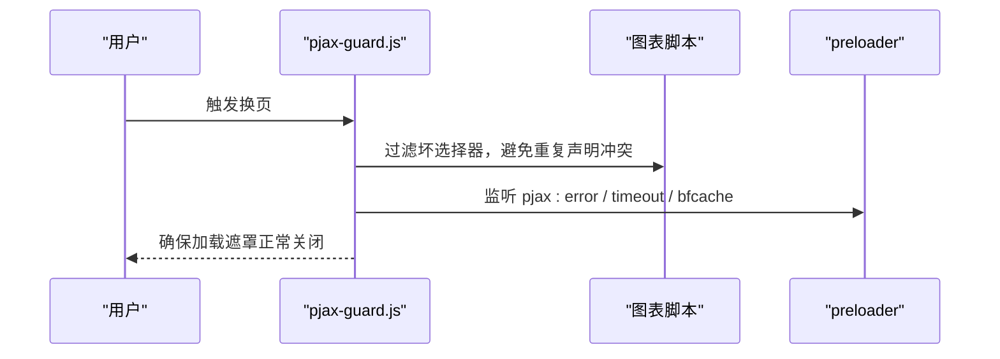
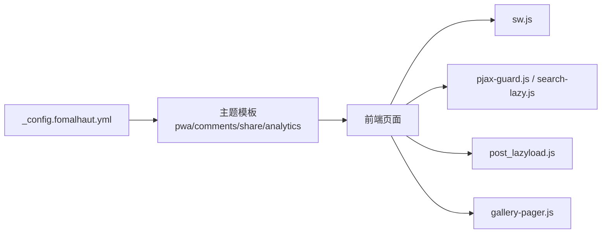

# 高级特性与扩展

<cite>
**本文引用的文件**   
- [sw.js](file://themes/fomalhaut/source/sw.js)
- [pwa.pug](file://themes/fomalhaut/layout/includes/head/pwa.pug)
- [manifest.json](file://source/manifest.json)
- [_config.fomalhaut.yml](file://_config.fomalhaut.yml)
- [default.yml](file://themes/fomalhaut/languages/default.yml)
- [zh-CN.yml](file://themes/fomalhaut/languages/zh-CN.yml)
- [button.js](file://themes/fomalhaut/scripts/tag/button.js)
- [post_lazyload.js](file://themes/fomalhaut/scripts/filters/post_lazyload.js)
- [comments/index.pug](file://themes/fomalhaut/layout/includes/third-party/comments/index.pug)
- [analytics.pug](file://themes/fomalhaut/layout/includes/head/analytics.pug)
- [share/index.pug](file://themes/fomalhaut/layout/includes/third-party/share/index.pug)
- [gallery-pager.js](file://scripts/gallery-pager.js)
- [pjax-guard.js](file://source/js/pjax-guard.js)
- [search-lazy.js](file://source/js/inject/search-lazy.js)
- [51la.js](file://source/js/51la.js)
</cite>

## 目录
1. [简介](#简介)
2. [项目结构](#项目结构)
3. [核心组件](#核心组件)
4. [架构总览](#架构总览)
5. [详细组件分析](#详细组件分析)
6. [依赖关系分析](#依赖关系分析)
7. [性能优化指南](#性能优化指南)
8. [故障排查](#故障排查)
9. [结论](#结论)
10. [附录：扩展开发最佳实践](#附录扩展开发最佳实践)

## 简介
本文件面向希望深入使用并扩展 Fomalhaut 主题的开发者，聚焦以下高级能力：
- PWA 能力：Service Worker 分流与缓存、Web App Manifest 配置、主题侧的 PWA 注入。
- 国际化支持：多语言文件结构、翻译键值组织、简繁切换机制。
- 插件与扩展：Hexo 标签开发、过滤器编写、运行时脚本注入。
- 第三方服务集成：评论系统、分享组件、统计分析。
- 性能优化：代码分割、资源预加载、缓存策略与懒加载。
- 扩展开发流程与最佳实践：从需求到发布的全链路建议。

## 项目结构
Fomalhaut 主题在站点根目录下以 themes/fomalhaut 形式存在，PWA 相关资源位于 source 与 theme layout 中；国际化文案集中在 languages 目录；扩展点包括 scripts/tag、scripts/filters、layout/includes 等。

图示来源
- [manifest.json:1-47](file://source/manifest.json#L1-L47)
- [sw.js:1-221](file://themes/fomalhaut/source/sw.js#L1-L221)
- [pwa.pug:1-12](file://themes/fomalhaut/layout/includes/head/pwa.pug#L1-L12)
- [comments/index.pug:1-45](file://themes/fomalhaut/layout/includes/third-party/comments/index.pug#L1-L45)
- [share/index.pug:1-8](file://themes/fomalhaut/layout/includes/third-party/share/index.pug#L1-L8)
- [analytics.pug:1-31](file://themes/fomalhaut/layout/includes/head/analytics.pug#L1-L31)
- [button.js:1-29](file://themes/fomalhaut/scripts/tag/button.js#L1-L29)
- [post_lazyload.js:1-30](file://themes/fomalhaut/scripts/filters/post_lazyload.js#L1-L30)
- [gallery-pager.js:63-139](file://scripts/gallery-pager.js#L63-L139)
- [_config.fomalhaut.yml:1147-1165](file://_config.fomalhaut.yml#L1147-L1165)

章节来源
- [manifest.json:1-47](file://source/manifest.json#L1-L47)
- [_config.fomalhaut.yml:1147-1165](file://_config.fomalhaut.yml#L1147-L1165)

## 核心组件
- PWA 入口与清单：通过主题 head 模板注入 manifest 链接与图标元信息；站点提供 Web App Manifest 定义应用名称、启动页、显示模式与图标集。
- Service Worker：实现 CDN 分流、版本化缓存、HTML 回源优先、文本资源短 TTL 静默校正、探测请求不落地缓存、异常回退原始请求。
- 国际化：默认英文与简体中文两套文案，右侧工具栏提供简繁切换提示。
- 扩展点：标签（如按钮）、过滤器（图片懒加载）、页面级脚本（PJAX 保护、搜索懒加载）。
- 第三方集成：评论系统（Twikoo 等）、分享组件（Share.js/AddThis/AddToAny）、统计分析（百度/GA/CNZZ/Cloudflare/Microsoft Clarity）。

章节来源
- [pwa.pug:1-12](file://themes/fomalhaut/layout/includes/head/pwa.pug#L1-L12)
- [manifest.json:1-47](file://source/manifest.json#L1-L47)
- [sw.js:1-221](file://themes/fomalhaut/source/sw.js#L1-L221)
- [default.yml:1-122](file://themes/fomalhaut/languages/default.yml#L1-L122)
- [zh-CN.yml:1-124](file://themes/fomalhaut/languages/zh-CN.yml#L1-L124)
- [button.js:1-29](file://themes/fomalhaut/scripts/tag/button.js#L1-L29)
- [post_lazyload.js:1-30](file://themes/fomalhaut/scripts/filters/post_lazyload.js#L1-L30)
- [comments/index.pug:1-45](file://themes/fomalhaut/layout/includes/third-party/comments/index.pug#L1-L45)
- [share/index.pug:1-8](file://themes/fomalhaut/layout/includes/third-party/share/index.pug#L1-L8)
- [analytics.pug:1-31](file://themes/fomalhaut/layout/includes/head/analytics.pug#L1-L31)

## 架构总览
下图展示 PWA 与服务端/对象存储之间的交互路径，以及主题模板如何装配 PWA 能力。

图示来源
- [pwa.pug:1-12](file://themes/fomalhaut/layout/includes/head/pwa.pug#L1-L12)
- [manifest.json:1-47](file://source/manifest.json#L1-L47)
- [sw.js:145-221](file://themes/fomalhaut/source/sw.js#L145-L221)

## 详细组件分析

### PWA 功能实现
- Web App Manifest：定义应用名、启动 URL、显示模式、作用域与多尺寸图标，供系统级“添加到主屏”使用。
- 主题注入：head 模板根据主题配置输出 manifest 链接、主题色、Apple 触摸图标与 favicon。
- Service Worker 关键策略：
  - 仅对目标主机白名单内的请求介入，避免误伤其他镜像线路。
  - HTML 始终回源，保证内容最新；同时用 index.html 内容哈希作为站点版本，变更时清空资源缓存。
  - 非 HTML 资源缓存优先，文本资源短 TTL（约 10 分钟）后台静默校正，媒体资源长 TTL（约 24 小时）。
  - 探测请求（带特定参数）只改写回源，不写缓存，防止无限膨胀。
  - 任何异常均回退到浏览器原始请求，绝不悬空。

图示来源
- [sw.js:153-221](file://themes/fomalhaut/source/sw.js#L153-L221)

章节来源
- [pwa.pug:1-12](file://themes/fomalhaut/layout/includes/head/pwa.pug#L1-L12)
- [manifest.json:1-47](file://source/manifest.json#L1-L47)
- [_config.fomalhaut.yml:1155-1165](file://_config.fomalhaut.yml#L1155-L1165)
- [sw.js:1-221](file://themes/fomalhaut/source/sw.js#L1-L221)

### 国际化支持
- 多语言文件结构：themes/fomalhaut/languages 下按语言分文件，例如 default.yml（英文）与 zh-CN.yml（简体中文），可按需新增 en.yml、zh-TW.yml 等。
- 翻译键值管理：采用 YAML 层级键，覆盖页脚、复制提示、文章元信息、搜索、分页、侧边栏卡片、时间后缀、打赏、分享、右侧工具栏、版权提示、Snackbar 提示、加载与 404 文案等。
- 语言切换机制：主题提供简繁转换开关与按钮文案，配合 Snackbar 提示当前语言状态。

图示来源
- [default.yml:1-122](file://themes/fomalhaut/languages/default.yml#L1-L122)
- [zh-CN.yml:1-124](file://themes/fomalhaut/languages/zh-CN.yml#L1-L124)
- [_config.fomalhaut.yml:1035-1047](file://_config.fomalhaut.yml#L1035-L1047)

章节来源
- [default.yml:1-122](file://themes/fomalhaut/languages/default.yml#L1-L122)
- [zh-CN.yml:1-124](file://themes/fomalhaut/languages/zh-CN.yml#L1-L124)
- [_config.fomalhaut.yml:1035-1047](file://_config.fomalhaut.yml#L1035-L1047)

### 插件开发指南（Hexo 标签与过滤器）
- 标签开发示例：按钮标签 btn 接收 url、text、icon、option 参数，生成美化链接元素，并通过 hexo.extend.tag.register 注册。
- 过滤器开发示例：图片懒加载过滤器在 after_render:html 与 after_post_render 两个钩子中将 img src 替换为 data-lazy-src，并注入占位图。
- 复杂逻辑示例：相册分页脚本将 Markdown 中的图片段切分为多页，调用 Hexo 渲染管线与分页器，确保懒加载过滤器继续生效。

图示来源
- [post_lazyload.js:11-29](file://themes/fomalhaut/scripts/filters/post_lazyload.js#L11-L29)
- [gallery-pager.js:96-139](file://scripts/gallery-pager.js#L96-L139)

章节来源
- [button.js:1-29](file://themes/fomalhaut/scripts/tag/button.js#L1-L29)
- [post_lazyload.js:1-30](file://themes/fomalhaut/scripts/filters/post_lazyload.js#L1-L30)
- [gallery-pager.js:63-139](file://scripts/gallery-pager.js#L63-L139)

### 第三方服务集成
- 评论系统：主题 comments 模板根据主题配置动态渲染多个评论系统容器（Disqus、Valine、Twikoo、Waline、Utterances、Giscus、Remark42、Facebook Comments 等），支持最多两个系统并列并可切换。
- 分享组件：根据主题配置选择 AddThis、Share.js 或 AddToAny，并在文章底部渲染对应容器。
- 统计分析：主题 analytics 模板根据配置注入百度统计、Google Analytics、CNZZ、Cloudflare Analytics、Microsoft Clarity 等脚本。

图示来源
- [comments/index.pug:1-45](file://themes/fomalhaut/layout/includes/third-party/comments/index.pug#L1-L45)
- [_config.fomalhaut.yml:538-666](file://_config.fomalhaut.yml#L538-L666)

章节来源
- [comments/index.pug:1-45](file://themes/fomalhaut/layout/includes/third-party/comments/index.pug#L1-L45)
- [share/index.pug:1-8](file://themes/fomalhaut/layout/includes/third-party/share/index.pug#L1-L8)
- [analytics.pug:1-31](file://themes/fomalhaut/layout/includes/head/analytics.pug#L1-L31)
- [_config.fomalhaut.yml:517-666](file://_config.fomalhaut.yml#L517-L666)

### 运行期增强与稳定性
- PJAX 保护：运行时过滤掉可能导致图表重复渲染失败的选择器，并在 pjax 事件异常或 bfcache 恢复时关闭加载遮罩，避免用户被卡在加载动画。
- 搜索懒加载：延迟加载 Algolia 搜索脚本，避免阻塞首屏；在页面 load 后安全注入并等待初始化完成。

图示来源
- [pjax-guard.js:14-60](file://source/js/pjax-guard.js#L14-L60)
- [search-lazy.js:118-155](file://source/js/inject/search-lazy.js#L118-L155)

章节来源
- [pjax-guard.js:14-60](file://source/js/pjax-guard.js#L14-L60)
- [search-lazy.js:118-155](file://source/js/inject/search-lazy.js#L118-L155)

## 依赖关系分析
- 主题模板依赖主题配置：PWA、评论、分享、统计等均由 _config.fomalhaut.yml 控制。
- Service Worker 与站点资源：sw.js 仅对目标域名介入，保留查询串，区分文本与媒体资源 TTL，并对探测请求做特殊处理。
- 过滤器与渲染管线：gallery-pager 复用 Hexo 渲染管线，确保 post_lazyload 过滤器继续生效。
- 运行时脚本：pjax-guard 与 search-lazy 在浏览器端增强体验与稳定性。

图示来源
- [_config.fomalhaut.yml:1147-1165](file://_config.fomalhaut.yml#L1147-L1165)
- [pwa.pug:1-12](file://themes/fomalhaut/layout/includes/head/pwa.pug#L1-L12)
- [comments/index.pug:1-45](file://themes/fomalhaut/layout/includes/third-party/comments/index.pug#L1-L45)
- [share/index.pug:1-8](file://themes/fomalhaut/layout/includes/third-party/share/index.pug#L1-L8)
- [analytics.pug:1-31](file://themes/fomalhaut/layout/includes/head/analytics.pug#L1-L31)
- [sw.js:153-221](file://themes/fomalhaut/source/sw.js#L153-L221)
- [post_lazyload.js:1-30](file://themes/fomalhaut/scripts/filters/post_lazyload.js#L1-L30)
- [gallery-pager.js:96-139](file://scripts/gallery-pager.js#L96-L139)
- [pjax-guard.js:14-60](file://source/js/pjax-guard.js#L14-L60)
- [search-lazy.js:118-155](file://source/js/inject/search-lazy.js#L118-L155)

章节来源
- [_config.fomalhaut.yml:517-666](file://_config.fomalhaut.yml#L517-L666)
- [sw.js:153-221](file://themes/fomalhaut/source/sw.js#L153-L221)

## 性能优化指南
- 代码分割与按需加载：
  - 搜索脚本通过 search-lazy.js 延迟加载，避免阻塞首屏。
  - 评论系统可开启 lazyload，进入视口再加载 SDK。
- 资源预连接与预加载：
  - 主题 inject.head 支持 preconnect 外部域名，减少 DNS/TCP/TLS 握手开销。
- 缓存策略：
  - Service Worker 对 HTML 回源优先，静态资源缓存优先；文本资源短 TTL 后台校正，媒体资源长 TTL 省流。
  - 站点版本基于 index.html 哈希，变更即清缓存，避免旧代码长期驻留。
- 懒加载：
  - 全局或文章内图片懒加载，使用占位图与 data-lazy-src 属性，降低首屏带宽压力。
- PJAX 稳定性：
  - 过滤危险选择器，避免图表脚本重复声明导致崩溃；异常时关闭加载遮罩，提升用户体验。

章节来源
- [search-lazy.js:118-155](file://source/js/inject/search-lazy.js#L118-L155)
- [comments/index.pug:1-45](file://themes/fomalhaut/layout/includes/third-party/comments/index.pug#L1-L45)
- [_config.fomalhaut.yml:1174-1182](file://_config.fomalhaut.yml#L1174-L1182)
- [sw.js:186-209](file://themes/fomalhaut/source/sw.js#L186-L209)
- [post_lazyload.js:11-29](file://themes/fomalhaut/scripts/filters/post_lazyload.js#L11-L29)
- [pjax-guard.js:14-60](file://source/js/pjax-guard.js#L14-L60)

## 故障排查
- Service Worker 分流失败：
  - 现象：资源无法加载或页面空白。
  - 排查：确认目标域名白名单、对象存储地址、查询串是否保留；查看控制台日志中的回退行为。
  - 参考：sw.js 中对异常的回退逻辑与探测请求的特殊处理。
- 站点版本未更新：
  - 现象：CSS/JS 仍为旧版本。
  - 排查：确认 index.html 内容变化会触发缓存清理；检查文本资源 TTL 是否过短或过长。
- 评论系统不显示：
  - 现象：评论容器为空。
  - 排查：检查主题 comments.use 配置与对应服务商配置项（如 Twikoo envId）。
- 分享组件未出现：
  - 现象：文章底部无分享按钮。
  - 排查：确认 sharejs/addThis/addtoany 的 enable 配置与 sites/item 设置。
- 统计脚本未上报：
  - 现象：后台无访问数据。
  - 排查：检查 analytics.pug 对应的主题配置项是否正确注入。

章节来源
- [sw.js:153-221](file://themes/fomalhaut/source/sw.js#L153-L221)
- [comments/index.pug:1-45](file://themes/fomalhaut/layout/includes/third-party/comments/index.pug#L1-L45)
- [share/index.pug:1-8](file://themes/fomalhaut/layout/includes/third-party/share/index.pug#L1-L8)
- [analytics.pug:1-31](file://themes/fomalhaut/layout/includes/head/analytics.pug#L1-L31)

## 结论
Fomalhaut 主题在 PWA、国际化、插件扩展、第三方服务集成与性能优化方面提供了完善的支撑。Service Worker 的分流与缓存策略兼顾了内容与资源的时效性与稳定性；主题模板与配置文件解耦清晰，便于按需启用与定制；过滤器与标签扩展点让内容创作更高效；运行期脚本增强了 PJAX 与搜索场景下的稳定性。建议在扩展开发中遵循最小侵入原则，优先通过主题配置与现有扩展点实现功能。

## 附录：扩展开发最佳实践
- 标签开发：
  - 使用 hexo.extend.tag.register 注册自定义标签，参数解析要健壮，输出 HTML 要语义化且可样式化。
  - 参考：按钮标签的实现方式。
- 过滤器开发：
  - 选择合适的钩子（after_render:html、after_post_render），注意条件判断与性能影响。
  - 参考：图片懒加载过滤器的实现方式。
- 运行时脚本：
  - 避免污染全局命名空间，做好错误捕获与降级；在 PJAX 环境下考虑重渲染与状态重置。
  - 参考：pjax-guard 与 search-lazy 的处理思路。
- 第三方服务：
  - 通过主题配置开关与参数注入，避免硬编码；在服务不可用时优雅降级。
  - 参考：评论、分享、统计的主题模板与配置项。
- 测试与验证：
  - 本地构建预览，结合浏览器开发者工具与网络面板验证缓存、懒加载与脚本加载顺序。
  - 关注控制台日志与异常堆栈，逐步定位问题。

章节来源
- [button.js:1-29](file://themes/fomalhaut/scripts/tag/button.js#L1-L29)
- [post_lazyload.js:1-30](file://themes/fomalhaut/scripts/filters/post_lazyload.js#L1-L30)
- [pjax-guard.js:14-60](file://source/js/pjax-guard.js#L14-L60)
- [search-lazy.js:118-155](file://source/js/inject/search-lazy.js#L118-L155)
- [comments/index.pug:1-45](file://themes/fomalhaut/layout/includes/third-party/comments/index.pug#L1-L45)
- [share/index.pug:1-8](file://themes/fomalhaut/layout/includes/third-party/share/index.pug#L1-L8)
- [analytics.pug:1-31](file://themes/fomalhaut/layout/includes/head/analytics.pug#L1-L31)